# 03 - System architecture

Status: implementation-ready for the v1 vertical slice. Binding inputs: `docs/00-contract.md` (stack, IDs, enums, behaviours, non-functional targets), `docs/04-data-model.md` and `schemas/schema.sql` (tables), `schemas/api.openapi.yaml` (HTTP API). Security detail lives in `docs/12-security-privacy-compliance.md`.

Evidence tags as in the contract: **[V]** read, **[S]** snippet, **[R]** recalled/unverified, **[P]/[inf]** proposal or inference. **Every price, quota, product limit and version in this document is [R] unless stated, and must be verified on the vendor's site before relying on it** (marked "verify at build time").

---

## 1. Goals, constraints, drivers

| ID | Driver | Source | Architectural consequence |
|---|---|---|---|
| AD-1 | One builder (the founder) using AI coding agents; boring, popular tech | D3 | Few moving parts: one web app, one worker, one sandbox, one database. No Kubernetes, no extra queue. |
| AD-2 | Mobile-first PWA, offline micro sessions | D2, 7.10 | Service worker + IndexedDB; offline pack; local provisional grading for numeric/MC only. |
| AD-3 | Execution-based grading; LLM never sole grader of numeric or code answers | 7.8 | Deterministic graders first; LLM only for explanation, rubric, tutoring. |
| AD-4 | Untrusted learner code and netlists | 3, 10 | Separate sandbox service with no secrets and no network (ADR-006). |
| AD-5 | Multi-user and cohort/experiment ready, single-user UX | D1 | RLS on every table, `user_id` everywhere, assignment framework. |
| AD-6 | Latency targets | 10 | See section 7.1 latency budgets. |
| AD-7 | Cost ceiling for a founder-funded beta | D1 | Section 12 cost model; per-user LLM budget caps. |
| AD-8 | Privacy minimum, no trackers, no biometric/neural data | 8, 10 | `events` table only; minimal data to the LLM provider. |

Non-functional target traceability (contract 10):

| Target | Mechanism | Verified by |
|---|---|---|
| Numeric/symbolic grading p95 < 2 s | Numeric in-process (TS); symbolic via worker fast path with 1.5 s hard cap | Load test T-PERF-1, metric `grade_latency_ms{grader}` |
| Code tests p95 < 20 s | Job queue, warm worker, sandbox with 10 s wall cap | T-PERF-2 |
| SPICE p95 < 20 s | Same path; ngspice 8 s wall cap | T-PERF-3 |
| KiCad ERC/DRC p95 < 60 s | `verify_evidence` job, `kicad-cli` 40 s cap | T-PERF-4 |
| Rubric LLM p95 < 30 s | Job; LLM timeout 25 s; one retry only for transient errors | T-PERF-5 |
| Micro session starts < 1 s on warm PWA, works offline | Session read from IndexedDB first, refresh in background; offline pack | Playwright test T-PWA-1 (offline mode) |
| Every verified item has `verification_report` | DB check constraint `items_verified_has_report` | Migration test |
| WCAG 2.2 AA, math alt text | `rendered.alt_text` required by content schema | axe-core in Playwright |

---

## 2. System context

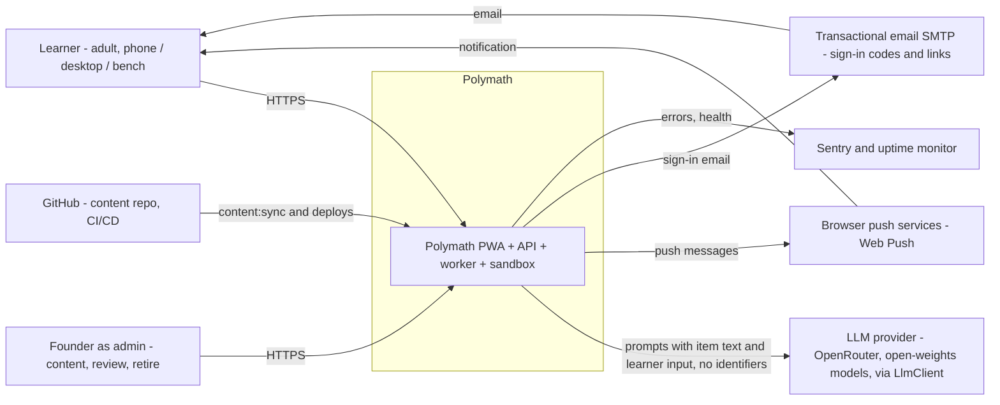

Trust boundaries: the learner's device and everything it sends are untrusted; the LLM provider is an external processor receiving only item text and learner-typed text (no names, emails or IDs); learner code and uploaded files are untrusted data in all internal services.

---

## 3. Container diagram

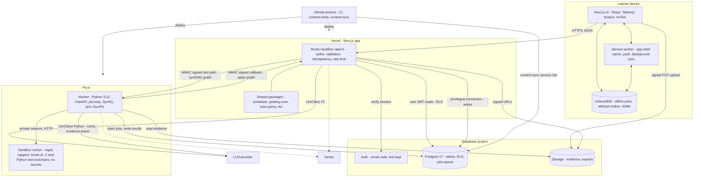

---

## 4. Component responsibilities

### 4.1 Next.js PWA and API (`apps/web`)

| Responsibility | Detail |
|---|---|
| Framework | Next.js 16 (current major; latest 16.4.3 on 2 Nov 2026, pin an exact version), Turbopack by default. `src/proxy.ts` exports `proxy`, runs on the Node runtime, refreshes the session cookie and redirects signed-out users. `middleware.ts` is deprecated and is not used. Proxy is a convenience: every route handler and Server Function still authenticates itself. |
| UI | App Router pages: today/session runner, review, skill graph, projects and evidence, checkpoint runner, settings and privacy, admin (content sync, evidence review, retire item). Mobile-first; desktop layout for focus and lab blocks. KaTeX for math with `alt_text` fallbacks. |
| Service worker | Serwist 9.4 or later (Workbox-derived) in configurator mode: `@serwist/next` only generates the `@serwist/cli` configuration, and `serwist build` runs after `next build`, so it does not depend on webpack and works with Turbopack. No `next-pwa`. Precache app shell, runtime-cache `GET /sync/pack` and figure assets, Web Push handler, Background Sync (Chromium only; iOS Safari falls back to sync on app open and on the `online` event). |
| Local state | IndexedDB (Dexie): `pack` (items with `local_check`), `outbox` (attempts and events not yet acknowledged), `drafts`. An attempt is written to the outbox **before** any network call (never lose an answer). |
| Route handlers | Implement `schemas/api.openapi.yaml`. Each handler: authenticate (Supabase JWT), validate (zod generated from the OpenAPI), enforce idempotency, rate-limit, authorise, call domain code in `packages/*`, map errors. |
| Domain code (TS packages) | `scheduler` (frontier, session builder, FSRS via `ts-fsrs`, Elo/IRT-lite), `grading-core` (numeric and multiple-choice comparators, shared with the client), `tutor-policy` (attempt-first, ladder, leak filter), `llm` (LlmClient TS). The worker never mutates learner state (ADR-009). |
| Privileged data access | Only modules under `apps/web/src/server/privileged/` may use the Supabase secret key or the privileged DB URL. User-scoped reads use the user's JWT so RLS applies. A lint rule enforces the boundary (section 14). |

### 4.2 Supabase

| Part | Use |
|---|---|
| Auth | Email sign-in in v1, no password. The primary path is a six-digit code typed in the app (`signInWithOtp`, then `verifyOtp({ email, token, type: 'email' })`), because an emailed link on iOS opens Safari and the installed PWA has separate storage (third-party sources, device test in BL-0063). The same email keeps the sign-in link for browser use: the Magic Link template carries `{{ .Token }}` and the link. Code and link share one expiry setting, 15 minutes. JWT lifetime 1 hour (default; verify). Re-authentication within 10 minutes is required for account deletion. Custom SMTP (Supabase's built-in mailer is rate limited, verify) |
| Postgres | Postgres 17 on every environment (the hosted default; local, CI, staging, production). System of record: all tables in `04-data-model.md`, RLS, `jobs` queue and queue functions, retention functions. Every new table, sequence and function gets explicit grants in its migration: new `public` tables are not exposed to the Data API by default on any project since 30 October 2026, and a missing grant fails with 42501 before RLS applies. |
| API keys | Publishable key (`sb_publishable_...`) in the browser and secret key (`sb_secret_...`) on servers. Requests run as the Postgres roles `anon` or `authenticated` and `service_role`, so policies and grants still name those roles. The legacy `anon` and `service_role` JWT keys are never used; they are being retired by the end of 2026. New keys are not JWTs: send them in the `apikey` header. Supabase rejects secret keys from browsers with HTTP 401, except on `localhost`. |
| Storage | Private buckets `evidence` and `exports`; uploads only via server-issued signed upload URLs; reads via short-lived signed URLs or own-folder RLS. Free plan: 50 MB per object and 1 GB total (G14); video evidence needs Pro (ADR-017). |
| Not used | Realtime, Edge Functions, PostgREST as a public API for writes (learner writes are limited by grants to profile fields, events, push subscriptions, item reports). |

### 4.3 Worker service (`services/worker`, Python 3.12 + FastAPI)

| Role | Detail |
|---|---|
| Job loop | Claims jobs with `claim_jobs()` (`FOR UPDATE SKIP LOCKED`), runs handlers with per-kind concurrency limits, completes or fails them with backoff (section 8). |
| Fast-path HTTP | `POST /grade/symbolic` (SymPy equivalence, 1.5 s cap), `GET /healthz`. Requests carry an HMAC signature and a timestamp (replay window 60 s). Not a public API. |
| Verifiers and graders | `symbolic_equivalence` (SymPy with subprocess + hard kill, then randomised numeric fallback), `code_tests` and `spice_compare` (orchestrate sandbox runs, compare results), `rubric_llm` (LlmClient Python with structured output), `measurement_check` (compare against per-learner project variation), evidence verification (file validation, log parsing, ERC/DRC via sandbox), item generation and independent verification (`pregenerate_items`). |
| Libraries | SymPy, pint, NumPy, `ngspice` (CLI, run only in the sandbox), `kicad-cli` (only in the sandbox), Pillow, `ffprobe` metadata only in the sandbox. |
| Runtime | Python 3.12 only (contract 3), pinned with uv, for the worker, the sandbox harness and the reference tools. The reference tests pass on 3.12 on Windows (doc 07); BL-0014 repeats them on Linux. |
| Secrets | DB URL (role with `service_role` privileges), storage key, LLM key, HMAC secret. **No** learner code is ever executed in this process. |

### 4.4 Execution sandbox (`services/sandbox-runner`)

A separate Fly app with its own image, **no database credentials, no storage keys, no LLM key, no environment secrets**, reachable only on Fly's private network from the worker. Each run executes inside an `nsjail` jail (new user, PID, mount, IPC, UTS and network namespaces; read-only root; tmpfs working directory; seccomp-bpf allow-list; rlimits and cgroup limits) inside a Fly Machine (a Firecracker microVM [R]), which is the second isolation layer. Interface: `POST /run` with `{runner, files, limits}` returning `{exit_code, stdout, stderr, usage, timed_out, killed_reason}` (stdout/stderr truncated to 64 KB). Runners: `c-tests` (gcc + a fixed test harness), `python-tests` (pinned CPython, no site-packages beyond pytest), `ngspice`, `kicad-cli`. Details and test plan: doc 12 section 3 (ADR-006).

### 4.5 LlmClient

One interface, two implementations (TypeScript for tutor/tagging in route handlers; Python for rubric grading, evidence assist and offline content tooling), sharing `prompts/` and `llm/pricing.json`. Parity is enforced by shared contract tests (`llm/contract-tests/*.json`).

```ts
interface LlmClient {
  complete(req: {
    purpose: 'tutor' | 'rubric_grade' | 'tagging' | 'drafting' | 'safety_check';
    modelTier: 'strong' | 'cheap';            // mapped to concrete model IDs in config
    promptId: string;                          // e.g. 'tutor/hint@v3' - file in prompts/
    variables: Record<string, string>;         // rendered into the template; learner text is passed ONLY as delimited data
    schema?: JsonSchema;                       // structured outputs, not a forced tool; validated; one repair retry
    effort?: 'low' | 'medium' | 'high';        // per tier; no temperature, top_p or top_k (00a H5)
    maxOutputTokens: number;
    timeoutMs: number;
    userRef?: string;                          // opaque; never email or name
  }): Promise<{ text: string; json?: unknown; usage: { inputTokens: number; outputTokens: number };
                modelId: string; promptVersion: string; latencyMs: number }>;
  stream(req: ...): AsyncIterable<LlmChunk>;   // used only where no output filter is required
}
```
Rules: every call writes one `llm_calls` row (no prompt text); provider failures map to `llm_unavailable`; budget check precedes the call; a `FakeLlmClient` (deterministic, scriptable) is the default in local and CI so no test calls a real provider. Concrete model IDs live in config, not code (verify current model names at build time).

### 4.6 Content pipeline (`tools/`, GitHub Actions)

`content/` YAML in git (skills, edges, templates, projects) -> `content:lint` (schema, key regex, DAG, licence/source present, forbidden licences such as NC-SA) -> `content:verify` (instantiate each template with N seeds, independent recomputation, dimensional check, store report) -> `content:sync` (upsert by `key`, soft-retire missing keys, write `content_sync_runs`). Detailed format: content documents. Nothing is promoted to `verified` by the sync alone; status is derived from the verifier result plus a human-reviewed flag in YAML.

---

## 5. Request, grading and data flows (sequence diagrams)

### 5.1 Build a session

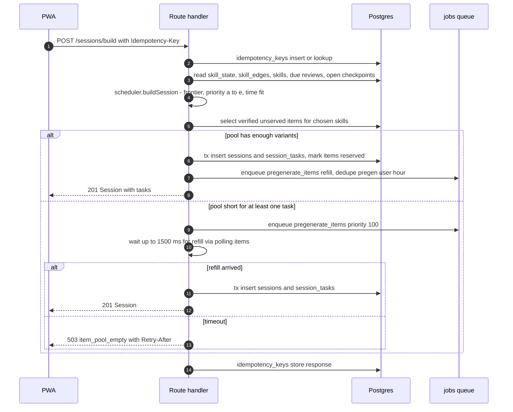

Preview (G16): with `dry_run: true` the same builder runs through the item selection but the transaction, the reservation, the `pregenerate_items` refill and the idempotency rows are skipped, and the handler answers `200` with a `SessionPreview`; it consumes a token of the separate `session_preview` rate-limit bucket (10 per minute). `GET /progress` is a read-only aggregate computed from the caller's own rows (04 section 5.10); it adds no table and no job.

Rules: the builder is a pure function `(state, clock, params) -> plan` so it is unit-testable with fixtures. It honours contract 7.2 priority a-e and 7.6; micro sessions use only `phone_suitable` templates; no cross-discipline interleaving except in `project_step` and `checkpoint` tasks. The plan's per-task `reason` is stored in `session_tasks.reason` and `sessions.plan`. Because items are pre-generated and verified (ADR-019), session building never runs a generator on the request path.

### 5.2 Submit and grade: numeric (inline)

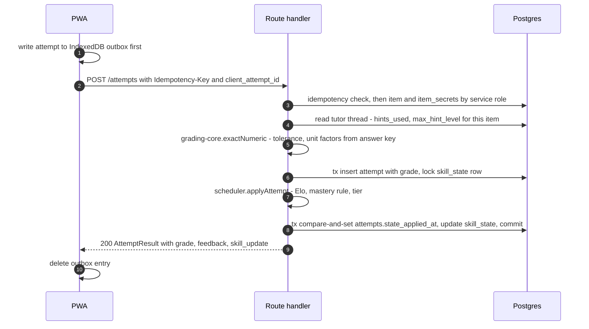
Rating derivation, Elo update and mastery rule are specified in doc 06; this document only fixes where they run (TS, route handler, one DB transaction) and that the write is idempotent through `attempts (user_id, client_attempt_id)` and the `attempts.state_applied_at` compare-and-set (00a H15). FSRS and `review_log` are not written at submit: the review unit commits at session close, through `POST /sessions/{session_id}/complete` or the idle timeout (06 section 3.3). Hint level 4 forces score 0 and `unaided=false` before grading is persisted. `symbolic_equivalence` follows the same flow but step 4 is `POST worker /grade/symbolic` with a 1500 ms client timeout; on timeout or worker failure the attempt is inserted `pending` and a `grade_attempt` job is enqueued (the response becomes 202).

### 5.3 Submit and grade: code tests

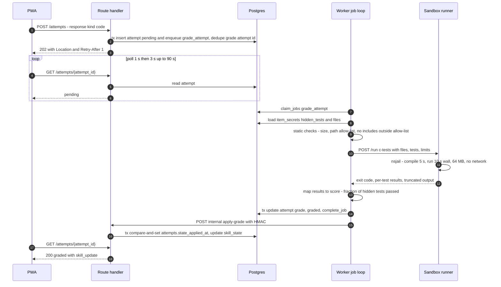
Failure handling: sandbox infrastructure failure (HTTP 5xx, runner busy) is retryable (`fail_job retryable=true`); learner-code failure (compile error, timeout, crash) is a **valid grade** with feedback, not a job failure. If the internal apply call fails, the next `GET /attempts/{id}` applies the grade (idempotent), and a reconcile timer applies any attempt with `grade_status='graded'` and `state_applied_at` null older than 60 s.

### 5.4 Submit and grade: SPICE

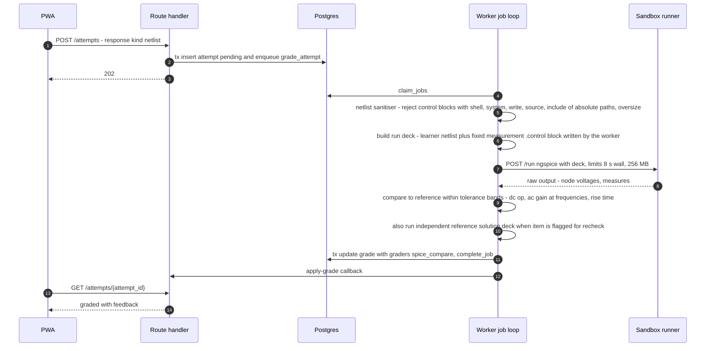
Why a worker-authored measurement block: learner netlists must never contain their own `.control` section (ngspice control language can run shell commands [R, verify]); the worker strips or rejects it and appends its own fixed `.control` that only prints requested measures.

### 5.5 Tutor hint request

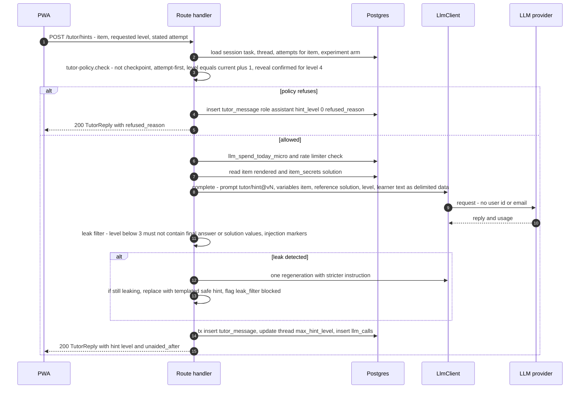
Notes: hints are bound to the **item**, not to an attempt, because the attempt row does not exist until submission; `hints_used` and `max_hint_level` on the attempt are derived from the thread at submit time (section 5.2). Replies for levels 1-3 are buffered and filtered before display; only level 4 and post-grading discussion stream tokens directly. The system prompt, reference solution and filter configuration are never sent to the client. In checkpoints the endpoint returns 403 `tutor_disabled_in_checkpoint`.

### 5.6 Project evidence upload and verification

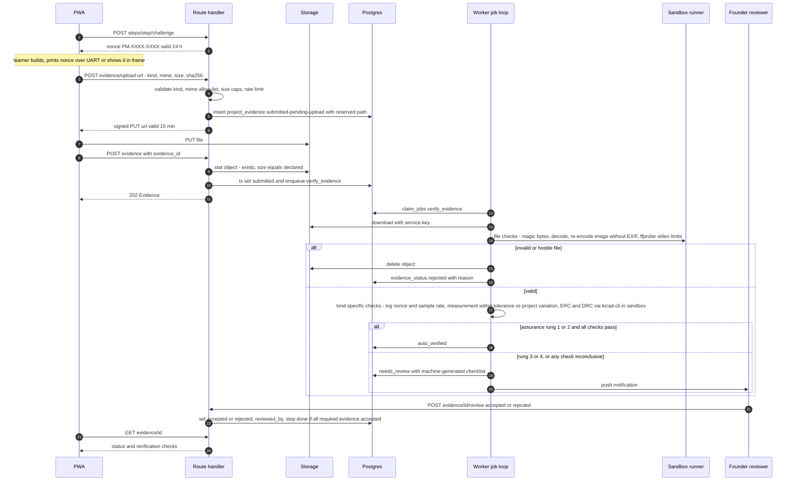
Optional vision assist (feature-flagged, off in v1 until evaluated) may give the reviewer a suggested checklist; it never changes `evidence_status` by itself and treats text inside images as untrusted data (doc 12, T-INJ-2).

### 5.7 Content sync

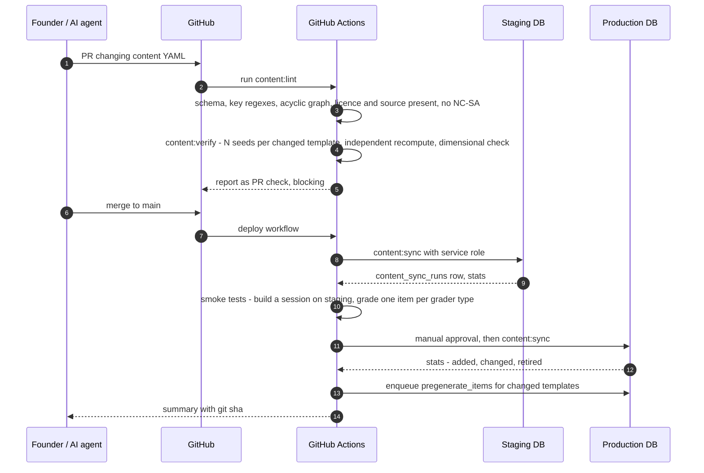
Rules: `content:sync` is idempotent (upsert by `key`, compare `content_hash`); keys removed from git become `retired`, never deleted; edges are replaced in one transaction after the acyclicity check; a template whose `version` increases retires its unserved pool items; a failed run leaves the previous content active (single transaction per entity type, `content_sync_runs.status='failed'` and an alert).

### 5.8 Offline sync

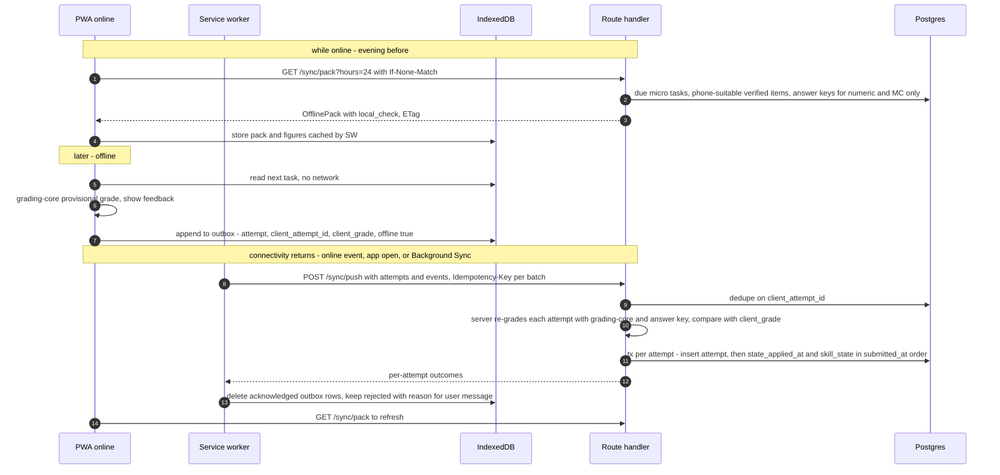
Conflict and edge rules: (1) server grade always wins; mismatches are logged as event `offline.grade_mismatch`. (2) Attempts are applied in `submitted_at` order; a review earlier than the card's `last_review` is applied with `reviewed_at = last_review` plus 1 s (clock-skew guard; exact rule in doc 06). (3) Attempts older than 7 days, or on retired items, are `rejected` and never alter state. (4) Offline attempts do not count toward mastery until `server_verified_at` is set (AR-DM-6). (5) A browser that evicted IndexedDB loses unsynced answers; mitigation: the outbox flushes on every `visibilitychange` to hidden when online, and the UI shows the count of unsynced answers [R: iOS Safari may evict site data after 7 days of non-use - verify]. (6) Checkpoints and code/SPICE/rubric items are never in the pack. (7) Clock: the client sends its own timestamps; the server clamps `submitted_at` to `[now - 7 days, now]` and records skew in `events`.

---

## 6. Grading matrix (who grades what, and where)

| grader_type | Where it runs | Sync / async | Deterministic checks first | Notes |
|---|---|---|---|---|
| `exact_numeric` | `packages/grading-core` in route handler (and client, provisional) | inline | Value vs expected with relative/absolute/log tolerance; unit factor table precomputed by pint at item generation (`accepted_units: [{unit, factor}]`); handles `0.264` vs `26.4 cents` class of errors without an LLM [P, from the report's observed LLM failure modes] | Same package on client and server (ADR-010) |
| `multiple_choice` | same | inline | Set equality on `choice_ids` | |
| `symbolic_equivalence` | Worker fast path (SymPy) | inline with 1.5 s cap, else job | `simplify(a-b)==0` in a killable subprocess, then random-point numeric check with tolerance; assumptions declared per template | Unparseable input is a learner error with feedback, not a system error |
| `code_tests` | Worker + sandbox | job | Static size/path checks; hidden tests; compile flags fixed | Score = fraction of hidden tests passed, per-test names visible only for public tests |
| `spice_compare` | Worker + sandbox (ngspice) | job | Sanitised netlist, worker-authored measurement block, tolerance bands vs reference | Reference answer generated and checked at item verification time |
| `drc_erc` | Worker + sandbox (kicad-cli) | job (evidence flow) | Rule file fixed per step; counts of violations by severity | |
| `rubric_llm` | Worker (LlmClient) | job | Never alone for numeric or code correctness: used for `explain_back`, design rationale. Checklist rubric with per-criterion scores; low-confidence results go to `needs_review` | The cited rubric studies are tiny [B]; treat agreement as a hypothesis to test in the evaluation plan |
| `measurement_check` | Worker | job | Values vs expected ranges derived from the learner's project `variation` | |
| `human_review` | Founder | async | n/a | Stays `pending` until review |

---

## 7. Latency budgets and failure behaviour

### 7.1 Latency budgets (p95)

| Path | Budget | Breakdown (ms) |
|---|---|---|
| Numeric submit | 2000 | auth 40 + idempotency 20 + item/secret read 40 + grade 5 + tx 80 + response 20, leaving > 1.5 s margin for cold route start |
| Symbolic submit | 2000 | as above minus grade, plus worker call: network 60 + SymPy 600 typical, hard cap 1500 |
| Code tests | 20000 | enqueue 100 + pickup 1000 + sandbox start (warm 100, cold machine start up to 3000 [R]) + compile 5000 cap + run 10000 cap + writes 300; learner-visible poll adds up to 1000 |
| SPICE | 20000 | pickup 1000 + sanitise 50 + ngspice 8000 cap + compare 100 + writes 300 |
| ERC/DRC | 60000 | pickup 1000 + download 2000 + kicad-cli 40000 cap + writes |
| Rubric LLM | 30000 | pickup 1000 + LLM 25000 timeout + parse/validate 100 |
| Session build (online) | 800 | auth 40 + reads 150 + planner 50 + item pick 100 + tx 100 |
| Session start (warm PWA) | 1000 | read from IndexedDB, no network on the critical path |

### 7.2 Graceful degradation

| Dependency down | Behaviour |
|---|---|
| LLM provider | Tutor returns 503 `llm_unavailable`; UI shows canned conceptual hints stored in the item (`rendered.static_hints`) when present; rubric jobs retry with backoff, grade stays `pending`; no learner state changes |
| Worker | Numeric and MC unaffected; symbolic falls back to a queued job; code/SPICE/evidence wait in queue with "grading delayed" status; alert after 5 minutes |
| Sandbox | Worker retries (infra errors only); after `max_attempts` the attempt becomes `grade_status='error'` and is **not** counted; learner may resubmit |
| Supabase (DB/Auth) | Cached micro tasks keep working offline; online features show a maintenance banner; outbox retains answers |
| Vercel | PWA shell served from the service worker cache; offline mode as above |

---

## 8. Job queue design (Postgres `jobs` table)

### 8.1 Why this design
At 1-50 users the queue handles tens of jobs per day to a few per second at most. Using the database that already holds attempts gives **transactional enqueue** (the attempt row and its `grade_attempt` job commit together, so no lost or phantom work) and one fewer service to run (ADR-004). Migration path if it ever becomes a bottleneck: swap the claim function for pgmq or a managed queue; handlers do not change because they are idempotent.

### 8.2 Lifecycle

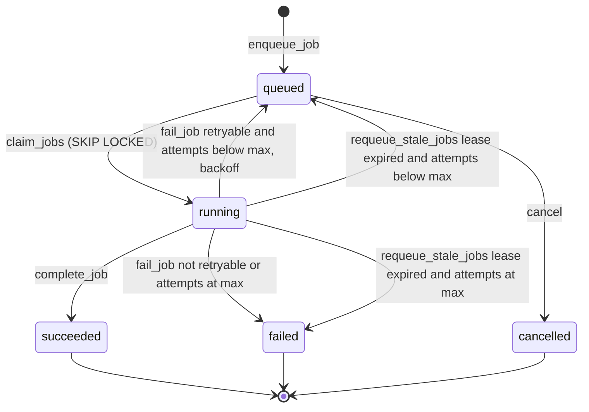

### 8.3 Kinds, priority, limits

| kind | Payload | Priority | Concurrency (per worker) | timeout_s | max_attempts | Dedupe key |
|---|---|---|---|---|---|---|
| `grade_attempt` | `{attempt_id, trace_id}` | 100 | 4 (sandbox-bound graders limited to 2) | 60 | 4 | `grade:{attempt_id}` |
| `verify_evidence` | `{evidence_id, trace_id}` | 60 | 2 (ERC/DRC 1) | 120 | 3 | `verify:{evidence_id}` |
| `pregenerate_items` | `{user_id, skill_keys, want}` | 100 if triggered by shortage, else 10 | 2 | 120 | 3 | `pregen:{user_id}:{yyyymmddhh}` |
| `content_postprocess` | `{sync_run_id}` | 20 | 1 | 600 | 2 | `post:{sync_run_id}` |
| `send_push` | `{user_id, kind, body_ref}` | 40 | 4 | 30 | 3 | `push:{user_id}:{kind}:{yyyymmddhh}` |
| `export_user_data` | `{request_id}` | 10 | 1 | 900 | 2 | `export:{request_id}` |
| `delete_user_data` | `{request_id, user_id}` | 80 | 1 | 900 | 5 | `delete:{request_id}` |
| `sweep_storage` | `{}` | 0 | 1 | 300 | 2 | `sweep:{yyyymmdd}` |
| `prune_expired` | `{}` | 0 | 1 | 300 | 2 | `prune:{yyyymmdd}` |
| `nightly_maintenance` (G15) | `{run_date}` | 0 | 1 | 900 | 2 | `nightly:{yyyymmdd}` |

Payloads carry IDs, never learner content, so queue rows contain no free text. Learner-visible status is read from the domain row (`attempts.grade_status`, `project_evidence.evidence_status`), never from `jobs`.

### 8.4 Worker loop (normative pseudocode)

```
every poll tick (200 ms when the last claim returned work, backing off to 5 s when idle):
  free = sum over kinds of (limit[kind] - running[kind])
  if free > 0:
     rows = rpc claim_jobs(worker_id, kinds_with_free_slots, free)
     for row in rows: spawn task(handler[row.kind], row)
every 30 s:  rpc requeue_stale_jobs()
every 60 s:  reconcile - grade_status='graded' and state_applied_at is null, older than 60 s -> call apply-grade;
             then units of sessions closed in the last 24 h with no review_log row -> call commit-review-units
every 5 min: call close-idle-sessions (internal route; the worker writes no session or learner state)
every 5 min: heartbeat row/metric; every day: enqueue prune_expired, sweep_storage and nightly_maintenance if missing

task(handler, row):
  try:   result = await with_timeout(handler(row), row.timeout_s)
         rpc complete_job(row.id, worker_id, result)
  except Retryable as e:      rpc fail_job(row.id, worker_id, str(e), true)
  except Exception as e:      log error with trace_id, rpc fail_job(row.id, worker_id, str(e), false)
```
Optionally `LISTEN jobs` on a direct (non-pooled) connection wakes the loop immediately on enqueue; polling remains the source of truth because transaction-mode poolers do not support LISTEN.

### 8.5 Semantics and guarantees
- **At-least-once** delivery. Every handler is idempotent: grade handlers check `grade_status` first; the effect is protected by the `attempts.state_applied_at` compare-and-set and by unique constraints (`review_log_session_skill_unique`, `review_log.attempt_id`, dedupe keys).
- **Lease:** `locked_at` is the lease start; a job is considered dead after `2 * timeout_s + 30 s` and requeued. A handler that exceeds `timeout_s` is cancelled by the worker itself first.
- **Backoff:** `5 s * 2^attempts`, capped at 900 s, with +/-20% jitter (in `fail_job`).
- **Poison jobs:** after `max_attempts` the job is `failed`, the domain row is set to its error state (`grade_status='error'`, evidence `needs_review` with reason `verification_failed`) and an alert fires.
- **Ordering:** by priority, then `run_after`, then `created_at`. No ordering guarantee across jobs of the same user; domain logic must not rely on it (apply-grade uses row locks and `submitted_at` ordering).
- **Multiple workers:** safe (SKIP LOCKED). v1 runs one worker machine plus an optional second for deploys without downtime (rolling deploy keeps leases consistent).
- **Back-pressure:** if queued `grade_attempt` age p95 exceeds 10 s the API stops enqueuing optional work (`pregenerate_items` priority 10) and an alert fires.
- **Visibility:** `jobs` is readable by the admin role; the admin page lists queue depth, oldest queued age and failed jobs.


### 8.6 Scheduled calls (G15)

Everything that runs on a clock, with its owner, cadence and rule. The worker timer is the source of truth; `pg_cron` (Supabase extension, enabling and limits not read on 31 Oct 2026) may call the same SQL functions as a second trigger, and every call is safe to run twice.

| Scheduled call | Cadence | Mechanism | What it does | Idempotency | Time budget |
|---|---|---|---|---|---|
| `requeue_stale_jobs()` | 30 s | worker timer (or `pg_cron`) | Requeues jobs whose lease expired (section 8.5) | Pure state transition | under 1 s |
| Reconcile graded attempts | 60 s | worker timer | Calls apply-grade for attempts with `grade_status='graded'` and `state_applied_at` null older than 60 s, then commits review units of sessions closed in the last 24 h that have no `review_log` row. A unit blocked by the one-per-local-day limit writes nothing, so the 24 h window bounds the re-checks | `attempts.state_applied_at` compare-and-set; unique `review_log_session_skill_unique` | under 5 s |
| Close idle sessions | 5 min | worker timer calls an internal route | Closes `active` sessions past the idle timeout as `abandoned` and commits their review units (06 section 3.3) | Status check on `active`; unique `review_log_session_skill_unique` | under 5 s |
| Heartbeat | 5 min | worker timer | Writes the worker heartbeat read by `/health` | Overwrites one row | under 1 s |
| `prune_expired` | daily | job kind `prune_expired` | Retention sweep (04 section 11) | Deletes by age only; dedupe `prune:{yyyymmdd}` | `timeout_s` 300 |
| `sweep_storage` | daily | job kind `sweep_storage` | Removes rejected and orphaned evidence objects within 24 h | Dedupe `sweep:{yyyymmdd}` | `timeout_s` 300 |
| **`nightly_maintenance`** | daily, enqueued once with `run_after` at 03:00 UTC, dedupe `nightly:{yyyymmdd}` | job kind `nightly_maintenance` (decision G15, finding F-05 of 00b) | Runs three steps in order, each recording its own result in `jobs.result` so a retry resumes after the last finished step. (1) **Decay evaluation** (06 section 4.3): for every learner with `mastered` skills, computes retrievability with the library and moves skills below 0.70 to `decayed` without erasing `tier_attained`; the worker calls the HMAC-protected internal endpoint of the web app in batches because learner-state logic lives only in TypeScript (ADR-009). (2) **Calibration monitor** (06 section 3.8 item 4 and section 12; doc 11 OM-12): per learner with at least 50 reviews in the window it computes Brier score and a 10-bin table over the last 300 reviews, and the Elo drift of items served (mean predicted minus observed correctness); it writes `fsrs_calibration` events and `fsrs_miscalibrated` when the lowest-R bin gap exceeds 0.15. It never changes parameters (G5: parameter changes need a human decision). (3) **Tutor audit sampling** (08 section 8.2): selects the 5 percent sample of unflagged tutor messages of the last 24 h (first 8 weeks, [P]) and lists flagged ones into the founder's review queue; on Sundays it also re-runs the leak filter over the week's stored messages. | Dedupe key per day; each step writes values keyed by `(user_id, run_date)` or an upsert (decay is a pure function of state and clock; events carry `run_date` and are deduplicated on it; the audit sample is chosen with a seeded hash of `message_id` and `run_date`, so a rerun picks the same rows) | `timeout_s` 900 for the whole job (single-founder scale; split by user batches if a step exceeds 5 minutes). The job must not hold a database transaction open across steps |

If the job is `failed` after `max_attempts`, the alert "Failed jobs" (section 10.5) fires and the next day's job runs normally; a missed night is harmless because decay is also evaluated after every attempt (06 section 4.3 (a)) and the monitor reads a rolling window.

---

## 9. Environments, configuration and secrets

| Environment | Web | Database | Worker / sandbox | LLM | Purpose |
|---|---|---|---|---|---|
| local | `next dev` | `supabase start` (Docker) with `supabase/seed.sql` | `docker compose up worker sandbox` (sandbox mode `docker`: weaker isolation, dev only) | `LLM_PROVIDER=fake` (default) | Development and tests; works offline from the internet |
| staging | Vercel preview/staging project | Separate Supabase project, synthetic data only | Fly apps `polymath-worker-stg`, `polymath-sandbox-stg` (sandbox auto-stop on idle) | Real provider with a low monthly cap | Pre-release checks, content sync smoke tests, RLS tests, security tests |
| prod | Vercel production | Separate Supabase project, backups enabled | Fly apps `polymath-worker`, `polymath-sandbox` | Real provider with budgets | Live |

Rule: **no production data in staging or local**; staging uses seeded or synthetic users.

**Lean-slice use of staging (00d section 9, decision G18).** The recommended path is Phase -1, then the lean slice (00d), then the deferred groups D1 to D9. The lean slice creates no production environment (BL-0109 is deferred): until D1 the founder's own study history lives in the staging Supabase project. That is an explicit, temporary exception to "synthetic data only": it is allowed only while the founder is the single user, and it ends before any beta learner is invited, when the production project is created and the history is migrated (or exported and re-imported). Because the Free plan has no backups (00e row 20) and staging may be Free, the lean set includes the backup and restore drill (BL-0103) and a weekly `pg_dump` export stored outside the project. The full plan above (separate production project with backups, synthetic-only staging) is unchanged and applies from the first outside user. Uploads are limited to the founder-only admin evidence log in the lean slice (G17 exception, doc 12). **Worker on the founder's laptop (00a I2):** in the lean slice the staging worker runs on the founder's laptop (`docker compose up worker`) against the staging database, in queue-only mode: `WORKER_URL` is unset on Vercel, so symbolic submits take the queued path of 7.2 and are graded while the laptop is on. Numeric and multiple-choice grading are unaffected. The worker needs only outbound connections, so the laptop exposes no port. No Fly app exists until D1.

### 9.1 Configuration inventory

| Variable | Where used | Secret? | Stored in | Notes |
|---|---|---|---|---|
| `NEXT_PUBLIC_SUPABASE_URL`, `NEXT_PUBLIC_SUPABASE_PUBLISHABLE_KEY` | Browser, web | No (public by design; RLS protects) | Vercel env, `.env.local` | `sb_publishable_...`; grants only what RLS and grants allow |
| `SUPABASE_SECRET_KEY` (`sb_secret_...`) | Web privileged modules, worker, CI sync | **Yes, highest** | Vercel (server only), Fly secrets, GitHub Actions environment secret | Never `NEXT_PUBLIC_`; never in the sandbox |
| `DATABASE_URL_PRIVILEGED` | Web privileged modules (transactions), worker | **Yes** | same | Pooler URL for web (transaction mode), direct URL for worker |
| `LLM_PROVIDER`, `LLM_MODEL_STRONG`, `LLM_MODEL_CHEAP` | Web, worker | No | env | Model IDs by config |
| `OPENROUTER_API_KEY` | Web, worker | **Yes** | Vercel, worker host secrets | One key per environment; monthly credit limit set on the key at OpenRouter (00a I1) |
| `LLM_DAILY_USER_BUDGET_USD`, `LLM_DAILY_GLOBAL_BUDGET_USD` | Web, worker | No | env | Defaults 0.50 and 5.00 |
| `WORKER_URL`, `WORKER_HMAC_SECRET` | Web <-> worker | Secret (HMAC) | Vercel, Fly | Rotate by supporting two secrets for 24 h |
| `INTERNAL_APPLY_HMAC_SECRET` | Worker -> web callback | Secret | Fly, Vercel | Separate from the above |
| `SANDBOX_URL` | Worker | No | Fly env | Private network address `http://polymath-sandbox.internal:8080` |
| `SANDBOX_MODE` | Sandbox | No | env | `nsjail` (staging, prod) or `docker` (local) |
| `VAPID_PUBLIC_KEY`, `VAPID_PRIVATE_KEY`, `VAPID_SUBJECT` | Web push | Private key secret | Vercel | |
| `SMTP_*` | Supabase Auth custom SMTP | Secret | Supabase dashboard | |
| `SENTRY_DSN` | Web, worker | Low sensitivity | env | |
| `APP_ENV` | all | No | env | `local|staging|prod` |
| `GIT_SHA` | all | No | CI | Included in logs and `/health` |

### 9.2 Secret handling rules (summary; full list in doc 12)
1. No secrets in git; `gitleaks` runs as pre-commit and in CI; `.env*` ignored.
2. Different keys per environment; only CI and the founder can read production secrets.
3. Secrets are set through each platform's secret store, never in `vercel.json`, `fly.toml` or Dockerfiles.
4. The sandbox image contains no secrets, and its environment is empty except `SANDBOX_MODE`.
5. Rotation runbook: rotate in provider, update stores, redeploy, verify, revoke old; rehearsed once before beta (doc 12 section 10).

---

## 10. Observability (solo-founder edition)

### 10.1 Principles
One place to look, few alerts that matter, no alert fatigue. The founder works full time elsewhere, so alerting is split into **wake-me** (rare, security or data-loss), **today** (evening check) and **weekly** review.

### 10.2 Logs
- Structured JSON: `ts, level, msg, request_id, trace_id, user_id (uuid only), route, status, duration_ms, job_id, job_kind, grader, git_sha, env`.
- Never log: learner free text, code, netlists, tutor message bodies, signed URLs, JWTs, API keys, emails. A logging wrapper redacts keys named `authorization`, `cookie`, `token`, `apikey`, `password`, `response`, `content`, `text`.
- Web (pino) -> Vercel log drain; worker (structlog) -> Fly logs; both optionally to a free-tier log aggregator (e.g. Better Stack or Grafana Cloud - verify free limits). Retention 7-30 days.

### 10.3 Metrics
Emitted as structured log lines and `events` where product-relevant, plus SQL queries run by the admin health page (no metrics backend in v1):

| Metric | Source | Why |
|---|---|---|
| `grade_latency_ms{grader}` p50/p95 | log field | NFR check |
| `job_queue_depth{kind}`, `job_oldest_queued_age_s`, `jobs_failed_24h` | SQL on `jobs` | Queue health |
| `attempts_pending_older_than_2m` | SQL on `attempts_pending_idx` | Stuck grading |
| `api_error_rate_5xx`, `api_p95_ms{route}` | logs / Vercel analytics | Availability |
| `llm_cost_usd_day{purpose}`, `llm_calls_blocked`, `llm_latency_ms` | `llm_calls` | Spend and abuse |
| `sandbox_runs`, `sandbox_timeouts`, `sandbox_infra_errors` | worker logs | Sandbox health |
| `offline_grade_mismatch_count` | `events` | Sync correctness |
| `content_sync_drift` | `/admin/content/sync-status` | Deployed SHA vs synced SHA |
| `backup_age_h` | backup job result | Recovery readiness |
| `rls_test_last_pass` | CI | Security regression |

### 10.4 Tracing
OpenTelemetry-lite: the web layer creates `trace_id` (W3C `traceparent`), passes it in the worker fast-path header and in `jobs.payload.trace_id`; worker logs and sandbox runs carry it; the response header `X-Request-Id` equals the trace id prefix. Spans are emitted for: route handler, DB transaction, worker job, sandbox run, LLM call. Export via Sentry performance (free tier sampling 10% - verify) or log-only. A full tracing backend is not needed at this scale.

### 10.5 Alerts and routing

| Alert | Condition | Severity | Route | First action (runbook id) |
|---|---|---|---|---|
| Site down | Uptime monitor 3 failures in 5 min on `/health` | today (wake if during waking hours) | Push + email | RB-1 check Vercel/Supabase status, redeploy |
| Worker down | No heartbeat > 5 min | today | Push | RB-2 restart Fly machine, check logs |
| Grading stuck | `attempts_pending_older_than_2m > 0` for 10 min | today | Push | RB-3 inspect jobs, sandbox health |
| Queue backlog | oldest queued age > 120 s for 10 min | today | Push | RB-3 |
| Failed jobs | `jobs_failed_24h > 5` | weekly/today | Email | RB-4 read errors |
| LLM spend | Global daily cost > 80% of cap | wake | Push + email | RB-5 lower caps, disable tutor flag, rotate key if abuse |
| Auth anomaly | > 20 sign-in email requests/min or > 100 failed logins/hour | wake | Push | RB-6 enable captcha/rate limit, review logs |
| Sandbox escape signals | Sandbox process egress attempt logged, unexpected syscall kills > 20/hour from one user | wake | Push | RB-7 doc 12 incident response |
| RLS test failure | CI RLS suite fails on main | block deploy | GitHub | Fix before release |
| Backup stale | last backup > 26 h | today | Email | RB-8 |
| Content drift | deployed SHA != synced SHA > 1 h | weekly | Email | RB-9 rerun sync |
| Error budget | 5xx rate > 2% for 15 min | today | Push | RB-1 |

Notification channel: a phone push service (for example ntfy or Pushover - verify) plus email, configured as the only destinations. Runbooks live in `infra/runbooks/RB-*.md` (written during implementation).

---

## 11. Error handling and idempotency rules

### 11.1 Idempotency rules (normative)

| ID | Rule |
|---|---|
| IR-1 | Every state-changing `POST` accepts `Idempotency-Key` (the PWA always sends one, generated when the user action starts and reused on every retry). |
| IR-2 | Algorithm: compute `request_hash = sha256(method + path + canonical body)`. `INSERT INTO idempotency_keys (user_id, key, ...) ON CONFLICT DO NOTHING`. If inserted, proceed and store `status_code` and `response` at the end (same transaction as the domain write when possible). If it existed: same hash and response stored -> return it with `Idempotent-Replay: true`; same hash with no response yet and age < 60 s -> 409 `idempotency_in_progress` with `Retry-After: 1`; same hash and age >= 60 s -> take over; different hash -> 409 `idempotency_key_reuse`. Keys expire after 48 h. |
| IR-3 | Natural idempotency beats keys: `attempts (user_id, client_attempt_id)`, `attempts.state_applied_at` (compare-and-set, 00a H15), `events (user_id, client_event_id)`, `review_log (session_id, skill_key)`, `review_log (attempt_id)`, `jobs.dedupe_key`. A replayed submit with the same `client_attempt_id` but a different body returns the stored attempt unchanged (the first write wins). |
| IR-4 | Job handlers must be safe to run twice; effects use unique constraints or compare-and-set on status. |
| IR-5 | Enqueue happens in the same transaction as the domain write (transactional outbox by construction). |
| IR-6 | Clients retry only on network failure, 408, 429 (honouring `Retry-After`), 502, 503, 504 with exponential backoff (1, 2, 4, 8, 16 s, max 5 tries) and the **same** keys. Never retry 4xx (other than 408/429). |
| IR-7 | The learner's answer is persisted locally before sending and deleted only after a terminal acknowledgement (200 graded, 202 accepted, or `duplicate`). |

### 11.2 Error handling rules

| ID | Rule |
|---|---|
| ER-1 | All errors use `application/problem+json` with stable `code` (see OpenAPI `Error`). Unknown exceptions return `internal` with `request_id` and no stack trace. |
| ER-2 | Distinguish **learner errors** (wrong answer, compile error, malformed expression: valid grade with feedback), **client errors** (4xx), and **system errors** (5xx, retried). A system error never changes learner state and never produces a wrong grade. |
| ER-3 | Every outbound call has an explicit timeout: DB statement 5 s (30 s for batch jobs), worker fast path 1.5 s, LLM 25-30 s, sandbox run per limits, storage 10 s. |
| ER-4 | Circuit breakers (in-process, per instance): LLM (open after 5 consecutive failures, half-open after 30 s), worker fast path (open after 3 failures; fall back to queue). |
| ER-5 | LLM structured outputs are validated against a JSON schema; one repair retry; on failure the task falls back to a deterministic path or `needs_human_review`. LLM text never decides correctness of numeric or code answers. |
| ER-6 | Partial failure in grading: attempt insert and grade are one transaction. State update is a second transaction triggered immediately; failure leaves a graded attempt with `state_applied_at` null, which the reconcile loop repairs within 60 s. |
| ER-7 | Validation happens at the edge (zod schemas generated from OpenAPI) and again in the DB (constraints). Reject unknown fields on writes. |
| ER-8 | Per-user limits: 120 req/min; tutor 20/min and daily budget; uploads 30/hour; attempts 60/min. Implemented with a Postgres-backed token bucket (an `app_private.rate_limits` table added by the first migration after baseline) or the platform's edge rate limiting; a single-instance in-memory limiter is not acceptable on serverless. |
| ER-9 | Time: server time is authoritative; client timestamps are clamped (section 5.8). |
| ER-10 | Feature flags (env-based, `FLAG_TUTOR`, `FLAG_VISION_ASSIST`, `FLAG_OFFLINE_PACK`) allow disabling risky features without a deploy. |

---

## 12. Cost model

**Read this first.** Prices were rechecked on **31 Oct 2026** against vendor pages (00e rows 20, 26, 28, 37, 38): Supabase, Vercel, Fly and Anthropic list prices below are **verified** and dated; email, Sentry, domain and GitHub Actions lines are still **[R]**. USD. Prices change; re-verify at integration. Accuracy target: within a factor of 2.

### 12.1 Assumptions

| Assumption | Value |
|---|---|
| Active learner usage | 8 h/week; 5 micro sessions/week of 15 min + 2 focus sessions/week + one lab/week |
| Attempts per user per month | 400 (about 100/week) of which 20% code or SPICE |
| Tutor calls per user per month | 110 (about 25/week) |
| Tutor call size | 3,000 input tokens (system, item, reference solution, history), 400 output tokens |
| Rubric calls per user per month | 40, each 2,000 input and 300 output tokens |
| Evidence uploads per user per month | 10 files, average 3 MB |
| LLM list prices per million tokens (**verified 31 Oct 2026**, platform.claude.com pricing; **superseded by 00a I1**, see the I1 note under 12.2: the OpenRouter open-weights prices replace these, so the LLM lines below are an upper bound) | strong model `claude-sonnet-5-5`: 2 input, 10 output; cheap model `claude-haiku-5-5`: 0.10 input, 0.50 output (prompts up to 100k). Earlier draft assumed 3/15 and 1/5, which are the Sonnet 4.x and Haiku 4.5 prices. Caching and batch discounts ignored, so conservative. Model IDs and prices are read from `pricing.json` at integration |
| Content authoring (founder, one-off, MVP slice of about 300 templates) | draft 6,000 in / 3,000 out on the strong model; 3 independent solves of 2,000 in / 800 out; roughly $0.12 per template, about $40 total, plus experimentation: budget $100 over the build |
| Regions | One region for Vercel functions, Supabase and Fly, chosen near the founder; jurisdiction/data residency still open (contract 12) |

### 12.2 Per-unit LLM cost

| Item | Calculation | Cost |
|---|---|---|
| Tutor call (Sonnet 5.5) | 3,000 x $2/M + 400 x $10/M = $0.006 + $0.004 | about $0.010 |
| Rubric call (Sonnet 5.5) | 2,000 x $2/M + 300 x $10/M = $0.004 + $0.003 | about $0.007 |
| Per user per month (Sonnet 5.5) | 110 x 0.010 + 40 x 0.007 = 1.10 + 0.28 | about $1.4 (was $2.1 at the old assumed prices) |
| Per user per month if tutor and rubric ran on Haiku 5.5 | 110 x 0.0005 + 40 x 0.00035 | about $0.07 (quality not evaluated) |

**00a I1 note (3 Nov 2026):** the provider is now OpenRouter with open-weights models; the per-unit lines above are kept as an upper bound until `pricing.json` holds the chosen models' verified prices (BL-0073). Anthropic prompt caching and Batch API figures in 12.4 do not apply.

### 12.3 Monthly estimate

| Line | 1 user (founder) | 50 users | Notes |
|---|---|---|---|
| Supabase | $0 on Free for dev/staging; **$25** Pro for production | $25 Pro (+ possible compute add-on $0-$30 if CPU-bound) | **Verified 31 Oct 2026**: Free pauses after 1 week of inactivity, 500 MB DB, 1 GB storage, 50 MB upload cap, no backups. Pro $25 includes 8 GB DB, 100 GB storage, 250 GB egress, daily backups kept 7 days, $10 compute credit. PITR from $100 per month per 7 days and is **not** assumed |
| Vercel | $0 Hobby if it is genuinely personal non-commercial use, else $20 Pro | $20 per developer seat Pro, $20 included usage credit | **Verified 31 Oct 2026** (vercel.com/pricing): Hobby is stated as for personal, non-commercial use. A beta with other users should be Pro. Function duration limits not stated on the page |
| Fly.io worker (always on) | about $7 (shared-cpu-1x 1 GB) to $13.39 (shared-cpu-2x 2 GB) | same, plus a second machine if p95 queue age alerts fire | **Verified 31 Oct 2026** (docs.fly.io/about/pricing): shared-cpu-1x 256 MB $2.19, 512 MB $3.69, 1 GB $6.70; no shared-cpu-1x 2 GB listed. Per-second billing; no free tier for new organisations |
| Fly.io sandbox (auto-stop when idle) | about $1-6 | about $6-11 | Pays only while running; cold start adds to p95 |
| Domain and DNS | about $1 | about $1 | |
| Transactional email (sign-in codes and links) | $0 (free tier) | $0-$20 | Free tiers around 3,000 mails/month [R] |
| Sentry | $0 (developer tier) | $0-$26 | [R] |
| Uptime monitor, log aggregator | $0 | $0 | Free tiers |
| GitHub Actions | $0 | $0 | Free minutes for private repos [R]; Playwright and content:verify are the main consumers |
| LLM tutor and rubric | about $1.4 | 50 x $1.4 = about $70; with 25% headroom about $88 (was $130) | Dominant variable cost |
| LLM content authoring (one-off, amortised) | $10-$20 per month during the build (3-6 months) | $5-$10 | Founder only |
| Storage (evidence, exports) | $0 (within plan quota) | 50 users x 10 files x 3 MB x 12 months about 18 GB, within the Pro quota (100 GB [R]) | Delete rejected uploads promptly |
| **Total, lean configuration** | **about $15-$35** (Hobby + Supabase Pro + small Fly, LLM $1.4 + authoring) | **about $155-$220** (was $200-$260; LLM line -$42, Fly line about +$0-2) | Recomputed 31 Oct 2026 |
| **Total, recommended configuration** | **about $45-$65** (Vercel Pro) | **about $190-$260** (was $230-$300) | |
| Per active user at 50 users | n/a | about $3.5-$5 per month | |

### 12.4 Cost sensitivities and controls
- **LLM is about 40-55% of the 50-user bill (recomputed with the 31 Oct 2026 prices).** Controls: per-user daily budget (default $0.50 = 5x the typical day), global daily cap (default $5), cheaper model for tagging and for rubric when confidence is not needed, prompt caching of the static prompt prefix (system + item + solution is repeated across the hint ladder). **Verified 31 Oct 2026:** 5-minute cache write costs 1.25x the input price, 1-hour write 2x, a read 0.05x on Sonnet 5.5 (0.1x on some other models), and one read repays a 5-minute write; the saving applies only to the cached prefix, so the total depends on how much of the 3,000 input tokens is a stable prefix. The Batch API is 50% off (usable for content drafting, not for live tutoring), max output tokens per purpose, 20 tutor messages/minute rate limit, refusal of off-topic requests before calling the model, attempt-first gating (also a learning-policy requirement) which cuts calls.
- **Worst-case abuse bound:** unchanged by price changes because it is set by the caps: with the per-user cap, 50 users cost at most 50 x $0.50 x 30 = $750/month in LLM; with the global cap $5/day = $150/month. The global cap is the hard stop.
- **Fly:** if graders run hot, scale worker to 2 machines rather than larger machines; sandbox runs are short.
- **Vercel and Supabase** limits (function duration, bandwidth, database size, egress) are the next surprises; add usage review to the monthly checklist.
- **When to revisit:** more than 200 users, or tutor usage above 3x assumption, or a move to payments (adds Stripe fees and tax handling, out of scope for v1).

---

## 13. Repository layout (monorepo)

Package managers: `pnpm` workspaces (TypeScript) and `uv` (Python). Task runner: `turbo` or plain `pnpm -r` (choose at build time; plain scripts preferred).

```
polymath/
  apps/
    web/                           Next.js App Router (PWA)
      src/app/                     pages and layouts (UI only)
      src/app/api/v1/**/route.ts   thin handlers: parse -> call domain -> map errors (no business logic)
      src/components/              shadcn/ui and app components (no data access)
      src/lib/                     auth helpers, zod from OpenAPI, idempotency, rate limit, logger, flags
      src/server/privileged/       ONLY place allowed to use the secret key / privileged DB URL
      src/sw/                      service worker source (Serwist), push handler
      public/                      manifest, icons
      tests/e2e/                   Playwright (online, offline, a11y)
  services/
    worker/                        Python 3.12 FastAPI
      polymath_worker/
        api/                       /grade/symbolic, /healthz (HMAC middleware)
        queue/                     claim loop, leases, reconcile
        handlers/                  one module per job kind
        graders/                   symbolic, code_tests, spice, measurement, rubric
        verifiers/                 item generation + independent verification
        evidence/                  file validation, log parsing, erc_drc
        sandbox_client/            HTTP client for sandbox-runner
        llm/                       LlmClient (Python)
      tests/                       pytest incl. golden grader fixtures
      Dockerfile  fly.toml
    sandbox-runner/                Python FastAPI + nsjail
      runner/  nsjail/*.cfg  toolchains/  tests/escape/   escape tests (doc 12)
      Dockerfile  fly.toml
  packages/
    shared-types/                  generated: OpenAPI types, Supabase DB types
    content-schema/                zod/JSON Schema for YAML, key regexes (single source of truth)
    grading-core/                  pure TS numeric and MC graders (shared client/server)
    scheduler/                     frontier, session builder, FSRS wrapper (ts-fsrs), Elo/IRT-lite, mastery rule
    tutor-policy/                  attempt-first, ladder, leak filter, injection heuristics
    llm/                           LlmClient interface, OpenRouter and Fake implementations, pricing.json
    offline/                       IndexedDB schema, outbox, sync client
  content/                         skills/, edges/, templates/, projects/  (YAML, source of truth)
  prompts/                         tutor/, rubric/, tagging/, drafting/  (versioned *.md with front matter)
  supabase/
    config.toml  migrations/  seed.sql  tests/rls/   (SQL RLS tests)
  schemas/                         api.openapi.yaml, schema.sql (reference baseline)
  tools/                           content-lint, content-verify, content-sync, authoring CLIs
  infra/                           github workflows templates, fly/vercel notes, runbooks RB-*.md
  docs/                            this specification package
  .github/workflows/               ci.yml, deploy-staging.yml, deploy-prod.yml, content.yml
  CLAUDE.md  AGENTS.md             rules for coding agents (module boundaries, test commands)
```

### 13.1 Module boundary rules (enforced in CI)

| Rule | Enforcement |
|---|---|
| `apps/web/src/app/**` and `components/**` never import from `server/privileged/**`, `@supabase/supabase-js` service client or `pg` | ESLint `no-restricted-imports` + `eslint-plugin-boundaries` |
| `packages/*` are pure: no network, no DB, no `process.env`; I/O is injected | `dependency-cruiser` rule + unit tests with fake clock |
| `packages/scheduler` and `packages/grading-core` depend on nothing but each other and `shared-types` | dependency-cruiser |
| `packages/llm` is the only code that imports an LLM SDK; web and worker call the `LlmClient` interface | ESLint / import-linter |
| Worker never writes `skill_state`, `review_log` or `sessions` (learner state is TS-only) | Python `import-linter` contract + DB-level review: worker SQL files grep test |
| `services/sandbox-runner` imports nothing from `services/worker`; shares no code and no env | separate images; CI check |
| Route handlers contain no business logic beyond parse -> call -> map | code review rule, max 60 lines per handler (lint) |
| Content YAML is validated only through `packages/content-schema` | CI |
| Key regexes live once in `content-schema` and mirror DB checks; a test compares them with the DB constraints | unit test |

---

## 14. Architecture Decision Records

Format: Context, Decision, Alternatives rejected, Consequences, Revisit when.

### ADR-001 PWA instead of native apps
- **Context:** One builder, mobile-first, installable, push, offline micro tasks (D2).
- **Decision:** Next.js PWA with service worker, Web Push, IndexedDB.
- **Rejected:** native iOS/Android (two codebases, store review, slower iteration); React Native/Expo (adds a second UI stack and native build pipeline, little benefit for a form-and-text UI); Flutter (new language and ecosystem, no reuse of KaTeX/React).
- **Consequences:** iOS PWA limits (Web Push requires an installed Home Screen PWA on iOS 16.4+ with standalone or fullscreen manifest and a user-gesture permission request - **verified 31 Oct 2026**, webkit.org; storage eviction [R]; no Background Sync [R], not covered by the source). Mitigations in section 5.8.
- **Revisit when:** camera/BLE/USB features are needed for hardware verification, or push reliability on iOS blocks the beta.

### ADR-002 Next.js monolith (UI + API route handlers), no separate API service
- **Context:** Small API surface, TypeScript domain code shared with the client (grading-core, scheduler).
- **Decision:** App Router route handlers implement `/api/v1`; domain code in `packages/*`.
- **Rejected:** separate NestJS/Express service (extra deploy, duplicated auth); FastAPI for the whole backend (would force scheduler and grading duplication in Python and TS); Supabase Edge Functions (Deno runtime split, limited debugging, second deployment path); tRPC (OpenAPI is a required deliverable and the contract for agents).
- **Consequences:** Serverless time limits apply to route handlers (hence async jobs for slow graders); cold starts mitigated by keeping handlers small.
- **Revisit when:** handler duration limits or cold starts hurt, or a mobile client needs a standalone API.

### ADR-003 Supabase for Postgres, Auth, Storage and RLS
- **Context:** Contract mandates it; need RLS multi-tenancy, email sign-in, private file storage.
- **Decision:** Supabase hosted, one project per environment.
- **Rejected:** Firebase/Firestore (document model poor for relational skill graph and SQL analytics; no SQL RLS); self-hosted Postgres plus Auth.js/Lucia (more ops and security surface for a solo builder); Neon + Clerk (two vendors, Clerk cost); PlanetScale/MySQL (no RLS, no jsonb parity).
- **Consequences:** Vendor lock-in is mild (Postgres is portable, Auth and Storage have equivalents); some behaviour (pooler, `auth.role()`) is Supabase-specific and tested on staging.
- **Revisit when:** residency requirements force a different region/provider, or pricing changes materially.
- **Verification note (31 Oct 2026):** Pro $25 per month and Free limits verified (supabase.com/pricing). Postgres 17 is the documented upgrade target and 15 is being phased out; default for new projects not read. Free caps uploads at 50 MB, so evidence video needs Pro (see ADR-017).
- **Verification note (2 Nov 2026):** Supabase docs and changelog: publishable and secret keys replace `anon` and `service_role` keys, which are being deprecated by the end of 2026 (supabase.com/docs/guides/api/api-keys); new `public` tables need explicit grants, on all existing projects from 30 October 2026 (changelog 45329; its text covers tables and sequences, functions are unclear, so this package grants functions explicitly too); email OTP is six digits by default and uses `{{ .Token }}` (supabase.com/docs/guides/auth/auth-email-passwordless). The docs do not say whether one email can hold both the token and a link; test it in BL-0021. The hosted default is Postgres 17 (Supabase changelog).

### ADR-004 Job queue on a Postgres table with `FOR UPDATE SKIP LOCKED`
- **Context:** Few jobs, need transactional enqueue, no extra infrastructure (contract 3).
- **Decision:** `jobs` table plus SQL functions (`enqueue_job`, `claim_jobs`, `complete_job`, `fail_job`, `requeue_stale_jobs`).
- **Rejected:** Redis + BullMQ/RQ (new stateful service, no transactional enqueue); SQS/Cloud Tasks (cloud lock-in, no transactional enqueue, IAM setup); pgmq extension (good, but availability on Supabase to be verified, adds a dependency for little gain); Inngest/Trigger.dev/Temporal (excellent but new vendor/platform, cost and learning curve, and the workload does not need workflows); in-process `setTimeout` in route handlers (lost on deploy/serverless freeze).
- **Consequences:** Polling latency (200 ms-5 s); we own retry and lease logic (about 150 lines of SQL, tested). `pg_cron` is a listed Supabase extension (verified 31 Oct 2026, enabling and limits not read); `pgmq` availability still unverified.
- **Revisit when:** sustained > 50 jobs/s, or multi-step workflows with timers appear.

### ADR-005 Python FastAPI worker as a separate always-on service
- **Context:** SymPy, pint, NumPy, ngspice and kicad-cli are Python or native tools; grading takes seconds and must not run inside serverless handlers.
- **Decision:** One container, job loop plus small HTTP surface.
- **Rejected:** do everything in Node (SymPy has no equal; shelling out from serverless is brittle); Celery/RQ (needs a broker); serverless Python functions (cold starts, no native toolchains, size limits); one worker per grader type (premature split).
- **Consequences:** Two languages; contract tests keep API and worker aligned; images are large (KiCad), so KiCad lives in the sandbox image, not the worker.
- **Revisit when:** a grader needs GPUs or very different scaling.

### ADR-006 Execution sandbox: separate Fly app, nsjail inside a Firecracker-based Machine, no secrets, no network
- **Context:** Learner code and netlists are hostile by assumption; a breakout must not reach database credentials.
- **Decision:** Dedicated `sandbox-runner` app with an empty environment, private-network-only ingress from the worker, per-run `nsjail` with namespaces, seccomp allow-list, rlimits/cgroups, read-only root, tmpfs workdir, and no network namespace interfaces. Optional upgrade: one ephemeral Machine per run via the Machines API.
- **Rejected:** running code in the worker process or container (shares secrets); Docker-in-Docker or mounting the Docker socket (host takeover); gVisor on Cloud Run (viable and strong, but ties us to Cloud Run and per-request cold starts; kept as the documented alternative if Fly is abandoned); self-managed Firecracker microVMs (strongest, but real ops burden and needs bare-metal/KVM); WebAssembly sandboxes such as Pyodide or WASI (excellent isolation but cannot run ngspice/gcc toolchains as needed and C toolchain support is immature); executing in the learner's browser (results are forgeable, so it can only be a convenience, never grading); third-party execution APIs such as Judge0, Piston or e2b (learner code leaves our boundary, cost, vendor SLAs; acceptable fallback after legal review).
- **Consequences:** Needs a tested escape suite (doc 12); Fly specifics (Machine isolation model, egress controls, auto-stop) must be verified at build time [R].
- **Verification note (31 Oct 2026):** Fly's architecture page confirms Firecracker microVM isolation. It documents **no way to restrict a Machine's egress**, so the decision's "no network" must come from the nsjail empty network namespace and from the sandbox app holding no secrets, as already designed. Auto-stop behaviour not checked.
- **Revisit when:** untrusted code is opened to people other than known beta users, or an escape test fails.

### ADR-007 Fly.io for worker and sandbox (Cloud Run as fallback)
- **Context:** Contract allows Fly.io or Cloud Run.
- **Decision:** Fly.io. Always-on small machine, simple Dockerfile deploys, private networking between worker and sandbox, Machines API, Firecracker-based VMs [R].
- **Rejected:** Cloud Run (scale-to-zero cold starts on the grading path, no private network without VPC connector, per-request CPU throttling affects job polling; gVisor isolation is attractive but see ADR-006); AWS ECS/Fargate (heavier IAM and networking); a VPS with Docker Compose (cheapest, but patching and uptime are on the founder).
- **Consequences:** Smaller vendor; mitigate with a plain Dockerfile and no Fly-specific code beyond `fly.toml`.
- **Revisit when:** reliability issues, or the founder prefers Google Cloud for residency or credits.
- **Verification note (31 Oct 2026):** Fly prices checked: shared-cpu-1x 1 GB $6.70 per month, no free tier for new organisations (docs.fly.io/about/pricing). Firecracker claim verified.

### ADR-008 Vercel for the Next.js app
- **Context:** First-class Next.js hosting, previews per PR, zero-config PWA serving.
- **Decision:** Vercel (Pro once other users join).
- **Rejected:** Fly.io for the web app too (single vendor and cheaper, but build/preview ergonomics and edge caching to be hand-built; remains the fallback); Cloudflare Pages/Workers (Node API compatibility gaps for the privileged DB driver and Supabase libraries); Netlify (comparable, less Next.js-native); Supabase hosting (not available for Next.js).
- **Consequences:** Serverless limits and pricing per seat [R].
- **Revisit when:** costs or limits bite; a Dockerfile for `apps/web` is kept working in CI as the escape hatch.
- **Verification note (31 Oct 2026):** Vercel states that Hobby is for personal, non-commercial use and Pro is $20 per developer seat (vercel.com/pricing). Decision stands: Pro once other users join. `ts-fsrs` 6.0.0 requires Node >= 24 per npm metadata; confirm Vercel offers Node 24 before pinning.

### ADR-009 Learner-state logic (scheduler, mastery, session builder) lives only in TypeScript route handlers
- **Context:** Needs one authoritative implementation of FSRS (`ts-fsrs`), Elo, frontier and mastery rules, plus unit tests.
- **Decision:** `packages/scheduler` executed in route handlers; the worker writes grades only, then calls an HMAC-protected internal endpoint (or the poll path) to apply the grade.
- **Rejected:** a second implementation in Python (`py-fsrs`) in the worker (two sources of truth, drift risk); plpgsql implementation (hard to test and evolve); worker applying learner state directly (violates the single-writer rule and complicates idempotency).
- **Consequences:** Extra hop for async grades; reconcile loop covers failures.
- **Verification note (31 Oct 2026):** `ts-fsrs` 6.0.0 is MIT, Node >= 24 per npm. **Corrected 2 Nov 2026 (00a H3):** it defaults to FSRS-7 and FSRS-6 is selected explicitly; pin `ts-fsrs@6.x` exactly. `py-fsrs` is MIT (00e rows 1-5).
- **Verification note (G11, 31 Oct 2026):** the pin is exact 6.x with a lockfile, never a caret range to a new major, and a major bump needs a new ADR and new test vectors. The adapter selects FSRS-6 explicitly (00a H3). The GitHub README says Node >= 20 and npm metadata says >= 24; use Node 24 on Vercel and in CI (availability on Vercel still to confirm).
- **Revisit when:** scheduling becomes compute-heavy (parameter fitting is offline anyway).

### ADR-010 Deterministic numeric and multiple-choice grading in a shared TypeScript package
- **Context:** Offline grading is required for cached numeric items; LLM graders showed unit and equivalent-form failures [R/B from the report].
- **Decision:** `packages/grading-core` compares values using answer keys that carry pre-computed unit factors and tolerances; the same code runs on client (provisional) and server (authoritative).
- **Rejected:** pint at grade time in the worker (breaks offline, adds a network hop, harder to meet 2 s); LLM grading (known failure modes, cost); client-only grading (forgeable).
- **Consequences:** Item generation must precompute `accepted_units` and tolerances and verify them (stored in `verification_report`); answer keys for cached items reach the device (threat T-OFF-1, accepted).
- **Revisit when:** non-founder users make offline answer-key exposure unacceptable (then grade offline items only after sync).

### ADR-011 LlmClient interface with versioned prompt files; OpenRouter (open-weights models) default; no orchestration framework
- **Context:** Contract: behind an interface, versioned prompts, never trust output as ground truth.
- **Decision:** Thin interface (section 4.5), two implementations, prompts as files with front matter (`id`, `version`, `variables`, `model_tier`), pricing table in repo.
- **Rejected:** LangChain/LlamaIndex (heavy abstractions, hidden prompts); LiteLLM proxy (extra service); Vercel AI SDK as the interface (convenient but couples code to its types; may still be used inside the TS implementation); fine-tuned models (no data, cost).
- **Consequences:** Provider switch means writing one adapter; both languages need an adapter.
- **Verification note (31 Oct 2026):** current Anthropic IDs are `claude-fable-5-1`, `claude-opus-5-5`, `claude-sonnet-5-5`, `claude-haiku-5-5`; the default strong tier in `pricing.json` should be Sonnet 5.5 ($2/$10) and the cheap tier Haiku 5.5 ($0.10/$0.50). Decision unchanged.
- **Amended 3 Nov 2026 (00a I1):** the default provider is OpenRouter with open-weights models, called over its OpenAI-compatible HTTP API with no vendor SDK. Every request sets provider routing `data_collection: "deny"`, so only providers that neither train on nor retain prompts serve it. The Anthropic IDs and prices in the note above are history, not configuration.
- **Revisit when:** a second provider is needed or tool-use orchestration is required.

### ADR-012 Content as YAML in git, synced by script
- **Context:** Contract: content as code; agents edit text well; review by diff.
- **Decision:** `content/` is the source of truth; `content:sync` upserts into Postgres.
- **Rejected:** CMS (Sanity/Strapi/Contentful: another system, weak validation of our schemas); Notion or spreadsheets (no review, no types); authoring directly in the database (no history, no PR review).
- **Consequences:** Non-engineers cannot edit content (acceptable); sync must be idempotent and safe.
- **Revisit when:** external content contributors join.

### ADR-013 Offline: service worker + IndexedDB outbox, provisional client grading, server re-verification
- **Context:** Contract 7.10.
- **Decision:** Serwist precache (configurator mode, section 4.1), Dexie IndexedDB, offline pack, outbox sync (section 5.8).
- **Rejected:** online-only (violates contract); full local-first sync engines such as PowerSync, ElectricSQL or RxDB with CRDTs (large complexity for a write-mostly append-only attempt log); native storage.
- **Consequences:** Eviction risk on iOS; answer keys on device for cached numeric items.
- **Revisit when:** sessions need richer offline data (lab notes, photos queued offline) - then add a general outbox for uploads.

### ADR-014 Poll for grade results (no WebSockets or Realtime in v1)
- **Context:** Grades arrive in 1-20 s; serverless handlers are poor at long-lived sockets.
- **Decision:** `202` + `Location` + polling (1 s then 3 s, 90 s cap).
- **Rejected:** Supabase Realtime (extra moving part, RLS on realtime channels to configure); SSE from serverless (time limits); WebSockets service (new service).
- **Consequences:** Slight extra requests; trivial at this scale.
- **Revisit when:** many concurrent async grades or chat-like UX is needed.

### ADR-015 Observability: Sentry + structured logs + SQL-backed health page; no metrics stack
- **Decision:** as section 10. **Rejected:** Datadog/New Relic (cost, setup), self-hosted Prometheus/Grafana/Loki (ops burden), full OpenTelemetry collector (overkill). **Revisit when:** more than 200 users or multi-region.

### ADR-016 Idempotency via client keys stored in Postgres plus natural unique constraints
- **Decision:** IR-1 to IR-7. **Rejected:** relying on retry-free clients (unrealistic on mobile networks); Redis-backed idempotency (new service); idempotency only by natural keys (does not cover non-attempt POSTs such as session build). **Revisit when:** keys table becomes hot (it will not).

### ADR-017 Evidence storage: private Supabase bucket, signed URL uploads, post-upload validation
- **Decision:** Section 5.6. **Rejected:** public buckets (privacy); direct client writes under RLS (cannot validate content type or size server-side before the object exists); proxying uploads through route handlers (serverless body limits, cost); external S3 (second storage vendor). **Revisit when:** video sizes exceed Supabase limits [R] or cost grows.
- **Verification note (31 Oct 2026):** limits checked: Free file cap 50 MB, Pro global cap adjustable up to 500 GB, per-bucket caps allowed; Free storage 1 GB, Pro 100 GB. Signed-upload URL expiry not verified.
- **Upload cap (G14):** on the Supabase Free plan every object is capped at 50 MB, so video evidence (the schema bucket allows up to 500 MB per file) needs the Pro plan with the global file limit raised and a per-bucket limit set on `evidence`. On Free, accept photo, log, measurement and note evidence only, or require short clips under 50 MB; the upload-URL endpoint must reject a declared size above the plan's cap with `validation_failed` and the app must not promise video until Pro is active. Decide the plan before the first evidence upload.

### ADR-018 Admin = row in `admin_users` + route handlers using privileged access
- **Decision:** `is_admin()` checks the table; admin API routes re-check it server-side. **Rejected:** `app_metadata.role` custom claim in the JWT (stale until refresh, requires auth hook; may be added later for performance); a role column on `profiles` (self-escalation risk if update policies slip); separate admin app (more surface). **Revisit when:** more than one admin or delegated reviewers.

### ADR-019 Pre-generated, verified item pool instead of generating on the request path
- **Decision:** `pregenerate_items` keeps a pool per user/skill; session build only picks verified items. **Rejected:** on-demand generation (latency, and verification could fail mid-session); static items only (no fresh variants, contradicts contract 7.3); LLM-generated items at runtime (74.8-78.8% usable in the cited study [B], so never served unverified). **Revisit when:** pool storage or staleness becomes an issue.

### ADR-020 First-party `events` table for analytics; no third-party trackers
- **Decision:** Per contract. **Rejected:** PostHog/Amplitude/GA (contract; privacy). **Consequences:** analysis by SQL/notebooks; event catalogue maintained in the evaluation plan. **Revisit when:** product analytics needs exceed SQL (unlikely before 500 users).

---

## 15. Assumptions and open items

| ID | Item | Status |
|---|---|---|
| OA-1 | Fly Machines isolation model, egress restriction options and auto-stop behaviour are as recalled | **Partly verified 31 Oct 2026**: Firecracker microVM isolation stated by Fly; **no egress restriction documented** (rely on jail netns); auto-stop not checked; pricing verified (00e rows 28-30) |
| OA-2 | Supabase features used (transaction-mode pooler, signed upload URLs, storage limits, `pg_cron`, PITR cost, SMTP limits) | **Partly verified 31 Oct 2026**: storage limits, PITR cost ($100 per month per 7 days), 7-day daily backups, plan prices, `pg_cron` listed as available, Postgres 17 upgrade target. Hosted default Postgres 17 verified 2 Nov 2026. **Unverified**: pooler, signed-URL expiry, SMTP limits, JWT claims. Test those on staging |
| OA-3 | `ts-fsrs` licence and numbering of `State` | **Licence verified 31 Oct 2026**: MIT, version 6.0.0, Node >= 24 (npm); defaults to FSRS-7, adapter selects FSRS-6 (00a H3); `State` numeric values still unverified (read installed typings); pin exact 6.x (G11: exact pin, no float to a new major; GitHub README says Node >= 20, npm says >= 24, use 24) |
| OA-4 | Vercel Hobby vs Pro licensing for a beta | **Verified 31 Oct 2026**: Hobby is personal non-commercial; Pro $20 per developer seat. Read the full terms before enrolling beta users |
| OA-5 | OpenRouter model slugs, prices, per-provider data policies and `data_collection: "deny"` routing (00a I1; replaces the Anthropic assumption) | **Partly verified 3 Nov 2026**: the founder's key works, a $50 monthly limit is set, the model catalogue and prices are readable from `/api/v1/models`. Unverified: OpenRouter's own retention and DPA, which underlying providers pass the deny filter for the chosen models, EU processing. Re-read at integration (BL-0073); route data-processing terms to legal review |
| OA-6 | Region and data residency | Open founder question (contract 12) |
| OA-7 | Exact Web Push and Background Sync behaviour on iOS | **Partly verified 31 Oct 2026**: Home Screen requirement, 16.4, user-gesture prompt. Background Sync and current iOS limits unverified; test on the founder's device in week 1. Sign-in: link-opens-Safari behaviour comes from third-party sources only; BL-0063 tests the code path in an installed PWA on a real iPhone |
| OA-8 | A rate-limit table (`app_private.rate_limits`) is referenced by ER-8 and is not in the baseline `schema.sql` | Add in the first migration after baseline |
| OA-9 | Secret keys map to the `service_role` Postgres role and are not JWTs (Supabase API keys docs, 2 Nov 2026). The docs do not say what `auth.role()` returns for them, so `is_service_role()` also checks `current_user`, which holds for either answer | Mitigated. Confirm on staging in BL-0007 before any privileged path depends on it |

Contract change requests arising from this document are listed at the end of `docs/04-data-model.md` (CCR-1 to CCR-8); this document adds none beyond them.
