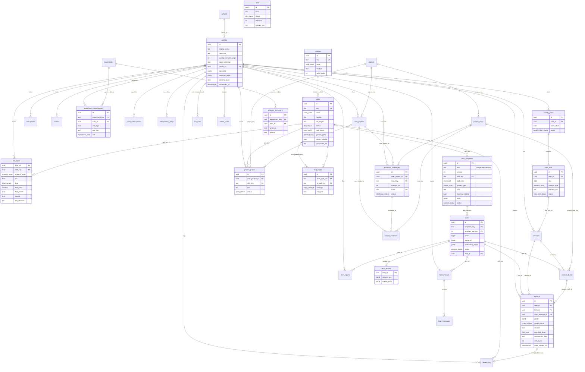

# 04 - Data model

Status: implementation-ready, revision 3 (adds the `nightly_maintenance` job kind, decision G15, and the read-model notes of section 5.10). Companion file: `schemas/schema.sql` (PostgreSQL 17, Supabase). Binding names: `docs/00-contract.md` section 6 and section 5, as amended by `docs/00a-change-decisions.md` (which wins on any disagreement). This document adds columns and supporting tables; it renames nothing. The change requests that earlier drafts listed here are resolved by 00a (section 15); what changed in revision 2 is in section 16.

Evidence tags follow the contract: **[V]** read, **[S]** snippet, **[R]** recalled, **[P]/[inf]** proposal.

---

## 1. Principles

| ID | Principle | Consequence in the schema |
|---|---|---|
| DM-P1 | Multi-user and multi-tenant ready from day one (decision D1), single-user UX in v1. | Every learner-owned table carries `user_id uuid not null references profiles(id) on delete cascade`; `cohorts` and `experiment_assignments` exist. |
| DM-P2 | Content is code. Git is the source of truth; Postgres holds a read model. | Content tables have a UUID `id` and a stable string `key` (unique, joined on `key`). They are written only by `content:sync` (service role) or by an admin. `content_hash` detects change. |
| DM-P3 | The learner must never be able to read an answer key. | Answer keys live in `item_secrets` (no learner policy). Solution-bearing columns (`item_templates.body`, `items.params`, `items.verification_report`), verification thresholds (`project_steps.verification_spec`), expected measurements (`projects.spec`) and allocation internals (`experiment_assignments.rng_seed`, `block_index`, `experiments.design`, `pre_registration`) are excluded from the client column grants. |
| DM-P4 | Grades and learning state are written only by trusted server code. | Learners have `select` only on `attempts`, `skill_state`, `review_log`, `sessions`, `session_tasks`, etc. Writes go through route handlers or the worker using the service role. |
| DM-P5 | Everything that can be retried is idempotent in the database. | `attempts (user_id, client_attempt_id)` unique, `attempts.state_applied_at` compare-and-set (00a H15), `review_log (attempt_id)` unique, `idempotency_keys`, `jobs.dedupe_key`, `events (user_id, client_event_id)` unique. |
| DM-P6 | Be able to explain and replay scheduling. | `review_log` stores state before/after; `sessions.plan` stores selection reasons; `skill_state.mastery_evidence` stores counters. |
| DM-P7 | Minimise personal data. | No birth date (only `adult_attested_at`), no emotion, biometric or neural data, no third-party IDs. Deletion cascades from `auth.users`. |
| DM-P8 | One definition of unaided. | `attempts.unaided` is a hard biconditional of `max_hint_level <= 1` (00a B1); the stricter evaluation signal is the view `app_private.v_attempts_strict_unaided` and never a stored column. |

---

## 2. Entity-relationship diagram



Reading notes: `jobs.user_id` and `privacy_requests.user_id` are deliberately not foreign keys (section 10). `llm_calls.user_id` is `on delete set null`. `tutor_messages.llm_call_id` is a soft reference. `skills` references `modules` through the pair `(node, module)`; `items` references `item_templates` through `(template_key, template_version)`. `app_private.rate_limits` and the view `app_private.v_attempts_strict_unaided` are not drawn (section 5.9).

---

## 3. Conventions

- Primary keys: UUID (`gen_random_uuid()`). Content objects also carry the stable `key` and other tables reference content by `key` (`on update cascade`).
- Time: `timestamptz`, UTC. Durations: `*_s` seconds, `*_min` / `*_minutes` minutes.
- Scores: `double precision` in [0, 1]. FSRS ratings: `smallint` 1-4.
- Enums are Postgres enum types with the exact contract spellings. `hint_level` is a `smallint` domain restricted to 0-4, not an enum (00a B2).
- All tables are in schema `public`; internal functions in `app_private` (not exposed by PostgREST).
- Every table has RLS enabled. A table without a policy is deny-all for `anon` and `authenticated`.
- Column-level `GRANT`s are used as a second line of defence under RLS (section 8).
- Naming: tables plural snake_case, constraints `{table}_{rule}`, indexes `{table}_{cols}_idx`, policies `{table}_{action}_{who}`.

---

## 4. Enumerations

Contract enums (exact): `tier`, `session_type`, `context`, `task_kind`, `grader_type`, `mastery_state`, `edge_strength`, `content_status`, `evidence_kind`, `evidence_status`, `experiment_arm`; `hint_level` as a domain (smallint 0-4, 00a B2); `node_code` as a domain (text restricted to the 20 node codes in contract section 4). `content_status` keeps its four contract values; skills use their own enum `skill_status` because only skills can be stubs (00a C).

Added enums:

| Type | Values | Used by |
|---|---|---|
| `session_status` | `planned`, `active`, `completed`, `abandoned` | `sessions.status` |
| `session_task_status` | `pending`, `in_progress`, `done`, `skipped` | `session_tasks.status` |
| `grade_status` | `pending`, `graded`, `invalid_input`, `pending_review`, `error` | `attempts.grade_status`; mirrors `attempts.grade ->> 'status'` (`graded`, `invalid_input`, `pending_review`, `error`); `pending` means no grade yet (00a D2) |
| `skill_status` | `stub`, `draft`, `verified`, `needs_human_review`, `retired` | `skills.status` (00a C) |
| `experiment_status` | `draft`, `running`, `paused`, `ended` | `experiments.status` |
| `weekly_plan_status` | `active`, `skipped`, `paused`, `superseded` | `weekly_plans.status` |
| `plan_slot_status` | `planned`, `done`, `missed`, `moved` | `plan_slots.status` (doc 06 7.9) |
| `challenge_status` | `open`, `consumed`, `expired` | `evidence_challenges.status` |
| `grant_status` | `pending`, `applied`, `suspended` | `project_grants.status` |
| `report_status` | `open`, `confirmed`, `dismissed` | `item_reports.status` |
| `user_project_status` | `active`, `paused`, `completed`, `abandoned` | `user_projects.status` |
| `tutor_role` | `user`, `assistant`, `system` | `tutor_messages.role` |
| `job_status` | `queued`, `running`, `succeeded`, `failed`, `cancelled` | `jobs.status` (`failed` is terminal: retries exhausted) |
| `checkpoint_status` | `due`, `in_progress`, `completed`, `expired` | `checkpoints.status` |
| `privacy_request_kind` | `export`, `delete` | `privacy_requests.kind` |
| `privacy_request_status` | `requested`, `processing`, `completed`, `failed` | `privacy_requests.status` |
| `sync_run_status` | `running`, `succeeded`, `failed` | `content_sync_runs.status` |

Adding a value later: `alter type ... add value 'x'` in its own migration (cannot be used in the same transaction that adds it).

---

## 5. Table-by-table description

Legend: **C** = contract column (name fixed), **+** = column added by this document. "Writer" is who may write rows in production.

### 5.1 Identity and access

**`cohorts`** (+ table). `id`, `key` (unique, `^[a-z0-9-]{2,40}$`), `name`, `created_at`. Writer: admin. Seed: `founder`, `beta-1`.

**`profiles`**. C: `id` (= `auth.users.id`), `display_name`, `timezone`, `weekly_minutes_target`, `created_at`. +: `updated_at`, `cohort_id`, `locale`, `target_retention` (default 0.90, check 0.70-0.97; contract 7.4), `reminder_time_local`, `adult_attested_at`, `terms_accepted_at`, `settings` (jsonb, < 16 KB); 00a C: `consents` (jsonb keyed by purpose, for example `research`), `bedtime_local` (time; only defaults quiet hours), `reminder_prefs` (jsonb: enabled, micro time, focus lead, quiet hours, max per day, weekly summary; **replaces** a separate `notification_prefs` table, which 00a rejected), `onboarded_at`.
- Created by trigger `on_auth_user_created` on `auth.users` (security definer).
- `weekly_minutes_target` default 480 (8 hours, contract section 1).
- Writer: owner for the whitelisted columns (column-level `UPDATE` grant, which now includes `consents`, `bedtime_local`, `reminder_prefs`, `onboarded_at`); `id`, `cohort_id`, `created_at` are protected by trigger `profiles_guard_update` even for column grants that change later.
- Acceptance AC-DM-PROF-1: a user who sends `update profiles set cohort_id = ...` receives `permission denied`.

**`admin_users`** (+ table). `user_id` PK. Membership means the admin role. Not a column on `profiles`, so no profile update path can escalate privileges. Granted manually by SQL by the founder (section 12.1). `public.is_admin()` is `security definer` and checks this table.

### 5.2 Content (read model of `content/` in git)

**`modules`** (+ table, 00a C). `id`, `key` (`{node}.{module}`, unique), `node`, `module`, `title`, `order_index` (the graph file's `order`), `description`, `is_stub`, timestamps. Unique `(node, module)`; check `key = node || '.' || module`. Written by `content:sync` (service role) or an admin; readable by every authenticated user. The graph file lists only the 17 real modules; `content:sync` must also upsert a row with `is_stub = true` (title = module slug, `order_index` 1000 and up) for each `(node, module)` pair used only by stub skills, because the foreign key below needs it (the 18 stub groups in graph 0.1.0 are `phys.mech`, `ctl.pid`, and so on).

**`skills`**. C: `key` (regex `^[a-z]+\.[a-z0-9-]+\.[a-z0-9-]+$`), `node`, `module`, `title`, `description`, `tier_target`, `est_minutes`, `license`, `source`, `status`. +: `id`, `version`, `content_hash`, `retired_at`, timestamps; 00a C: `task_kinds task_kind[]`, `grader_types grader_type[]`, `phone_suitable boolean`, `confusable_set text`.
- `status` is `skill_status` (`stub`, `draft`, `verified`, `needs_human_review`, `retired`). `skills.module` references `modules` through the foreign key `(node, module)` (constraint `skills_module_fk`).
- Check `skills_key_node_matches`: first key segment equals `node`; second equals `module`.
- Check `skills_stub_shape`: a stub has `est_minutes = 0`, empty `task_kinds` and `grader_types` and `phone_suitable = false`; every other skill has `est_minutes >= 1`, at least one grader type, and `task_kinds` containing `worked_example` and `retrieval` (doc 05 5.3). The 5-40 minute range for real skills is enforced by the graph validator, not the database (the column check is 0-600).
- Check `skills_no_session_level_kinds`: `diagnostic` and `checkpoint` never appear in `task_kinds` (00a A2).
- Visible to learners when `status in ('stub','verified','retired')` (stubs let the map show where other disciplines attach; the builder never offers them); `draft` and `needs_human_review` only to admins (the founder is the admin in v1, which satisfies contract 7.8).

**`skill_edges`**. C: `from_skill_key` (prerequisite), `to_skill_key`, `strength`, `min_tier`. +: `id`, `created_at`.
- Unique `(from_skill_key, to_skill_key)`, no self loops.
- Trigger `skill_edges_acyclic` rejects an edge that would close a cycle (recursive CTE over all edges). `content:sync` also checks acyclicity in memory before writing so failures are reported with the cycle path.
- `min_tier` defaults to `L0` (no tier requirement beyond the prerequisite itself being mastered).
- Edge cases: an edge whose endpoint is `retired` stays; the frontier query ignores edges from retired skills (06).

**`item_templates`**. C: `key` (`^tpl\.[a-z]+\.[a-z0-9-]+$`), `skill_key`, `task_kind`, `grader_type`, `difficulty_prior`, `version`, `status`, `body`. +: `id`, `phone_suitable` (used by micro sessions, contract 7.6), `est_seconds`, `license`, `source`, `content_hash`, `retired_at`, `retired_reason`, timestamps; 06 section 2 and 00a C: `difficulty_est` (live calibrated difficulty), `n_obs`, `tier` (null = the skill's `tier_target`), `pool` (`practice`, `assessment`, `transfer`; default `practice`), `interleave`, `reference_time_s`, `mastery_eligible` (default true; the content pipeline sets false for `rubric_llm` templates until the rubric is calibrated, 00a B4).
- **One row per `(key, version)`** (constraint `item_templates_key_version_unique`; `key` alone is no longer unique). A new `version` is a new row; old versions stay so items remain traceable.
- `body` contains parameter samplers, solution generators and verifier config: **never** selectable by clients. Admins read it through `admin_get_template(key, version default null)` (latest when no version) or the service role. `difficulty_est`, `n_obs`, `content_hash` and `retired_*` are also not in the client column grant.
- `difficulty_prior` is a float strictly between 0 and 1 (check; 0 trivial, 1 very hard, default 0.5); the Elo conversion `1500 + 400*log10(d/(1-d))` is owned by doc 06 (00a D3).
- Template files declare only `authoring_status` `draft`, `ready` or `retired`; only the pipeline sets `status = 'verified'` (00a D4).
- Evaluation pools: the trigger `session_tasks_pool_guard` rejects a `session_tasks` row that attaches an `assessment`-pool item without an `assessment_kind` (doc 11: the assessment pool is never shown in practice).
- Rule: a template cannot be `verified` unless a human or CI marked it so; `content:sync` sets `status` from the YAML front matter and never promotes automatically.

**`items`**. C: `id`, `template_key`, `seed`, `params`, `rendered`, `verification_report`, `status`, `difficulty_est`. +: `template_version`, `user_id` (null = shared pool item), `created_at`, `retired_at`, `retired_reason`. The pair `(template_key, template_version)` is a composite foreign key to `item_templates (key, version)` (constraint `items_template_fk`).
- Unique `(template_key, template_version, seed, user_id)` (a regenerated seed for the same user is rejected).
- Check `items_verified_has_report`: a `verified` item must have `verification_report` containing keys `verifier` and `agreed` (contract 7.8, 10: every verified item stores its report).
- `rendered` is learner-visible (prompt text, figures, response schema, unit expectations). `params` and `verification_report` are not.
- Clients may select: `id, template_key, seed, rendered, status, difficulty_est, template_version, user_id, created_at` where `status in ('verified','retired')` and (`user_id = me` or `user_id is null`); admins see all.
- Retirement: `status = 'retired'`, `retired_at`, `retired_reason`. Retired items are never deleted (attempts reference them) and are never served again.

**`skill_lessons`** (+ table, 00a K7). `id`, `skill_key` (references `skills.key`), `version`, `status` (`content_status`), `body` (jsonb: the validated `content/lessons/<skill_key>.yaml`, schema `schemas/lesson.schema.json`), `content_hash`, `license`, `source`, `reviewed_by` (references `auth.users`), `reviewed_at`, `retired_at`, timestamps.
- One row per `(skill_key, version)` (constraint `skill_lessons_skill_version_unique`). `content:sync` writes a `ready` file as a new version with `status = 'needs_human_review'` when its hash changes and never sets `verified` (00a K9).
- Check `skill_lessons_verified_reviewed`: a `verified` row has `reviewed_by` and `reviewed_at`. The founder's approval in the review console sets all three for that hash.
- Learners select rows with `status = 'verified'`; admins read and write all versions. The body holds no secret: primer checks are ungraded, so their correct options are learner-visible by design. Served through `getTask` as `TaskDetail.lesson` (newest verified version, 00a K8).

**`item_secrets`** (+ table). `item_id` PK, `answer_key`, `solution`, `hidden_tests` (code tests). No policy and no grant for clients. Read by graders and by the tutor service (reference solution is pre-loaded into the tutor context, contract 7.9). Offline packs may carry numeric and multiple-choice answer keys to the device; those attempts count toward mastery only after server verification (00a C, AR-DM-6).

**`projects`**. C: `key` (`^prj\.L[0-9]\.[a-z0-9-]+$`), `title`, `ladder_level`, `tier_gate`, `est_hours`, `bom` (jsonb array), `status`. +: `id`, `description`, `license`, `source`, `content_hash`, timestamps; 00a C: `spec` (jsonb: `learning_goals`, `prerequisite_skill_keys`, `grants_tier`, `time_split_min`, `tools`, `safety_notes`, `expected_measurements`, `failure_modes`; doc 10 section 3). Check: the digit in the key equals `ladder_level`. `spec` is not in the client column grant (it holds expected-value formulas); the API returns a learner-safe projection (`ProjectDetail`) that omits `expected_measurements`.

**`project_steps`**. C: `key` (`^prj\.L[0-9]\.[a-z0-9-]+#s[0-9]{2}$`), `project_key`, `position`, `title`, `est_min`, `session_type`, `skill_keys` (text[]), `evidence_required`. +: `id`, `instructions` (jsonb), `verification_spec` (jsonb, e.g. `{"nonce":true,"grader":"measurement_check"}`), `status`, `created_at`.
- `evidence_required` is `evidence_kind[]`; an empty array means none (00a C).
- Unique `(project_key, position)`; check: the part of `key` before `#` equals `project_key`.
- Check `project_steps_est_by_type` (00a A1): `micro` steps are at most 20 minutes, `focus` 45-120, `lab` 120-240, so no step can be authored in the 21-44 minute range. All 68 steps of `content/project-ladder.yaml` satisfy it.
- `verification_spec` (check lists, thresholds, pass criteria) is not in the client column grant; structural checks of evidence (file formats, build success, log parsing) live in `project_evidence.verification`, not in `grader_type` (00a D1).

### 5.3 Sessions and attempts

**`sessions`**. C: `id`, `user_id`, `session_type`, `context`, `planned_min`, `actual_min`, `started_at`, `ended_at`. +: `status`, `available_minutes`, `builder_version`, `plan` (jsonb: per-task selection rationale), `created_at`; 06 section 2 and 00a C: `plan_slot_id` (weekly slot this session fulfils, `on delete set null`), `experiment_snapshot` (jsonb: parameter values and arms in force), `graph_version` (text).
- Check `sessions_planned_min_by_type`: micro 1-20, focus 45-120, lab 120-240 (contract section 1). Check `sessions_micro_not_bench`.
- Partial indexes for "my open session" lookup and for slot-to-session lookup.
- 21-44 minutes (00a A1): there is no session type for such a window. The builder returns one micro session of up to 20 minutes, optionally followed by a second micro session; the second is a separate `sessions` row. A diagnostic is a `focus` session whose tasks have `task_kind = 'diagnostic'` (00a A2).

**`session_tasks`**. C: `id`, `session_id`, `position`, `task_kind`, `skill_key`, `item_id`, `status`. +: `user_id` (denormalised for RLS speed), `project_step_key`, `est_seconds`, `reason` (`due_review|continue|frontier|interleave|checkpoint|project`, mirrors contract 7.2 a-e), `started_at`, `completed_at`, `created_at`; 00a C: `assessment_kind` (null for practice; `diagnostic`, `module_end`, `periodic`, `delayed`, `transfer`).
- Unique `(session_id, position)`. Check `session_tasks_content_ref`: `project_step` tasks require `project_step_key`; every other kind requires `skill_key` except `checkpoint`.

**`attempts`**. C: `id`, `user_id`, `item_id`, `session_id`, `started_at`, `submitted_at`, `response`, `grade`, `hints_used`, `max_hint_level`, `latency_ms`, `confidence`, `unaided`. +: `session_task_id`, `client_attempt_id`, `grade_status`, `graded_at`, `grader_version`, `offline`, `client_grade`, `server_verified_at`, `created_at`; 06 section 2 and 00a C: `expected_ms`, `flags` (text[], for example `rapid_guess`), `assessment_kind` (same values as on `session_tasks`), `active_ms` (active time; `latency_ms` is wall time); 00a H15: `state_applied_at`.
- **`state_applied_at` (00a H15).** Set by compare-and-set in the state transaction and the guard that Elo and mastery apply once (06 section 3.3). Check `attempts_state_applied_when_graded` allows it only on `graded` attempts. Reconcile selects `grade_status = 'graded' and state_applied_at is null`, through `attempts_state_unapplied_idx`.
- `grade` shape (00a D2): `{ "status": "graded"|"invalid_input"|"pending_review"|"error", "score": 0..1|null, "correct": bool|null, "graders": [ {"type": grader_type, "score": .., "detail": {..}} ], "feedback"?, "misconception_tags"?, "mastery_eligible"?, "needs_human"?, "graded_at"?, "grader_build"? }`. `score` and `correct` are JSON `null` unless `status = graded`. Check `attempts_grade_shape` enforces: `grade.status` equals `grade_status`; `graded` has a numeric score in [0,1] and a boolean `correct`; every other status has null `score` and `correct`. Check `attempts_pending_has_no_grade`: `grade_status = 'pending'` means no grade yet. `attempts_graded_has_grade`: `graded` and `invalid_input` need a grade. `error` may have no grade (a poison job sets it). The scheduler ignores every attempt whose status is not `graded` (00a B4), so a parse error never counts as a wrong answer. `correct` means `score >= 0.8` (00a B3).
- **`unaided` (00a B1).** `unaided` is TRUE iff `max_hint_level <= 1` (level 4, reveal, is therefore never unaided). Check `attempts_unaided_rule` is the biconditional `unaided = (max_hint_level <= 1)`, so it rejects both `unaided = true` with level 2 or more and `unaided = false` with level 0 or 1. Checkpoints expose no hint UI: check `attempts_checkpoint_no_hints` requires `max_hint_level = 0` and `hints_used = 0` when `assessment_kind` is `module_end`, `periodic` or `delayed`. Level 4 sets `grade.score = 0` and `correct = false` for credit (contract hint level 4 ends credit); this is an application rule (AR-DM-1), not a constraint. Whether the attempt counts toward mastery additionally needs `grade.status = graded`, `grade.mastery_eligible` not false and, for offline attempts, `server_verified_at` (AR-DM-6); those are scheduler inputs, not part of `unaided`.
- **Strict-unaided** (`max_hint_level = 0` and no tutor panel opened) is the evaluation term of doc 11. It is derived in the view `app_private.v_attempts_strict_unaided` (section 5.9), not stored. "Tutor panel opened" is evidenced by a `tutor_threads` row for the same user and item created at or before `submitted_at`, so the tutor service must create the thread when the panel opens, even if no message is sent.
- `client_attempt_id` is generated by the client (UUID v4) and makes submit idempotent: unique `(user_id, client_attempt_id)`.
- `client_grade` stores an offline provisional grade for audit; it never feeds `skill_state`.
- Partial index `attempts_pending_idx` supports the "stuck grading" alert.

### 5.4 Learner model

**`skill_state`**. C: `user_id`, `skill_key`, `mastery_state`, `elo`, `stability`, `difficulty`, `due`, `last_review`, `reps`, `lapses`, `fsrs_state`, `tier_attained`. +: `elapsed_days`, `scheduled_days`, `learning_steps` (ts-fsrs Card fields), `mastery_evidence` (jsonb counters for the mastery rule), `first_seen_at`, `mastered_at`, `updated_at`. PK `(user_id, skill_key)`. 00a B6/B7 and 06 section 2: `fsrs_model` (text, default `'fsrs-6'`), `fsrs_extra` (jsonb), `source` (`learned` or `placement`), `n_attempts`, `epoch_start`, `ever_mastered`, `loop_step` (`worked_example`, `faded_problem`, `retrieval_same_day`, `practice`, `verify`, `done` or null), `blocked_by` (text[]), `interleave_stage` (0-3), `diag_credit`.
- `fsrs_state`: 0 New, 1 Learning, 2 Review, 3 Relearning (ts-fsrs `State`; confirm numbering against the installed version). The model is pinned to FSRS-6 behind one adapter file (00a B7); re-verify the `ts-fsrs` licence and API at build time.
- Placement (00a B6): a diagnostic gives provisional credit only. Check `skill_state_placement_never_mastered` forbids `source = 'placement'` with `mastery_state = 'mastered'`; when a placed skill is later mastered through real attempts the scheduler sets `source = 'learned'` in the same update.
- `mastery_evidence` shape (canonical rule in doc 06): `{"unaided_correct":[{"attempt_id":..,"day":"2026-11-02","item_id":..}], ...}`; stored as jsonb so 06 can evolve the rule without a migration. A row exists only after first exposure; absence means `unseen`.
- `elo` default 1000.
- Index `skill_state_due_idx` serves "due reviews now": `where user_id = $1 and due <= now() order by due`.

**`review_log`**. C: `id`, `user_id`, `skill_key`, `attempt_id`, `rating` (1-4), `reviewed_at`, `elapsed_days`, `scheduled_days`. +: `state_before`, `stability_after`, `difficulty_after`, `due_after`, `fsrs_params_version`; 06 section 2: `flags` (text[]), `attempt_ids` (uuid[], all attempts aggregated into the review; `attempt_id` stays the anchor); added by this document: `session_id`.
- A row is one review unit, written at session close (06 section 3.3). `attempt_id` is the unit's last attempt, so most attempts have no row of their own; applied state is read from `attempts.state_applied_at`, not from this table. Unique partial index on `attempt_id` guarantees at most one review per attempt (idempotent re-grade). Unique partial index `review_log_session_skill_unique (session_id, skill_key)` enforces one review row per skill per session (00a B3).
- Append-only by convention: the service never updates rows.

### 5.5 Projects and evidence

**`user_projects`**. C: `id`, `user_id`, `project_key`, `status`, `started_at`, `completed_at`. +: `current_step_key`, `variation` (per-learner parameters to deter copied designs), `created_at`, `updated_at`; 00a C: `bench_state` (jsonb, < 32 KB; pause/resume state of a bench step, doc 10 section 5.7; autosaved, no expiry). Unique partial index: one `active|paused` row per `(user_id, project_key)`. Check: `completed_at` is set exactly when `status = 'completed'`. `unique (id, user_id)` lets child tables carry a composite foreign key so a denormalised `user_id` can never disagree with the project owner.

**`project_evidence`**. C: `id`, `user_project_id`, `step_key`, `evidence_kind`, `storage_path`, `verification` (jsonb), `evidence_status`. +: `user_id`, `challenge_nonce`, `mime_type`, `size_bytes` (max 500 MB), `sha256`, `content` (jsonb, < 64 KB: measurement values, repo URL, note text), `reviewed_by`, `reviewed_at`, `review_note`, timestamps; added by this document: `challenge_id` (the `evidence_challenges` row the evidence answers). The composite foreign key `(user_project_id, user_id)` to `user_projects` keeps the denormalised `user_id` honest. The evidence bucket accepts `video/quicktime` in addition to `video/mp4` and `video/webm` (00a C).
- `photo|video|log|scope_capture` require `storage_path`; `storage_path` must start with `{user_id}/` (check `project_evidence_path_prefix`) which pairs with the storage policy.
- `verification` shape: `{ "assurance": 1..4, "checks": [ {"name":"nonce_in_log","pass":true,"detail":..} ], "llm_assist"?: {...}, "file": {"magic_ok":true,"exif_stripped":true} }`. The assurance rungs follow the researchers' ladder [P]: 1 instrumented measurement with nonce, 2 hardware-in-the-loop challenge, 3 time-stamped video with nonce, 4 photo only.
- State machine, enforced by trigger `project_evidence_status_guard` (00a C; the DB raises `23514` on anything else): `submitted -> auto_verified | needs_review | rejected`; `auto_verified -> accepted` (promotion when the step is closed); `needs_review -> accepted | rejected` (human). `rejected` is terminal: the learner submits a new row and the old row gets `verification.superseded_by`. The worker never sets `accepted` for rungs 3-4 (they always need human review in v1). When a row becomes `accepted` the same trigger sets its challenge to `consumed`.
- Doc 08 section 2.9 describes a human "rework" decision that sends evidence back to `submitted`; the status machine above forbids it. Until docs 08 and 10 are reconciled, rework is expressed as `rejected` plus a new submission (see the open conflicts in section 15).

- **Upload cap by plan (G14, verified 31 Oct 2026):** the `evidence` bucket is seeded with a 500 MB limit and `video/*` types, but Supabase Free caps every object at 50 MB (1 GB total storage) whatever the bucket says; Pro raises the global limit (up to 500 GB) and gives 100 GB of storage. Consequences: on Free, video evidence larger than 50 MB cannot be stored, so only photo, log, measurement, note and short clips are available and the upload-URL route must refuse a declared `size_bytes` above the plan cap with `validation_failed`; to accept 500 MB videos, move to Pro, raise the global file limit and keep the bucket limit at 500 MB; the plan decision precedes the first evidence upload. Stored files count against the plan total, which is another reason to prefer short clips plus a nonce over long videos.

**`evidence_challenges`** (+ table, 00a C; doc 10 section 7.4). `id`, `user_id`, `user_project_id`, `step_key`, `attempt_no`, `code` (`PM-XXXX-XXXX` from a 30-symbol alphabet; unique across all users; format-checked), `digits` (six digits or null), `params` (jsonb attempt parameters), `issued_at`, `expires_at`, `bound_to` (an earlier challenge this one reuses; self-reference), `consumed_at`, `status` (`open`, `consumed`, `expired`), `created_at`. Unique `(user_project_id, step_key, attempt_no)`. Written only by the server (code generation with the HMAC scheme of doc 10 7.4.2 happens in application code; the database stores the result). Learners can select their own rows. Helper functions: `app_private.check_challenge_code(user, user_project, step, code)` (service role) and `public.verify_challenge_code(user_project, step, code)` (caller only) normalise the code (uppercase, drop spaces and hyphens, optional `PM` prefix) and return `{valid, reason, challenge_id}` with `reason` in `OK`, `NONCE_MISSING`, `NONCE_MISMATCH`, `NONCE_EXPIRED`; a bound challenge is validated against the code and expiry of the challenge it reuses. Rate limits (5 challenges per step per 24 h) are enforced by `app_private.rate_limits`.

**`project_grants`** (+ table, 00a B5; doc 10 section 8.2). `id`, `user_id`, `user_project_id`, `project_key`, `skill_key`, `tier` (`L0` or `L1` only: no project grants L2 or L3), `status` (`pending`, `applied`, `suspended`), `granted_at`, `applied_at`, `assisted`. Unique `(user_project_id, skill_key)`. L0 credit is written `applied`; L1 credit starts `pending` and becomes `applied` only after the step evidence is `accepted` and the skill conditions of doc 10 8.2 hold (application logic). Credit counts only toward the "applied" condition of the mastery rule and the module-level L1 condition. Learners read their own rows; the service role writes.

### 5.6 Tutor

**`tutor_threads`**. C: `id`, `user_id`, `item_id`, `skill_key`. +: `session_id`, `attempts_seen`, `max_hint_level`, `closed_at`, `created_at`. One thread per `(user, item)` in practice.

**`tutor_messages`**. C: `thread_id`, `role`, `content` (max 20,000 chars), `hint_level`, `policy_flags`. +: `id`, `user_id`, `llm_call_id`, `prompt_version`, `created_at`.
- `policy_flags` keys (written by the tutor service): `attempt_first_ok`, `leak_filter` (`pass|redacted|blocked`), `injection_suspected`, `refused_reason`.
- Every message, including refusals, is stored with the `hint_level` actually delivered (contract 7.9).

### 5.7 Experiments, checkpoints, events

**`experiments`**. C: `key`, `description`, `started_at`. +: `id`, `ended_at`, `allocation_treatment_pct`, `pre_registration` (jsonb), `created_at`; 00a C: `design` (jsonb: `unit_type`, `arm_labels` mapping `control`/`treatment` to the named conditions, `allocation` `'hash'` or `'external'`, pairing rules; doc 11 CCR-13), `status` (`experiment_status`), `preregistration_ref` (git tag and SHA-256 of the frozen pre-registration, recorded before the first assignment). `experiment_arm` stays `control`/`treatment`; the named conditions (for example ON/OFF, blocked/interleaved) are labels in `design.arm_labels`. Control is an active control (00a D7).
**`experiment_assignments`**. C: `experiment_key`, `user_id`, `arm`. +: `assigned_at`; 00a C: `id` (new PK), `unit_type` (`user`, `skill`, `module`, `confusable_set`; default `user`), `unit_key`, `block_index`, `rng_seed`. Unique `(experiment_key, user_id, unit_type, unit_key)`; check: for `unit_type = 'user'` the `unit_key` is the user id. Learner column grant excludes `block_index` and `rng_seed`.
- Hash allocation is by `assign_experiment(experiment_key, unit_type default 'user', unit_key default null)`: the bucket is `abs(hashtextextended(user_id || ':' || experiment_key || ':' || unit_type || ':' || unit_key, 0)) % 100 < allocation_treatment_pct` gives `treatment`, else `control`. It is sticky at **unit** level: an existing row for the unit is always returned, even if the experiment has ended or the allocation percentage changed; a new unit is refused unless `status = 'running'` and the time window is open. A design whose `unit_type` differs from the call is refused; an unknown skill or module is refused; `design.allocation = 'external'` (permuted blocks, matched pairs with a stored `rng_seed` and `block_index`) is written by the service role and the function then only returns existing rows.
- Example: with `allocation_treatment_pct = 50` the arm of a given skill for a given learner never changes between calls or releases, and is independent across experiments and units because both keys are in the hash.

**`analysis_exclusions`** (+ table, 00a C; doc 11 section 11.4). `id`, `experiment_key` (null = every analysis), `user_id`, `unit_key`, `reason`, `decided_by`, `decided_at`; at least one of `user_id` and `unit_key`. Admin only (select and insert); there is no update or delete grant, so exclusions are append-only and the published exclusion list is reproducible. Learners have no policy.

**`checkpoints`** (+ table; the contract names checkpoints only as a behaviour, 7.7). `id`, `user_id`, `scope_node`, `scope_module` (null = node-wide), `reason` (`module_end|every_14_days|manual`), `status`, `due_at`, `session_id`, `score`, `started_at`, `completed_at`, `details`. A checkpoint row is created by the scheduler when a module finishes or when 14 days have elapsed since the last completed checkpoint for the node. Checkpoint attempts expose no hint UI: they have `max_hint_level = 0` (database check, section 5.3) and tutor access is disabled (enforced in the tutor endpoint by checking the thread's session). Checkpoints are never served offline.

**`events`**. C: `id`, `user_id`, `name`, `props`, `at`. +: `client_event_id` (dedupe), `session_id`; 00a C: `graph_version`. `name` matches `^[a-z0-9_.]{1,64}$`; `props` < 8 KB. The event catalogue of doc 11 is the normative list of event names (00a D6); this document does not repeat it. No PII in `props` (AR-DM-2).

### 5.8 Infrastructure tables

**`jobs`**. C: `id`, `kind`, `payload`, `status`, `attempts`, `locked_at`, `result`, `error`, `created_at`. +: `updated_at`, `finished_at`, `run_after`, `max_attempts` (default 5), `priority`, `timeout_s` (default 120), `locked_by`, `dedupe_key`, `user_id`.
- `kind` check list (doc 03 section 8.3 is the source, 00a C): `grade_attempt`, `pregenerate_items`, `verify_evidence`, `content_postprocess`, `export_user_data`, `delete_user_data`, `send_push`, `prune_expired`, `sweep_storage`, `nightly_maintenance` (G15, added 31 Oct 2026). `status` values: `queued`, `running`, `succeeded`, `failed`, `cancelled`. Adding a kind is a migration (drop and re-add the check).
- **`nightly_maintenance`** (G15; finding F-05 of 00b): one job a day, payload `{run_date}`, dedupe key `nightly:{yyyymmdd}`, priority 0, `timeout_s` 900, `max_attempts` 2. It performs the decay evaluation, the FSRS/Elo calibration monitor and the tutor audit sampling described in 03 section 8.6. It reads `skill_state`, `review_log`, `attempts`, `tutor_messages` and writes `skill_state.mastery_state` (through the web app's internal endpoint, ADR-009), `events` (`fsrs_calibration`, `fsrs_miscalibrated`, `tutor_policy_flag`) and its own `jobs.result`. It adds no table and no column; `needs_applied` is not stored (the engine pass derives it at read time). Docs 07 and 08 use other kind names (for example `human_review`); see section 15.
- Claim index `jobs_claim_idx (priority desc, run_after, created_at) where status = 'queued'`.
- Functions (service role only): `enqueue_job`, `claim_jobs`, `complete_job`, `fail_job`, `requeue_stale_jobs`. Queue semantics are in 03, section 8.

**`idempotency_keys`**. PK `(user_id, key)`; stores `request_hash`, final `status_code` and `response` for replay for 48 hours. Service role only.

**`content_sync_runs`**. One row per `content:sync` run: `git_sha`, `status`, `stats`, `errors`. Admin readable. Feeds `GET /admin/content/sync-status`.

**`llm_calls`**. One row per provider call: `purpose`, `provider`, `model`, `prompt_version`, tokens, `cost_usd_micro`, `latency_ms`, `outcome`. No prompt or completion text is stored here. `user_id` is `on delete set null` so cost accounting survives deletion without identifying anyone.

**`push_subscriptions`**: Web Push endpoint and keys; owner may insert/delete. **`privacy_requests`**: export/delete requests; see section 10. **`item_reports`** (00a D5): a learner flags a wrong or ambiguous item (`reason`, `note`, optional `attempt_id`); the app also emits an `item_reported` event. Admin triage columns: `status` (`open`, `confirmed`, `dismissed`), `resolved_by`, `resolved_at`. `unique(user_id,item_id,reason)`. Learners can insert only `user_id, item_id, reason, note, attempt_id` with `status = 'open'`; only an admin can update `status`, `resolved_by`, `resolved_at`.

### 5.9 Weekly plans and the `app_private` objects

**`weekly_plans`** (+ table, 00a C; docs 06 7.8-7.9 and 09 S16). `id`, `user_id`, `week_start` (the local Monday; check `isodow = 1`), `status` (`active`, `skipped`, `paused`, `superseded`), `target_minutes` (snapshot of the weekly target), `planned_minutes` (sum of non-missed slots, kept by the server), `slack_minutes`, `paused_until`, `carry` (jsonb minutes carried in by the 50% focus rule or a missed lab), `forecast` (jsonb estimate: reviews due, new skills; always labelled an estimate), `params_version`, `generated_by`, timestamps. Unique `(user_id, week_start)`. The plan stores **slots only**; tasks are chosen at session start.

**`plan_slots`** (+ table). `id`, `plan_id`, `user_id`, `day` (date), `position`, `session_type`, `planned_min`, `context`, `status` (`planned`, `done`, `missed`, `moved`), `start_time_local`, `moved_from_day`, `carried_min`, `note`, timestamps. Composite foreign key `(plan_id, user_id)` to `weekly_plans`, so a slot can never belong to another learner's plan. Checks mirror the session rules (micro at most 20, focus 45-120, lab 120-240, micro never `bench`); `moved` requires `moved_from_day`. `sessions.plan_slot_id` links the session that fulfils a slot. Learners read their own rows; all plan writes (generate, rebalance, move, skip, pause) are server code, because the rebalance rules of doc 06 7.9 must run.

**`app_private.rate_limits`** (+ table, 00a C; doc 03 ER-8). Token bucket per `(user_id, bucket)`: `tokens`, `updated_at`; cascades with the user. RLS is enabled with no policy and every role except the owner is revoked. `app_private.rate_limit_take(user, bucket, capacity, refill_per_s, cost)` (service role only) refills, takes `cost` tokens and returns `0` when allowed, otherwise the seconds to wait. Limits (120 requests/min, tutor 20/min, uploads 30/hour, attempts 60/min, challenges 5 per step per day) are application configuration passed as arguments. Idle rows are removed by `prune_expired()` after one day.

**`app_private.worker_heartbeat`** (+ table, 00a I3; doc 03 sections 8.4 and 8.6). Exactly one row (`id boolean` primary key, check `id`): `worker_id`, `git_sha`, `beat_at`. The worker overwrites it every 5 minutes through `app_private.record_worker_heartbeat(worker_id, git_sha)` (server time); `GET /health` reads `app_private.worker_heartbeat_age_s()` (seconds, null before the first beat) through the privileged module, and the "worker down" alert uses the same value. RLS is enabled with no policy, the service role may only select the table (writes go through the function), and both functions are `security definer` and executable by the service role only.

Function privileges (00a I3): besides the schema-level default privileges, the migration role has the global default entry `revoke execute on functions from public`, so a new function in any schema is executable by no one but its owner until its migration grants it.

**`app_private.v_attempts_strict_unaided`** (view, 00a B1). One row per graded attempt with `max_hint_level = 0`, `hints_used = 0` and **no** `tutor_threads` row for the same user and item created at or before the attempt was submitted. Columns: attempt, user, item, session, task, `skill_key`, template key and version, `pool`, `task_kind`, `grader_type`, `assessment_kind` (attempt value, else the session task's), `score`, `correct`, `confidence`, `latency_ms`, `active_ms`, `offline`, `server_verified_at`, `submitted_at`. Doc 11 outcome measures use this term. It is internal only: the service role can select it, no API route exposes it, and the analysis package applies `analysis_exclusions` on top.

---

### 5.10 Read models behind `GET /progress` and the session preview (G16)

Neither feature adds a table, column, view or job. Both are computed on request from the caller's own rows under RLS (they run as the learner, not as the service role, so another learner's rows cannot appear).

| API element | Data sources | Notes |
|---|---|---|
| `GET /progress` `nodes[].tier_counts`, `by_mastery_state`, `l1_scope_*` | `skill_state` left-joined from `skills` (rows are absent for `unseen` skills; they count as `unseen` and `tier_attained` null), grouped by `skills.node`; stub and retired skills excluded | `l1_scope_skills` counts skills with `tier_target` L1 or below |
| `nodes[].l1_gate_project`, `l1_working` | `projects` (`tier_gate = 'L1'`), `user_projects`, `project_steps`, `project_evidence` (`evidence_status = 'accepted'` per required evidence) | `l1_working` follows contract 7.13: at least 90% of the L1-scope skills at L1 or higher and all required gate evidence accepted |
| `review_load` | `skill_state.due` for states `learning`, `reviewing`, `mastered`, `decayed`, bucketed by the learner's local date (`profiles.timezone`) for 7 days; `overdue_now` is `due <= now()`; minutes use the same per-review estimate as `GET /review-queue` | Index `skill_state (user_id, due)` serves it |
| `week` | `sessions.actual_min` of `completed` sessions with `ended_at` in the learner's current ISO week; target from the active `weekly_plans.target_minutes`, else `profiles.weekly_minutes_target` | |
| `projects` | `user_projects` with counts from `project_steps`, `project_evidence` (`needs_review`) and `project_grants` (`pending`, `applied`) | |
| `POST /sessions/build` with `dry_run: true` | Same reads as a real build (`skill_state`, `skill_edges`, `skills`, `weekly_plans`, `plan_slots`, `checkpoints`, items by availability) | Writes nothing: no `sessions`, `session_tasks`, `idempotency_keys` or reservation rows, and no `pregenerate_items` job; the rate-limit bucket `session_preview` in `app_private.rate_limits` is the only write (it is infrastructure, not learner data) |


## 6. Indexes (summary and the query each serves)

| Index | Query |
|---|---|
| `skill_state_due_idx (user_id, due) where mastery_state in (...)` | Due reviews for session builder; offline pack (next 24 h) |
| `skill_state_mastery_idx (user_id, mastery_state)` | Frontier computation; graph overlay |
| `skill_edges_to_idx (to_skill_key)` + unique `(from,to)` | Prerequisite lookup; reverse traversal |
| `item_templates_skill_idx (skill_key, status)` | Pick templates for a skill |
| `items_user_status_idx`, `items_pool_idx` | Pre-generated variant lookup |
| `attempts_user_submitted_idx (user_id, submitted_at desc)` | History, rate limiting, export |
| `attempts_pending_idx (created_at) where grade_status='pending'` | Stuck-grading alert |
| `attempts_state_unapplied_idx (graded_at) where grade_status='graded' and state_applied_at is null` | Reconcile loop |
| `review_log_user_skill_idx (user_id, skill_key, reviewed_at)` | FSRS parameter fitting, mastery-day counts |
| `sessions_user_active_idx` | Resume open session |
| `jobs_claim_idx`, `jobs_dedupe_idx`, `jobs_running_idx` | Queue claim, dedupe, lease recovery |
| `project_evidence_review_idx where evidence_status='needs_review'` | Founder review queue |
| `events_user_at_idx`, `events_name_at_idx` | Per-user timeline, experiment analysis |
| `modules_order_idx (order_index)` | Module list in default learning order |
| `skills_confusable_idx (confusable_set) where not null` | Interleaving candidates within a confusable set |
| `weekly_plans (user_id, week_start)` unique, `plan_slots_plan_idx (plan_id, day, position)`, `plan_slots_user_day_idx` | Plan screen, rebalance, reminders |
| `sessions_plan_slot_idx (plan_slot_id)` | Slot to session lookup |
| `review_log_session_skill_unique (session_id, skill_key)` | One review per skill per session |
| `evidence_challenges_open_idx (user_project_id, step_key) where status='open'`, unique `(user_project_id, step_key, attempt_no)`, unique `(code)` | Fetch the open challenge; nonce lookup |
| `project_grants_user_skill_idx (user_id, skill_key)`, unique `(user_project_id, skill_key)` | Credit lookup by skill; one credit row per skill and project |
| `experiment_assignments_exp_idx (experiment_key, unit_type, unit_key)`, unique `(experiment_key, user_id, unit_type, unit_key)` | Unit stickiness; exposure completeness |
| `analysis_exclusions_exp_idx (experiment_key, user_id)` | Analysis joins |
| `item_reports_open_idx (created_at) where status='open'` | Admin triage queue |
| `rate_limits_updated_idx (updated_at)` | Pruning idle buckets |

Capacity reasoning [inf]: 50 users x 40 attempts/day x 365 days is about 730k attempts/year; `events` about 10x that. All fit a single small Postgres without partitioning. Revisit at 5M rows per table (section 13).

---

## 7. Triggers and functions

| Name | Kind | Purpose |
|---|---|---|
| `set_updated_at` | trigger fn | Maintains `updated_at` on `profiles`, `modules`, `skills`, `item_templates`, `projects`, `skill_state`, `project_evidence`, `user_projects`, `weekly_plans`, `plan_slots` |
| `evidence_status_guard` | trigger fn, security definer | Enforces the evidence status machine and consumes the challenge on `accepted` |
| `session_task_pool_guard` | trigger fn, security definer | Rejects an assessment-pool item attached to a practice task |
| `verify_challenge_code(user_project, step, code)` | plpgsql, security definer | Nonce check for the caller; returns `{valid, reason, challenge_id}` |
| `app_private.check_challenge_code(user, user_project, step, code)` | plpgsql, security definer | Same check for the worker (service role) |
| `app_private.rate_limit_take(...)` | plpgsql, security definer | Token-bucket take; service role only |
| `handle_new_user` | trigger on `auth.users` | Creates the `profiles` row |
| `guard_profile_update` | trigger | Blocks owner edits to `id`, `cohort_id`, `created_at` |
| `skill_edge_acyclic` | trigger | DAG guard |
| `is_admin()` | sql, security definer | Admin check used by policies |
| `is_service_role()` | sql | Used by guards; true when `current_user` or `auth.role()` is `service_role`, or for `postgres` and `supabase_admin` sessions (03 OA-9) |
| `assign_experiment(key, unit_type, unit_key)` | plpgsql, security definer | Sticky deterministic arm assignment of one unit for `auth.uid()` |
| `admin_get_template(key, version)` | plpgsql, security definer | Admin read of a template body (latest version when `version` is null) |
| `enqueue_job`, `claim_jobs`, `complete_job`, `fail_job`, `requeue_stale_jobs` | plpgsql, security definer | Queue operations (`FOR UPDATE SKIP LOCKED`) |
| `prune_expired()` | plpgsql, security definer, `app_private` | Retention |
| `llm_spend_today_micro(user)` | sql | Daily LLM budget check |

All `security definer` functions pin `search_path = public, pg_temp` (a test asserts that no definer function in `public` or `app_private` lacks a pinned path). Execute is revoked from `PUBLIC` and `anon`, and granted only as listed in `schema.sql` section 14. In `app_private`, execute is revoked from `PUBLIC`, `anon` and `authenticated` and granted to `service_role` only for the three callable functions.

---

## 8. Row Level Security and privileges

Rule set:
1. Learners read only rows where `user_id = auth.uid()` (or `id = auth.uid()` on `profiles`).
2. Content tables (`modules`, `skills`, `skill_edges`, `skill_lessons`, `projects`, `project_steps`, `item_templates`, `items`, `experiments`, `cohorts` for members) are readable by authenticated users, filtered by status; the admin role sees everything and may write content tables and experiments. `item_templates` and `items` writes are service-role only.
3. Learners may write only: `profiles` (owner columns), `events` (insert), `push_subscriptions` (insert, delete), `item_reports` (insert of the five learner columns, status `open`).
4. Every other write (attempts, grades, skill state, sessions, tasks, weekly plans and slots, tutor, evidence rows, challenges, project grants, jobs) uses the service role in server code that has already authenticated the user and derived `user_id` from the verified session, never from the request body.
5. `auth.uid()` is wrapped as `(select auth.uid())` in policies so Postgres evaluates it once per statement.

Matrix (S select, I insert, U update, D delete; "own" = row owner; "adm" = admin; "svc" = service role only):

| Table | anon | authenticated | admin | service |
|---|---|---|---|---|
| cohorts | - | S (own cohort) | S I U D | all |
| modules | - | S | S I U D | all |
| profiles | - | S own, U own (column list) | S all | all |
| admin_users | - | S own row | S own row | all |
| skills | - | S (stub/verified/retired) | S all, I U D | all |
| project_steps, projects | - | S (verified/retired; columns except `project_steps.verification_spec` and `projects.spec`) | S same columns, all statuses, I U D | all |
| skill_edges | - | S | S, I U D | all |
| item_templates | - | S (columns except `body`; verified/retired) | S all columns except `body`; `admin_get_template` for body | all |
| items | - | S (columns except `params`, `verification_report`; own or pool; verified/retired) | S same columns, all statuses | all |
| item_secrets | - | - | - | all |
| skill_lessons | - | S (verified) | S all, I U D | all |
| sessions, session_tasks, attempts, skill_state, review_log, user_projects, tutor_threads, tutor_messages, checkpoints, privacy_requests | - | S own | S own | all |
| weekly_plans, plan_slots, project_grants | - | S own | S own | all |
| project_evidence, evidence_challenges | - | S own; `verify_challenge_code()` | S all | all |
| experiments | - | S (columns except `design`, `pre_registration`, `preregistration_ref`) | S same columns, I U D | all |
| experiment_assignments | - | S own (columns except `block_index`, `rng_seed`); `assign_experiment()` | S all (same columns) | all |
| analysis_exclusions | - | - | S I (append-only; `decided_by` = caller) | all |
| events | - | S own, I own | S all | all |
| push_subscriptions | - | S I D own | - | all |
| item_reports | - | S own, I own (seven columns, status `open`; a tutor report only on the learner's own message, 00a H16) | S all, U (`status`, `resolved_by`, `resolved_at`) | all |
| jobs, content_sync_runs | - | - (policy admin-only) | S | all |
| llm_calls | - | S own | S all | all |
| idempotency_keys | - | - | - | all |
| `app_private.rate_limits`, `app_private.v_attempts_strict_unaided` | - | - (no schema usage) | - | all (select on the view) |
| storage `evidence`, `exports` | - | S own folder | - | all (uploads via signed URLs) |

Because column-level grants exclude `body`, `params`, `verification_report`, `projects.spec`, `project_steps.verification_spec`, `experiments.design` and the allocation internals of `experiment_assignments`, a client `select *` on those tables fails with `permission denied`; clients must name columns (the generated Supabase types and the API layer do so). The Next.js API returns learner-safe projections and uses the service role for anything touching hidden columns (admins use the same route handlers; the admin role does not widen column grants).

RLS test cases (all executed against PostgreSQL 16 with a Supabase stub; see section 14) are repeated as the security test checklist in doc 12 (tests ST-RLS-*).

---

## 9. Seed data notes

- `schema.sql` section 16 seeds `cohorts` (`founder`, `beta-1`) and the storage buckets `evidence` and `exports`.
- Content (modules, skills, edges, templates, projects) is **not** seeded in SQL; `pnpm content:sync` loads it from `content/` (see 03, section 10 and the content-format document). Order inside a sync run: `modules` (including stub modules), `skills`, `skill_edges`, `item_templates`, `projects`, `project_steps`. Loading the full graph (`content/mvp-skill-graph.yaml`: 156 skills, 238 edges, 35 modules including 18 stub groups) and the project ladder (68 steps) into the schema is part of the validation in section 14. In a fresh environment: apply migrations, run `content:sync`, then promote the founder to admin:
  ```sql
  insert into public.admin_users (user_id) select id from auth.users where email = 'andrea@stefanachi.com';
  ```
  (Run once in the Supabase SQL editor after the first magic-link login.)
- Local development seed: `supabase/seed.sql` creates two auth users (`learner@example.test`, `admin@example.test`), puts the second in `admin_users`, and inserts the three-skill fixture graph used by tests (`elec.dc.ohms-law -> elec.dc.voltage-divider`, plus one `draft` skill), one verified template and two items. This is the fixture the RLS tests in section 14 and doc 12 use.
- Experiments are created by migration or admin call, never by the client. Example row: `('exp.tutor-gating', 'Hint ladder strictness', now(), null, 50)` (with `status = 'running'`) is inserted by the evaluation plan's seed once that document fixes the experiment list. `preregistration_ref` is set before the first assignment.

---

## 10. Retention and deletion behaviour

Retention defaults (the founder may shorten; **proposal [P]**, not a legal determination - needs legal review for the jurisdiction chosen under contract 12):

| Data | Retention | Mechanism |
|---|---|---|
| Account, profile, skill state, attempts, review log, sessions, projects, evidence, tutor messages | Until the user deletes the account | Cascade from `profiles` |
| `events` | 13 months rolling | `prune_expired()` |
| `llm_calls` | 13 months rolling (anonymised on user deletion) | `prune_expired()`, `on delete set null` |
| `idempotency_keys` | 48 hours | `prune_expired()` |
| `app_private.rate_limits` | idle buckets after 1 day | `prune_expired()`; cascade on user deletion |
| `jobs` succeeded / failed | 30 / 90 days | `prune_expired()` |
| Export archives | 7 days after creation | storage lifecycle + `privacy_requests.export_expires_at` |
| `privacy_requests` (delete kind) | 90 days after completion, pseudonymous UUID only | `prune_expired()` |
| Evidence files | Until the user project or account is deleted; rejected/invalid uploads purged within 24 h (Free plan: 50 MB per file, 1 GB total, G14) | `sweep_storage` job |
| Database backups | Provider-defined window (verify in Supabase plan); deleted data persists in backups until they roll off | see doc 12 |

Account deletion (flow `DELETE /me`, implemented as job `delete_user_data`):
1. API verifies a recent login (re-authentication within 10 minutes) and a typed confirmation, inserts `privacy_requests(kind='delete', status='requested')` and enqueues the job. The account is immediately marked unusable by revoking sessions.
2. Worker deletes all storage objects under `evidence/{user_id}/` and `exports/{user_id}/`.
3. Worker deletes the `auth.users` row via the Supabase admin API. `on delete cascade` removes `profiles` and every dependent row (attempts, skill_state, review_log, sessions, session_tasks, user_projects, project_evidence, tutor_*, checkpoints, events, push_subscriptions, item_reports, idempotency_keys, experiment_assignments, weekly_plans, plan_slots, evidence_challenges, project_grants, analysis_exclusions, `app_private.rate_limits`, per-user `items` and their `item_secrets`).
4. `llm_calls.user_id` becomes null. `jobs.user_id` and `privacy_requests.user_id` are not foreign keys so the audit trace outlives the user; the worker scrubs the delete job's payload (sets `payload = '{}'`) and the user id remains only as an opaque UUID in `privacy_requests` for up to 90 days.
5. Worker marks the request `completed`.
Edge cases: a delete job that crashes after step 2 is safe to retry (each step is idempotent); a delete request while an export job is running cancels the export; evidence a reviewer already accepted is deleted with the account (no credentials are issued in v1).

Account export (`POST /me/export`): job `export_user_data` writes a ZIP to `exports/{user_id}/{request_id}.zip` containing one JSON Lines file per user-owned table (excluding `idempotency_keys`) plus the user's evidence files, and the signed URL is valid for 7 days. Hidden answer keys are excluded; `items` appear with `rendered` only. Test: export row counts equal table counts for that user (AC-DM-EXP-1).

---

## 11. Application rules that the database does not enforce (and tests that must)

| ID | Rule | Test |
|---|---|---|
| AR-DM-1 | Hint level 4 gives score 0 for credit; `unaided` is exactly `max_hint_level <= 1` (the database enforces the biconditional); strict-unaided is derived only in the view | Unit test on grading pipeline with levels 0-4; view test |
| AR-DM-2 | `events.props` and `llm_calls` hold no free-text learner input | Lint rule on event emitters; review of event catalogue |
| AR-DM-3 | `user_id` for service-role writes comes from the verified session | Lint rule forbidding `userId` from `req.body` in privileged modules; integration test posting another user's id is ignored |
| AR-DM-4 | Items served only when `status = 'verified'` (or `needs_human_review` to admin) | Trigger `session_task_pool_guard` rejects any other item, including from the service role; integration test: inserting a draft item fails |
| AR-DM-5 | Re-grading an attempt twice yields one `review_log` row, and Elo and mastery apply once through the `state_applied_at` compare-and-set | Test using the unique index and a repeated apply-grade call |
| AR-DM-6 | Offline-graded attempts contribute to mastery only after `server_verified_at` is set | Unit test on scheduler input filter |
| AR-DM-7 | The scheduler ignores attempts whose `grade_status` is not `graded` and attempts with `grade.mastery_eligible = false` (uncalibrated `rubric_llm`) | Unit test with `invalid_input`, `pending_review`, `error` fixtures |
| AR-DM-8 | The tutor service creates the `tutor_threads` row when the panel opens, so the strict-unaided view sees panel openings with no message | Integration test: open panel, submit, attempt absent from the view |
| AR-DM-9 | When a placed skill is mastered through real attempts, `skill_state.source` flips to `learned` in the same update (the database forbids `placement` + `mastered`) | Scheduler unit test |
| AR-DM-10 | Challenge codes are generated in application code (doc 10 7.4.2) and retried on a unique-code collision; at most 5 per step per 24 h via `rate_limit_take` | Integration test |
| AR-DM-11 | L1 `project_grants` become `applied` only after the evidence is `accepted` and the skill conditions hold; no grant above L1 | Worker test on completion |
| AR-DM-12 | `content:sync` upserts a stub module row for every `(node, module)` pair used only by stubs | Sync test with the shipped graph |

---

## 12. Migration strategy

1. **Tooling:** Supabase CLI migrations in `supabase/migrations/{timestamp}_{name}.sql`, forward-only, applied by `supabase db push` in CI to staging then production. No down migrations; rollback is a new forward migration or a point-in-time restore (doc 12).
2. **Baseline (revision 2 includes every 00a C addition, `app_private.rate_limits` included):** `schemas/schema.sql` is copied verbatim to `supabase/migrations/20261101000000_baseline.sql`. After the baseline exists, `schemas/schema.sql` is regenerated by `pnpm db:dump` (pg_dump `--schema-only`, normalised) and CI fails if it drifts from the migrations (`pnpm db:check`). The hand-written version in this package is the reviewed baseline.
3. **Expand / contract:** destructive changes take two releases: (a) add new column/table and dual-write, backfill; (b) later migration removes old. Never rename a contract table or key column; add a view if an alias is needed.
4. **Content migrations:** content changes never need a SQL migration; `content:sync` upserts by `key`. A skill key rename is a retire plus a new skill with an `aliases` entry in YAML; `skill_state` for the old key is migrated by a one-off script (reviewed), because `skill_key` is `on update cascade` but keys are intended to be immutable.
5. **Enum changes:** `alter type ... add value` in its own migration; removing a value requires creating a new type and swapping (avoid).
6. **CI checks:** (a) apply all migrations to an empty Postgres 17 container with the Supabase stub, (b) run RLS tests, (c) run `pglast` parse on every migration file, (d) schema drift check, (e) generate TypeScript types (`supabase gen types`) and fail if the committed file differs.
7. **Zero-downtime:** a single-region small database tolerates seconds of lock; use `create index concurrently` (outside a transaction block, so in a separate migration file with `-- supabase: no-transaction` handling per CLI version, verify at build time) for any index on tables over 1M rows.
8. **Environments:** each of local, staging and production has its own Supabase project (03, section 9). Production migrations run only from the main branch with a manual approval step.
9. **Rehearsal:** before any migration touching `attempts`, `skill_state` or `review_log`, restore last night's production backup into a scratch project and run the migration there (checklist item in doc 12).

### 12.1 Granting the admin role

Admin status is a row in `admin_users`; no API route and no profile column can create it (section 5.1). The founder grants it once per environment, in the Supabase SQL editor (service role), after the first magic-link login of the account:

```sql
insert into public.admin_users (user_id) select id from auth.users where email = '<founder email>';
```

Rules: run it on each environment separately (local seed already does it for `admin@example.test`); revoke with `delete from public.admin_users where user_id = ...`; admin grants are rare, so record the date in the founder's operations notes. Because `is_admin()` is evaluated per request, a revoke takes effect on the next call.

---

## 13. Growth and partitioning notes [inf]

- Candidates for time partitioning when row counts pass about 5M: `events`, `review_log`, `attempts`, `llm_calls`. Partition by month on `at` / `reviewed_at` / `submitted_at`. Primary keys would need to include the partition column; plan this before adopting (not required for 50 users).
- `jobs` is churned heavily; autovacuum settings: `autovacuum_vacuum_scale_factor = 0.02` on `jobs` (add when queue depth or bloat alerts fire).
- `pg_cron` (Supabase extension, verify availability) may schedule `prune_expired()` and `requeue_stale_jobs()`; the worker also calls both on a timer so the system works without `pg_cron`.

---

## 14. Validation performed on schemas/schema.sql (revision 3; revision 2 checks re-run)

| Check | Result |
|---|---|
| `pglast.parse_sql` (pglast 8.7) on the whole file | Passed: 288 statements parsed, no syntax errors (revision 3 re-run: see the table below) |
| Applied to a real PostgreSQL 16.15 server (throwaway cluster, `initdb`, local) after a stub of the Supabase `auth` (`users`, `uid()`, `role()`), `storage` (`buckets`, `objects`, `foldername()`) and the roles `anon`, `authenticated`, `service_role`, `supabase_auth_admin`, with `ON_ERROR_STOP` | Passed: no errors; 37 tables across `public` and `app_private` |
| Real content loaded into the schema: `content/mvp-skill-graph.yaml` (35 module rows = 17 real + 18 stub groups, 156 skills of which 18 stubs, 238 edges through the acyclicity trigger) and `content/project-ladder.yaml` (projects with `spec`, 68 steps) | Passed: every skill satisfies `skills_stub_shape` and the module foreign key, every step satisfies `project_steps_est_by_type` |
| Behaviour tests (230 checks, scripted with `psycopg2` and `set local role`, two learners A and B plus an admin; now committed as `reference/db_tests.py` with `reference/db_tests_cases.py`, run on 31 Oct 2026 after the G15 change on PostgreSQL 16, throwaway cluster) | 230 passed, 0 failed; the 3 new checks cover `nightly_maintenance` (accepted, deduped per day, claimed by kind, completed; not enqueueable by a learner; learners see no jobs) |

Behaviour tests, grouped:
- **RLS isolation.** A sees zero foreign rows in each of 20 user-owned tables; A sees own attempt, plan slots, grants and items (own and pool) only; A cannot read B's challenge; the admin sees all reports and assignments; learners see stubs and no drafts.
- **Hidden columns.** A is denied `item_templates.body`, `.n_obs`, `select *` on templates and items, `items.params`, `items.verification_report`, `item_secrets`, `projects.spec`, `project_steps.verification_spec`, `experiments.design`, `.pre_registration`, `experiment_assignments.rng_seed`, `.block_index`, `claim_jobs`, `enqueue_job`, `rate_limit_take`, `check_challenge_code`, every `app_private` object; the admin is also denied `items.params` through the client role; `admin_get_template` returns the latest or the requested version for the admin only; the service role reads `item_secrets` and the strict view.
- **Anon.** `anon` is denied 17 tables, `assign_experiment`, `verify_challenge_code`, `is_admin`, `app_private`, and cannot insert events. Catalogue checks: no `anon` table grants and no `anon` function execute in `public` or `app_private`; RLS is enabled on every table in both schemas; every definer function has a pinned `search_path`; no function in `app_private` is executable by `authenticated`.
- **Learner writes.** A updates own profile including `consents`, `reminder_prefs`, `bedtime_local`, `onboarded_at`; cannot change `cohort_id` or another profile; cannot insert attempts, plans, grants or challenges, cannot update plan slots; can insert an own event but not as B; can file an item report but not as `confirmed`; cannot update reports; only the admin resolves reports and writes modules; exclusions are admin-only, need `decided_by` = caller, require a target and cannot be deleted.
- **Constraints (B1/B2/D2).** `unaided` biconditional (level 0 and 1 true; level 2 true rejected; level 0 false rejected; level 4 false accepted); hint level 5 and -1 rejected by the domain; checkpoint attempts with hints rejected; `invalid_input` and `pending_review` need null score/correct; numeric score on a non-graded status, null score on `graded`, score 1.5, `grade.status` not mirroring `grade_status`, `pending` with a grade and `graded` without one are all rejected; `error` without a grade is accepted.
- **Sessions and content.** 30-minute micro and focus sessions rejected; a diagnostic is a `focus` session with `diagnostic` tasks; 30-minute micro and focus project steps rejected; stub with minutes, real skill without `retrieval`, `checkpoint` in `task_kinds`, unknown module all rejected; `(key, version)` uniqueness, a new template version, `difficulty_prior` 0 and 1 rejected, items need an existing template version; an assessment-pool item cannot be a practice task but can be a `delayed` task; `placement` + `mastered` rejected; one review per skill per session.
- **Plans.** Non-Monday week, duplicate week, 30-minute micro slot, slot with another user's plan (composite foreign key) rejected; moved slot needs an origin; a session links to a slot.
- **Evidence and challenges.** All 9 status paths checked (legal: `submitted` to `rejected`, `auto_verified` to `accepted`, `needs_review` to `accepted` or `rejected`; illegal: `submitted` to `accepted`, `rejected` to anything, `auto_verified` to `rejected`, `accepted` to `needs_review`); the challenge becomes `consumed` only on `accepted`; evidence with another user's id rejected; code format, per-step attempt and global code uniqueness; nonce verification (exact, lowercase without prefix, spaces, wrong code, another learner's code, empty, unissued step, other user, expired, bound challenge); grants: L2 rejected, L0 cannot be pending, applied needs `applied_at`.
- **Experiments.** User-level and skill-level assignments are sticky across connections (11 skills, one row each, both arms occur), unchanged after the allocation percentage is set to 0, returned unchanged after the experiment ended while a new unit is refused; wrong unit type for the design, unknown skill, draft experiment, external allocation (new unit refused, existing returned), foreign `unit_key` for a user unit, missing JWT all refused; unit uniqueness; invalid `design.unit_type` rejected.
- **Jobs and infrastructure.** `nightly_maintenance` is accepted, dedupes on `nightly:{yyyymmdd}`, is claimable by kind and completes; a learner cannot enqueue it and sees no jobs. Enqueue with a dedupe key returns the existing job; the first `claim_jobs` claims it and the second returns nothing; `fail_job` requeues with a future `run_after`; an unknown job kind is rejected; the token bucket allows three calls then returns a wait; invalid parameters rejected; `prune_expired` runs.
- **Strict view.** An attempt with a tutor thread created before submission, a level-1 attempt and an `invalid_input` attempt are excluded; an unaided level-0 attempt is included.
- **Triggers and cascades.** A signup as `supabase_auth_admin` creates a profile although `app_private` is locked down; an `authenticated` profile update still works with the `app_private` triggers; deleting the `auth.users` row leaves no row in 18 dependent tables (including plans, slots, challenges, grants, exclusions, per-user items and their secrets).

Not validated (needs a staging Supabase project or other tooling):
- PostgreSQL 15 itself (only 16.15 was available); no PG16-only syntax is used.
- Supabase-specific behaviour that the stub only imitates: real JWT claim handling in `auth.role()` and `auth.uid()`, `storage.objects` policies and `storage.foldername`, `pg_cron`, PostgREST schema exposure (that `app_private` is not exposed), Supabase default privileges and the `supabase_auth_admin` privilege set (the stub only grants it insert on `auth.users`).
- PostgREST behaviour with column-level grants (for example `select=*` returning `permission denied`, which clients must avoid).
- Concurrency of `rate_limit_take` under parallel callers and of `claim_jobs` with several workers (logic reviewed, not load tested).
- Migration from an earlier schema: this revision is a fresh baseline; nobody has deployed the revision 1 baseline.

---

## 15. Resolved by 00a

The CONTRACT CHANGE REQUESTS that revision 1 of this document filed (CCR-1 to CCR-8) were all ratified or superseded by `docs/00a-change-decisions.md`, which is binding. They are no longer open and are not repeated here. Where the decisions landed in the schema:

| Former request | Decision | Where it lives |
|---|---|---|
| CCR-1 `hint_level` as integers 0-4 | 00a B2: `smallint` domain, not an enum | domain `hint_level`; section 3 |
| CCR-2 hide answer keys, `items.params`, `verification_report`, `item_templates.body` | 00a C Security | `item_secrets`, column grants; sections 5.2, 8 |
| CCR-3 denormalised `user_id` on `session_tasks`, `tutor_messages`, `project_evidence` | 00a C | those three tables |
| CCR-4 `project_steps.evidence_required` as `evidence_kind[]` | 00a C | section 5.2 |
| CCR-5 extra tables (`checkpoints`, `cohorts`, `admin_users`, `item_secrets`, `idempotency_keys`, `content_sync_runs`, `llm_calls`, `push_subscriptions`, `privacy_requests`, `item_reports`, plus `app_private.rate_limits`) | 00a C | sections 5.1-5.9 |
| CCR-6 `jobs.status` and `jobs.kind` | 00a C: follow doc 03 | section 5.8 |
| CCR-7 21-44 minute windows | 00a A1: one micro session, optionally chained | sections 5.2 (project steps) and 5.3 |
| CCR-8 offline answer keys, server verification | 00a C Security | section 5.2 (`item_secrets`), AR-DM-6 |

Further decisions applied in revision 2 (details in sections 4-5): A2 (diagnostic as a `focus` session with `diagnostic` tasks; session-level kinds not in `skills.task_kinds`), B1 (unaided biconditional and the strict view), B3/B4/D2 (grade status, mastery eligibility), B5 (project credit ledger), B6/B7 (placement source, FSRS-6 columns), D1 (no `structural_check` grader), D3/D4 (`difficulty_prior` range, template `authoring_status`), D5 (`item_reports`), D6 (doc 11 owns event names), D7 (active control).

**Conflicts left for a human decision** (documents other than 00 and 00a that this schema cannot reconcile on its own; none blocks the schema):
1. Doc 08 section 2.9 lets a human reviewer send evidence back to `submitted` for rework; 00a C and doc 10 7.7 make `rejected` terminal and allow only the listed moves. The schema follows 00a; rework is `rejected` plus a new submission.
2. Docs 07 (CCR-04: `generate_item`, `verify_template`, `grade`, `human_review`, `triage_item_report`, `nightly_calibration`) and 08 (`kind = human_review`) name job kinds that differ from doc 03's list, which 00a C makes binding. Human review currently has no job kind; it can run as `verify_evidence` or a documented new kind added by migration.
3. Doc 03 section 8 / ER-8 and OA-8 say `app_private.rate_limits` arrives in the first migration after the baseline; it is now in the baseline.
4. The graph file lists 17 modules while 18 stub groups appear only on stub skills; `content:sync` must create stub module rows (AR-DM-12) or the graph file must list them.
5. `skills.status = 'stub'` is a value of the new enum `skill_status`, not of `content_status` (doc 05 CCR-05-1 proposed extending `content_status`). 00a speaks of "the skill status enum", which this follows.
6. Doc 06 describes `item_templates.difficulty_est` as an Elo-scale difficulty and doc 07 as a value in (0,1); only `difficulty_prior` has a stated range (00a D3), so `difficulty_est` is unconstrained.
7. Doc 11 asks for `tutor_messages.model`, `tutor_messages.attempt_id` and `items.pool`; these are not in 00a C and are not added (the pool is read through the template).
8. The strict-unaided definition needs a `tutor_threads` row whenever the tutor panel is opened (AR-DM-8); doc 08 does not say when a thread is created.
9. Doc 09 uses `notification_prefs` in several places; 00a rejected that table in favour of `profiles.reminder_prefs`.

---

## 16. Change log

| Revision | Date | Change |
|---|---|---|
| 1 | 2026-10-31 | First implementation-ready data model (contract-bound tables, RLS, job queue, privacy flows). |
| 2 | 2026-10-31 | Applies `00a-change-decisions.md` sections C and D. **Added tables:** `modules`, `weekly_plans`, `plan_slots`, `evidence_challenges`, `project_grants`, `analysis_exclusions`, `app_private.rate_limits`; **view** `app_private.v_attempts_strict_unaided`. **Added columns:** `profiles` (`consents`, `bedtime_local`, `reminder_prefs`, `onboarded_at`); `skills` (`task_kinds`, `grader_types`, `phone_suitable`, `confusable_set`); `item_templates` (`difficulty_est`, `n_obs`, `tier`, `pool`, `interleave`, `reference_time_s`, `mastery_eligible`); `sessions` (`plan_slot_id`, `experiment_snapshot`, `graph_version`); `session_tasks.assessment_kind`; `attempts` (`expected_ms`, `flags`, `assessment_kind`, `active_ms`); `skill_state` (`fsrs_model`, `fsrs_extra`, `source`, `n_attempts`, `epoch_start`, `ever_mastered`, `loop_step`, `blocked_by`, `interleave_stage`, `diag_credit`); `review_log` (`flags`, `attempt_ids`, `session_id`); `projects.spec`; `user_projects` (`bench_state`, `updated_at`); `project_evidence.challenge_id`; `experiments` (`design`, `status`, `preregistration_ref`); `experiment_assignments` (`id`, `unit_type`, `unit_key`, `block_index`, `rng_seed`); `events.graph_version`; `item_reports` (`attempt_id`, `status`, `resolved_by`, `resolved_at`). **Changed:** `skills.status` is the new enum `skill_status` (adds `stub`) and `est_minutes` may be 0 for stubs; `grade_status` has five values and mirrors `grade.status`; `attempts.unaided` is a biconditional with `max_hint_level <= 1`; `item_templates` is unique on `(key, version)` and `items` references the pair; `experiment_assignments` is unique per unit with a new surrogate key; `assign_experiment` takes a unit; `admin_get_template` takes a version; `difficulty_prior` is in (0,1) with default 0.5; evidence status transitions are enforced by trigger; project steps are range-checked per session type; the evidence bucket accepts `video/quicktime`; learner column grants hide `projects.spec`, `project_steps.verification_spec`, `experiments.design` and allocation internals; definer functions use `search_path = public, pg_temp`; `app_private` is closed to every role except `service_role`. **Removed:** the CONTRACT CHANGE REQUESTS section (replaced by section 15). |
| 3 | 2026-10-31 | Platform pass (decisions G14 to G17, findings F-05, F-09 of 00b). **Changed:** `jobs.kind` check adds `nightly_maintenance` (section 5.8; scheduler in 03 section 8.6); no column added (`needs_applied` is derived at read time by the engine, not stored). **Added text:** section 5.10 (data sources of `GET /progress` and of `POST /sessions/build` with `dry_run`; no new table); section 12.1 (granting the admin role, which fixes finding F-09, a dangling reference to a subsection that did not exist); upload cap by plan in section 5.5 and the retention table (Supabase Free 50 MB per object, 1 GB total; video needs Pro); seed comment in `schema.sql` for the `evidence` bucket limit. **Validation:** re-run on PostgreSQL 16.15 (230 checks, 0 failed, section 14). |
| 4 | 2026-11-04 | Teaching layer (00a K7). **Added table:** `skill_lessons` (section 5.2) with RLS (learners read verified versions, admins all), grants and the check `skill_lessons_verified_reviewed`. No other table changed. |
