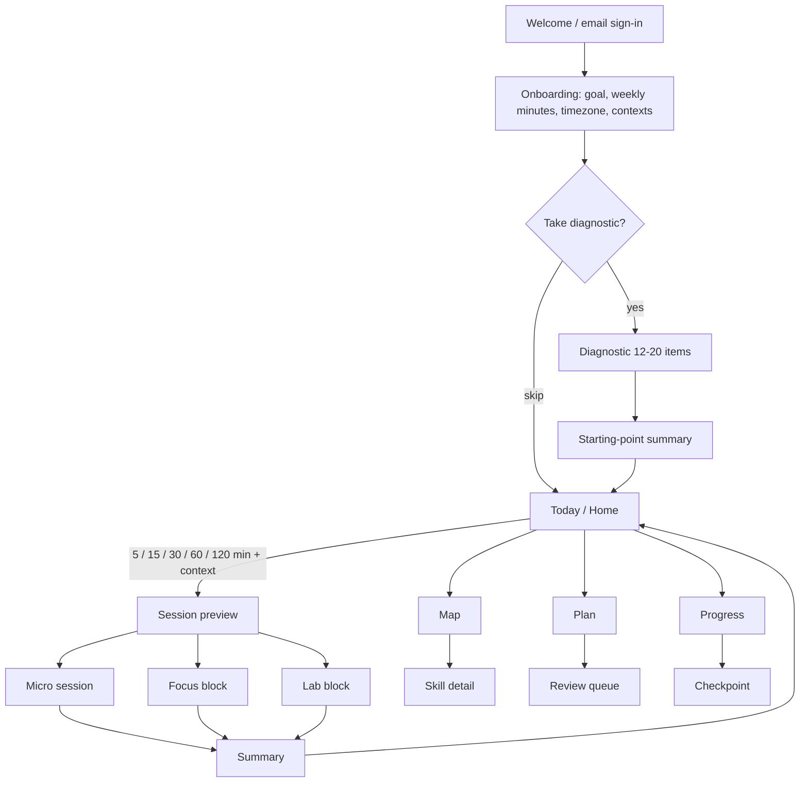

# 09 - UX and flows (mobile-first PWA)

Status: implementation-ready. Follows `00-contract.md`; scheduler behaviour is defined in `06-learner-model-and-scheduler-spec.md` (called "06" below). Entity and enum names are the contract's. Routes labelled `API:` use the real names of `schemas/api.openapi.yaml` (base path `/api/v1`); the first informal proposals survive only as history in `00c-route-rename-map.md`, and `python3 reference/check_package.py` fails on any route that is not in the OpenAPI file. Evidence tags as in the contract; UI copy must never present [P]/[inf]/[R] items as facts.

Stack: Next.js App Router, React, Tailwind, shadcn/ui, KaTeX, PWA with service worker, Web Push (contract section 3).

<!-- readability:start -->

> **At a glance**
>
> **Purpose:** screens, flows, accessibility, offline, notifications, design tokens and copy for the mobile-first PWA.
> **Read by:** the agent building UI tasks (BL-0027, 0058 to 0064, 0078, 0087, 0091, 0093, 0095 to 0099, 0126) and the founder reviewing screens.
>
> 1. The home question is "What fits my time now?": the learner picks minutes and context, the session builder does the rest (section 1).
> 2. Screens S01 to S20 (section 4) each give purpose, entry, data and acceptance criteria; wireframes W1 to W9 are in section 5.
> 3. Flow state machines for micro, focus, lab and checkpoint sessions are in section 6.
> 4. Accessibility is WCAG 2.2 AA for core flows (section 7); offline behaviour follows contract 7.10 (section 8).
> 5. Notifications: at most 2 pushes a day, quiet hours, no guilt wording (section 9).
> 6. Design tokens and the component inventory (section 10); the copy and tone guide obeys the claims policy (section 11).
> 7. Section 12 lists the real routes of `schemas/api.openapi.yaml`; the old informal names are only in `00c-route-rename-map.md`.
> 8. Section 13 holds the Playwright scenarios; section 14 lists unverified items.

**Contents**

- [1. Principles](#1-principles)
- [2. Information architecture](#2-information-architecture)
- [3. Global patterns](#3-global-patterns)
  - [3.1 Layout and interaction](#31-layout-and-interaction)
  - [3.2 State vocabulary used in every screen](#32-state-vocabulary-used-in-every-screen)
  - [3.3 Standard empty/error/loading copy](#33-standard-emptyerrorloading-copy)
- [4. Screens](#4-screens)
  - [S01 Welcome and sign-in (`/welcome`)](#s01-welcome-and-sign-in-welcome)
  - [S02 Onboarding (`/onboarding`)](#s02-onboarding-onboarding)
  - [S03 Diagnostic intro (`/diagnostic`)](#s03-diagnostic-intro-diagnostic)
  - [S04 Diagnostic item (`/diagnostic/(sessionId)`)](#s04-diagnostic-item-diagnosticsessionid)
  - [S05 Diagnostic result (`/diagnostic/(sessionId)/result`)](#s05-diagnostic-result-diagnosticsessionidresult)
  - [S06 Home / Today (`/`) - wireframe W1](#s06-home--today----wireframe-w1)
  - [S07 Session preview (sheet over S06)](#s07-session-preview-sheet-over-s06)
  - [S08 Micro session runner (`/session/(id)`, phone) - wireframes W2, W3](#s08-micro-session-runner-sessionid-phone---wireframes-w2-w3)
  - [S09 Micro session summary (`/session/(id)/summary`)](#s09-micro-session-summary-sessionidsummary)
  - [S10 Tutor sheet (phone) and tutor panel (desktop) - wireframe W5 shows the desktop panel](#s10-tutor-sheet-phone-and-tutor-panel-desktop---wireframe-w5-shows-the-desktop-panel)
  - [S11 Focus block runner (desktop, `/session/(id)`) - wireframe W4](#s11-focus-block-runner-desktop-sessionid---wireframe-w4)
  - [S12 Lab block runner (`/project/(key)`, `/project/(key)/step/(stepKey)`) - wireframe W6](#s12-lab-block-runner-projectkey-projectkeystepstepkey---wireframe-w6)
  - [S13 Evidence capture (sheet within S12)](#s13-evidence-capture-sheet-within-s12)
  - [S14 Skill map (`/map`) - wireframe W7](#s14-skill-map-map---wireframe-w7)
  - [S15 Progress and tier view (`/progress`) - wireframe W8](#s15-progress-and-tier-view-progress---wireframe-w8)
  - [S16 Weekly plan and calendar (`/plan`) - wireframe W9](#s16-weekly-plan-and-calendar-plan---wireframe-w9)
  - [S17 Review queue (`/review`)](#s17-review-queue-review)
  - [S18 Checkpoint flow (`/checkpoint/(id)`)](#s18-checkpoint-flow-checkpointid)
  - [S19 Settings (`/settings`)](#s19-settings-settings)
  - [S20 Offline and sync status (global)](#s20-offline-and-sync-status-global)
- [5. Wireframes (low fidelity)](#5-wireframes-low-fidelity)
  - [W1 Today (phone, 360 px)](#w1-today-phone-360-px)
  - [W2 Micro task: numeric answer (phone)](#w2-micro-task-numeric-answer-phone)
  - [W3 Micro feedback (phone)](#w3-micro-feedback-phone)
  - [W4 Focus workspace (desktop >= 1024 px)](#w4-focus-workspace-desktop--1024-px)
  - [W5 Tutor ladder states (detail of the right panel)](#w5-tutor-ladder-states-detail-of-the-right-panel)
  - [W6 Lab block (desktop or tablet at the bench)](#w6-lab-block-desktop-or-tablet-at-the-bench)
  - [W7 Skill map](#w7-skill-map)
  - [W8 Progress](#w8-progress)
  - [W9 Weekly plan](#w9-weekly-plan)
- [6. Flow specifications](#6-flow-specifications)
  - [6.1 Micro flow (state machine)](#61-micro-flow-state-machine)
  - [6.2 Focus flow](#62-focus-flow)
  - [6.3 Lab flow](#63-lab-flow)
  - [6.4 Checkpoint flow](#64-checkpoint-flow)
  - [6.5 Return after absence](#65-return-after-absence)
- [7. Accessibility requirements (WCAG 2.2 AA for core flows; contract section 10)](#7-accessibility-requirements-wcag-22-aa-for-core-flows-contract-section-10)
- [8. Offline behaviour (contract 7.10)](#8-offline-behaviour-contract-710)
- [9. Notification design (Web Push)](#9-notification-design-web-push)
- [10. Design tokens and components](#10-design-tokens-and-components)
  - [10.1 Token starter (Tailwind CSS variables; shadcn/ui theme)](#101-token-starter-tailwind-css-variables-shadcnui-theme)
  - [10.2 Component inventory (shadcn/ui based)](#102-component-inventory-shadcnui-based)
- [11. Copy and tone guide (obeys the claims policy)](#11-copy-and-tone-guide-obeys-the-claims-policy)
- [12. Data and API reference summary](#12-data-and-api-reference-summary)
- [13. End-to-end acceptance scenarios (Playwright)](#13-end-to-end-acceptance-scenarios-playwright)
- [14. Assumptions and unverified items](#14-assumptions-and-unverified-items)
- [Resolved by 00a (v1.1)](#resolved-by-00a-v11)

<!-- readability:end -->

---

## 1. Principles

1. **One question on the home screen: "What fits my time now?"** The learner picks minutes and context; the session builder (06 section 7) does the rest. No menu of courses to browse first.
2. **Active by default.** Every task requires the learner to produce something (type, tap, sketch, measure, upload). Reading-only content is a `worked_example` with a mandatory self-explanation prompt.
3. **Phone for micro, desktop for focus and lab,** bench context for hands-on work. Layouts adapt by breakpoint, not by separate apps. Simulation (when used) is a commute track; L1 still needs a bench or applied attempt (01 section 1.4, NG-10).
4. **Honest feedback and progress.** The first line on Progress is the next competence artifact (01 section 1.4, FR-090), then what was checked and how ("3 correct answers with at most a nudge, on 3 different days"). No badges that imply mastery of anything not evidenced. No streak-shaming.
5. **The tutor is a tool you open, never a pop-up.** Attempt-first and the hint ladder are visible in the UI, not hidden rules. Help is item-bound structured feedback (ladder plus a short post-attempt review on the open item). There is no persistent chat across items (01 section 1.4, FR-050).
6. **Works offline for micro.** The next 24 hours of due micro tasks are cached (contract 7.10).
7. **No emotion inference, no biometric data, no health claims** (contract section 8).

---

## 2. Information architecture

Primary navigation (bottom tab bar on phone, left rail on desktop >= 1024 px):

| Tab | Route | Contents |
|---|---|---|
| Today | `/` | Home: time + context chooser, today's plan slot, due count |
| Map | `/map` | Skill graph map, skill detail |
| Plan | `/plan` | Weekly plan, calendar, review queue (sub-tab) |
| Progress | `/progress` | Skills, tiers, checkpoints, evidence |
| Settings | `/settings` | Target minutes, notifications, contexts, data |

Non-tab routes: `/welcome`, `/onboarding`, `/diagnostic`, `/session/[id]` (full-screen, hides tabs), `/session/[id]/summary`, `/checkpoint/[id]`, `/project/[key]` (lab), `/project/[key]/step/[stepKey]`, `/review`, `/skill/[key]`, `/settings/data`.



Mapping of time choice to session type (default; the builder may return a shorter list):

| Minutes chosen | Session type | Notes |
|---|---|---|
| 5, 15 | `micro` | context `phone` or `desktop` |
| 30 | `micro` (capped at 20) + the remainder offered as an optional second `micro` | builder cap is 20 for micro; the 30 option shows "20 + 10" as two chained micro sessions (00a A1) |
| 60 | `focus` | desktop recommended; on phone a notice "Some tasks need a larger screen" and the phone filter applies |
| 120 | `focus` (up to 120) or `lab` (>= 120 with bench context) | |

Note (00a A1, ratified): there is no session type for 21-44 minutes. Any window in that range, including the 30-minute chip, yields one `micro` session of up to 20 minutes plus an optional second `micro` session, which is a separate `sessions` row built from the remaining minutes. The app never creates a 30-minute `focus` session.

---

## 3. Global patterns

### 3.1 Layout and interaction

- Mobile: single column, 16 px side gutter, primary actions in the bottom 40% of the screen (thumb zone), minimum touch target 48 x 48 px, 8 px minimum spacing between targets.
- Single-hand micro flow: answer input, "Check" and "Next" all reachable at the bottom; destructive or costly actions (reveal solution, end session) require a confirm sheet, never a swipe-only gesture.
- Desktop focus/lab: two- or three-pane layout (task and workspace, tutor panel, optional notes).
- Persistent top bar inside a session: elapsed/planned minutes (text, not only a ring), task n of N, "Pause", "End".
- Always-visible "Save and exit": progress persists per task (attempt rows are written on submit; a draft answer is stored in IndexedDB).

### 3.2 State vocabulary used in every screen

`loading` (skeleton shapes, no spinner longer than 400 ms without skeleton), `empty`, `error` (message + retry + what is safe), `offline` (banner "Offline: your answers are saved on this device"), `stale` (cached data shown with its age).

**Skill-state words (all screens).** `reviewing` is shown as "Reviewing". When the scheduler flag `needs_applied` is true (derived at read time: the skill is `reviewing` and the only unmet mastery condition is the applied attempt, G2) the state line reads **"Reviewing: needs one more applied problem"** and the skill detail drawer explains "You have the recall evidence. One worked problem, a debugging case or a checkpoint item completes it." The packer gives such a skill priority for an applied task, so the line is also the answer to "why is this skill not mastered yet?". A skill in the 14-day placement grace shows "Seems solid (to re-check)" and never a tier (G1). Never show a numeric mastery percentage.

### 3.3 Standard empty/error/loading copy

| State | Copy |
|---|---|
| Loading session | "Building your session..." with skeleton cards |
| No due reviews | "Nothing is due right now." |
| Nothing eligible for the chosen minutes | "That is everything useful for now. Come back later, or pick a longer session." |
| Network error | "Could not reach the server. Your answers are saved here and will upload when you are back online." |
| Server error building a session | "We could not build a session. Try again. If it keeps happening, use the saved offline set." |
| Grading delayed | "Still checking your answer..." (then "This is taking longer than usual; you can continue and we will show the result when it arrives.") |
| Item failed verification mid-session | "We could not use this question. Skipped, no effect on your progress." (the item is skipped; the attempt is not logged) |
| Unauthorized | "Please sign in again." (email code or link) |

---

## 4. Screens

Format per screen: Purpose, Entry, Elements, States, Data, Acceptance (AC). `T:` means `session_tasks`, `A:` `attempts`. IDs are for the backlog.

### S01 Welcome and sign-in (`/welcome`)

- **Purpose:** explain in one sentence what the app is and sign in with a six-digit code sent by email; the same email keeps a sign-in link.
- **Entry:** first visit; signed out.
- **Elements:** one-paragraph description (copy in section 11), email field, "Email me a code" button, then a six-digit code field (`inputmode="numeric"`, `autocomplete="one-time-code"`, paste accepted) with "Sign in" and "Send a new code", link to privacy summary and data export/delete.
- **States:** `idle`, `sending`, `sent` ("Check your email and enter the 6-digit code here. The email also has a sign-in link, which may open in your browser instead of this app."), `verifying`, `error` (invalid email; rate-limit), `code wrong or expired`, `link expired`.
- **Data:** Supabase Auth; creates `profiles` row (`id`, `timezone` from browser, `weekly_minutes_target` default 480).
- **AC:** (1) invalid email shows inline error without page reload; (2) after a valid code, or a link click, the user lands on `/onboarding` if `profiles.onboarded_at` is null, else `/`; (3) no third-party tracker loads (network test); (4) page passes axe with no critical violations; (5) the code path completes inside an installed iOS PWA (real iPhone, BL-0063).

### S02 Onboarding (`/onboarding`)

- **Purpose:** collect the minimum needed to plan: goal confirmation, weekly time, timezone, usual contexts, notification preference.
- **Entry:** first sign-in; "Redo onboarding" in settings.
- **Elements:** 4 steps with progress text "Step 2 of 4". (1) Goal: fixed in v1 - "Working knowledge in a slice of hardware and software engineering: algebra to a measured, working sensor board." with "What this means" expander (tier L1 definition, honest: "a guided project completed and debugged; this is a target, not a promise of timing"). (2) Weekly time: stepper default 8 h (480 min), range 1-20 h, shows the resulting default plan from 06 section 7.8 ("5 short sessions, 2 longer sessions, 1 lab block per week") using `weeklyPlanSlots`. (3) Timezone (prefilled, editable) and which days/times suit micro, focus, lab (defaults from 06). (4) Notifications: opt-in explanation and time pickers (section 9).
- **States:** `saving`, `error` (retry), steps validated before Next.
- **Data:** `profiles` (`timezone`, `weekly_minutes_target`), `weekly_plans`/`plan_slots` (created), notification settings.
- **AC:** (1) finishing creates a plan whose `planned_total_min <= weekly_minutes_target` (verified against the 06 vector `week-480` = 460); (2) the user can go back and change any step; (3) Skip is not offered for weekly minutes; (4) notification permission is requested only after the user taps "Turn on reminders", never on load.

### S03 Diagnostic intro (`/diagnostic`)

- **Purpose:** offer the placement diagnostic (06 section 5.5) with honest framing.
- **Elements:** what it is ("Up to 20 written-answer questions, in one or two sittings of about 25 minutes each (about 2.5 minutes a question); adjusts to your answers; no hints or tutor; 'I don't know' is fine; you can stop after the first sitting"), what it does ("sets a starting point; skills it infers you know are re-checked over the next days"), time estimate, "Start now", "Do it later", "Skip - start from the beginning".
- **States:** `resumable` (draft in progress shows "Continue").
- **Data:** a `sessions` row (stored with `session_type = focus`, see note) with `session_tasks.task_kind = diagnostic`.
- **Note (00a A2, ratified):** a diagnostic is a `sessions` row with `session_type = focus` whose tasks have `task_kind = diagnostic`; it is not a separate session type. G7: constructed-response items only (no multiple choice), about 2.5 minutes per item, at most **two sittings of 25 minutes each**. A sitting is one `focus` session of `diagnostic` tasks; the second sitting is a continuation session started from the learner's saved diagnostic state (05 section 11 and 06 section 5.5 own the algorithm; the learner may do the second sitting on another day, and placement is applied after each sitting with the evidence collected so far). Pausable within a sitting.
- **AC:** (1) Skip leads to Home with all skills `unseen` and a banner "Starting from the beginning. You can take the diagnostic later in Settings."; (2) Start creates a session with at most 10 `diagnostic` tasks (one 25-minute sitting at 2.5 minutes each); the result screen offers "Continue with a second sitting (up to 10 more)" or "Stop here"; (3) the screen contains no claim about measuring intelligence or "true level".

### S04 Diagnostic item (`/diagnostic/[sessionId]`)

- **Purpose:** serve one constructed-response item at a time.
- **Elements:** question (KaTeX), answer control per card type (S09 card types, never MC), "I don't know" secondary button, progress "Question 7 of up to 20 (sitting 1 of 2)", "Pause", "Finish this sitting" (shown after item 8; the learner can stop at any time and the result is computed from what was answered). No hint, no tutor, no confidence rating (kept minimal).
- **States:** `answering`, `submitting`, `graded` (no correctness shown mid-diagnostic; "Saved" only), `offline` (continues from cache only if items pre-cached; otherwise pauses with message).
- **Data:** `A:attempts` (`unaided = true`), `T`, diagnostic selection 06 section 5.5.
- **AC:** (1) no correctness feedback until the result screen; (2) pressing "I don't know" writes an attempt with `score = 0` and a flag `dont_know`; (3) back navigation cannot resubmit a graded item; (4) minimum touch target 48 px for all controls.

### S05 Diagnostic result (`/diagnostic/[sessionId]/result`)

- **Purpose:** show the starting point plainly.
- **Elements:** "Starting point estimate" heading; counts per node: "Seems solid (to re-check): 9 skills", "Ready to learn next: 4", "Later: 28"; list of skills to re-check with "These will come back as short questions over the next few days"; "Start learning" button.
- **States:** `computing` (<= 2 s skeleton), `error`.
- **Data:** `skill_state` (`mastery_state`, `source = placement`, `diag_credit`), frontier from 06 section 6 (placement cards in `reviewing` get a 14-day grace, 00a B6).
- **AC:** (1) no skill is displayed as "mastered" or with a tier badge after a diagnostic; (2) the numbers equal `count(skill_state)` by category; (3) copy includes "This is an estimate; your next sessions will correct it"; (4) after sitting 1 the screen offers the second sitting without blocking "Start learning"; (5) skills credited by placement are shown as "Seems solid (to re-check)", never as a tier; the grace that lets them open dependent skills for 14 days (G1) is explained in one plain line ("Skills you showed you know can unlock the next ones for now; they come back as short checks").

### S06 Home / Today (`/`) - wireframe W1

- **Purpose:** answer "what fits my time now?" in two taps.
- **Entry:** app open; tab Today; notification tap.
- **Elements (top to bottom):** (a) greeting-free header with date; (b) **time chips** 5 / 15 / 30 / 60 / 120 min (single select, default = the minutes of the next plan slot, else 15), plus a text button **"Just my reviews (5 min)"** (see below); (c) **context selector** segmented control: Phone / Desktop / Bench (default from device: phone-width viewport -> Phone, otherwise Desktop; remembers last choice); (d) primary button "Build my session" (shows estimate "about 14 min, 9 tasks" after build preview); (e) card "Due today: N reviews (about M min)"; (f) card "Next on your plan": slot day/time/type/minutes with "Start this" (planned slot; a lab slot with no eligible project step reads "Practice block" and starts a `focus` session, G4, see 6.3); (g) small line "This week: 210 of 480 min" (text + bar); (h) if a checkpoint is due: card "Unaided check due (up to 25 min)" with "Why?" link; (i) offline/sync banner when relevant.
- **States:** `loading` (skeleton cards), `no-tasks` (copy from 3.3), `backlog` (banner: "Catching up on reviews first: N skills due"), `return` after >= 14 days (banner "Welcome back. We will start with a short refresher, about 12 questions."), `offline` (only cached micro available; 15/30/60/120 hidden if cache empty), `error`.
- **Reviews-only micro option (00f F-16).** The button "Just my reviews (5 min)" builds a 5-minute `micro` session of due reviews only (no new skill, no problem), the smallest unit a tired or busy day can meet; it never pulls an overdue checkpoint forward and shows "No reviews due. Nothing to do now." when none are due. It uses the ordinary build call; until the API has an explicit reviews-only option (request in 00b section 9) the client builds with `available_minutes = 5` and the preview keeps only tasks whose reason is `due_review` or `verify_inferred`.
- **Data:** `API: POST /api/v1/sessions/build {available_minutes, context, dry_run}` -> builder output (`06 buildSession`; the preview call sends `dry_run: true`, which writes no `sessions` row and reserves no item (G16); Start calls it again with `dry_run` false, which persists a `planned` session, auto-abandoned after 2 hours); `plan_slots`, `skill_state` (due counts), `checkpoints`, `sessions` (this week's actual minutes).
- **AC:** (1) selecting a time chip and a context calls the preview within 300 ms of the last tap (debounced) and shows the estimated minutes <= chosen minutes; (2) selecting Phone never previews a task whose kind is outside the phone-suitable list (06 section 7.3); (3) selecting Bench shows the lab path only and states "Bench: step-by-step project work"; (4) "Build my session" -> `/session/[id]` in <= 1 s on a warm PWA (contract 10) for micro; (5) the whole screen is operable with keyboard and screen reader (chips are a radio group with labels "5 minutes", etc.); (6) Today shows no streak counter.

### S07 Session preview (sheet over S06)

- **Purpose:** let the learner see and trim the list before starting.
- **Elements:** estimated total vs chosen minutes (text "About 13 min of your 20"), grouped list: "Reviews (3)", "Continue: Series and parallel resistors", "New: Voltage divider", with reason chips from the builder (`due_review`, `new_frontier`, `same_day_retrieval`, `checkpoint_overdue`, `verify_inferred`, `applied_gap`), per-task time. Actions: "Start", "Remove task" (swipe-free: via menu; removing a due review shows "It will stay due"), "Make it shorter/longer" (re-preview).
- **States:** `loading`, `error`.
- **Data:** builder output; `session_tasks` created on Start.
- **AC:** (1) Start writes one `sessions` row (`planned_min` = chosen minutes, `context`, `session_type`) and N `session_tasks` with positions 1..N matching the previewed order; (2) removed tasks create no `session_tasks`; (3) the reason chip is plain language ("Due for review"; for `applied_gap` "One more applied problem to finish this skill"), never an internal code; (4) the preview comes from `dry_run: true` and leaves no `sessions` row when the sheet is dismissed.

### S08 Micro session runner (`/session/[id]`, phone) - wireframes W2, W3

- **Purpose:** run tasks one at a time with immediate, honest feedback.
- **Flow per task:** *present -> answer -> (optional) confidence -> Check -> feedback -> Next*. For `worked_example`: *(concept primer, card 9, on the skill's first example or its recap when relearning) -> read steps one at a time, each with "What is this step doing?" when the steps are labelled -> optional one-sentence explanation -> Next* (00a K1, K4, K8).
- **Card types (all must support keyboard, screen reader, and light/dark):**
  1. **Numeric answer** (`exact_numeric`, `measurement_check`): numeric keypad with unit selector (pint-compatible units) and "x10^" helper; shows accepted format hint.
  2. **Multiple choice** (`multiple_choice`): radio list, large rows; used sparingly (06 limits).
  3. **Symbolic/expression** (`symbolic_equivalence`): math keyboard (digits, operators, fractions, powers, common functions); live KaTeX preview of the typed expression; text alternative provided.
  4. **Short text** (`rubric_llm`, `explain_back`): textarea 2-4 lines, character counter, "no AI-written answers needed; your own words".
  5. **Perceptual drill** (`perceptual_drill`): image/schematic with tappable regions or a quick choice list; time-boxed display optional off by default.
  6. **Worked example stepper**: the problem statement, then `rendered.worked_steps` revealed one at a time, each headed by its `label` when present. With labels, each step asks "What is this step doing?" with the item's step labels as tap choices; the right label is shown at once whatever the learner picks, and the next step unlocks (no penalty, never graded). After the last step: `rendered.explanation_md`, an optional one-sentence "Why does this work?" field, then Next, which calls `completeTask` with `outcome = done` and the choices and text in `self_explanation` (00a K2, K4).
  7. **Faded problem**: the problem statement, the shown `worked_steps` (labelled as in card 6, read-only), a line "Step n of `steps_total`: your turn" for the first hidden step, then the item's normal answer control. Fade positions follow 00a K3; grading is unchanged.
  8. **Code snippet read/predict (phone)**: read-only code with an output prediction field (editing code is desktop only).
  9. **Concept primer** (inside a `worked_example` task, 00a K6 to K8): up to three swipeable screens (title, short text, optional figure rendered from SVG as an image with its alt text), then a "Common mix-up" screen (wrong idea, why it is tempting, the correct idea), then one or two quick checks with feedback on every option, then "Now see it worked out" into card 6. "Skip to the example" is on every screen. Checks show "Quick check, not scored". The `recap` variant is one screen: the recap and the correct idea. No confidence selector, no timer pressure.
- **Elements common:** top bar (minutes used / planned, task n of N, Pause), question area, answer control, **confidence selector** (5 buttons labelled 1 "Guessing" ... 5 "Certain", shown after the answer is entered and before Check; "Skip" is allowed and shown as text button; not shown for `worked_example`), primary "Check" button bottom, "I'm stuck" secondary button.
- **Feedback states:**
  - *Correct*: "Correct." + one-line why + `Next`. Never confetti or point awards.
  - *Partly correct* (score 0.5-0.79): "Partly right: <what was missing>" + show your answer next to the reference; `Next`.
  - *Incorrect*: "Not quite." + the reference answer and a short explanation + "Try a similar one later" is automatic (the skill is rescheduled); `Next`. When the grade's `misconception_tags` matches the skill's lesson misconception, add "Common mix-up:" with the lesson's correct idea and a "Review the idea" link that opens the recap (00a K8). If `high_confidence_error` (06 section 3.4): a neutral note "You were sure about this one. Worth a closer look." with a link to the explanation (no scolding).
  - *Grading pending* and *grading failed* (see 3.3).
  - *Revealed* (after hint level 4): "Solution shown. This attempt does not count toward mastery." (information, not punishment).
- **"I'm stuck":** opens the tutor sheet (S11). Available only after an attempt or a statement of what was tried (attempt-first, contract 7.9).
- **States:** `loading item`, `answering`, `checking`, `feedback`, `paused`, `offline` (numeric/MC graded locally for cached items, provisional until re-verified server-side on sync; counts toward mastery only after that verification), `item-error`.
- **Data:** `A:attempts` (all contract columns: `started_at`, `submitted_at`, `response`, `grade`, `hints_used`, `max_hint_level`, `latency_ms`, `confidence`, `unaided`), `items.rendered`, `T:status`; `API: POST /api/attempts`; rating and scheduling are computed server-side by 06 after submit (never in the UI).
- **AC:** (1) `latency_ms` excludes paused time and idle gaps over 45 s; (2) "Check" is disabled until an answer is entered; (3) confidence is recorded as `attempts.confidence` 1-5 or null and is requested **before** feedback is shown; (4) after feedback appears the answer can no longer be edited; (5) the whole task (present to feedback) is operable with one thumb on a 360 x 640 px viewport with no horizontal scroll; (6) pressing the browser back button during a session shows "Pause session?" and does not lose the current answer; (7) every math expression has an accessible text alternative (`aria-label` from the item's `rendered.alt_text`); (8) a micro session never shows a card whose kind is outside the phone-suitable list when context is Phone; (9) an unsynced offline attempt shows a small "Saved on this device" marker until synced; (10) a worked example shows every step of the item one at a time, and a faded problem never shows its final step (00a K2, K3); (11) the concept primer is reachable and skippable by keyboard alone, its figure has alt text, and its checks write no attempt (LS-099); (12) the primer plus the stepper fit a 360 x 640 px viewport without horizontal scroll.

### S09 Micro session summary (`/session/[id]/summary`)

- **Purpose:** close the loop honestly in under 10 seconds of reading.
- **Elements:** minutes used vs planned; counts "9 questions, 7 correct with at most a nudge"; "Skills practised" list with state words (learning/reviewing/mastered/refresher needed; a `needs_applied` skill reads "reviewing: needs one more applied problem"); "Needs another look" list (rating 1/2) with note "These come back soon"; "Next due: tomorrow (3 skills)"; buttons "Done" and "Another short session".
- **States:** `loading`, `error`.
- **Data:** `sessions` (`actual_min`, `ended_at`), `attempts`, `skill_state`, `review_log`.
- **AC:** (1) numbers equal sums of the session's `attempts`; (2) no streak, XP or badge elements; (3) "Another short session" re-runs the builder with the same context.

### S10 Tutor sheet (phone) and tutor panel (desktop) - wireframe W5 shows the desktop panel

- **Purpose:** guarded help with an explicit **hint ladder** (contract 7.9).
- **Elements:** (a) **Ladder** with 4 rungs as a vertical stepper: 1 "Nudge" (a small pointer, no content), 2 "Concept hint", 3 "Show the next step", 4 "Reveal solution". Rungs 2-4 are disabled (with reason text "Try rung 1 first") until the previous rung was used or the learner typed what they tried; rung 4 needs a confirm sheet: "Revealing the solution ends credit for this attempt. Continue?" (b) **item-bound** message thread (learner and tutor) that exists only for the open item and is discarded from the UI when the item is left; there is no global chat inbox. Input placeholder "What have you tried so far?" After a graded attempt, a short **post-attempt review** (up to three bullets against the template rubric) is shown before any free-text follow-up. (c) attempt gate: before any tutor reply the learner must have (i) submitted an attempt, or (ii) typed at least 15 characters describing what they tried; otherwise the input shows "Write what you tried first - even a guess." (d) badge per tutor message showing its hint level (for example "Concept hint"); (e) "Close and try again" button returns to the same item with the same seed; (f) a persistent line "The tutor can be wrong; the checked answer is the reference."
- **States:** `gated` (attempt not yet made), `idle`, `streaming`, `error` ("The tutor is unavailable. You can still check your answer."), `rate-limited`, `refused` (policy: shows "I will not give the full answer yet. Try rung N first." style message), `post-attempt-only` (see below).
- **Over-reliance behaviour (G6, 00f F-15).** When strict-unaided checkpoint accuracy trails aided accuracy by more than 0.15 over the last two checkpoints (at least 10 attempts; thresholds [P]), the tutor switches to **post-attempt-only for the affected node**: the typed-explanation route of the attempt gate is closed, so the tutor answers only after a submitted attempt, and rungs 2-4 stay locked until then. The sheet shows one neutral line, "For this topic the tutor now answers after you submit an attempt, because your unaided checks are lower than your practice. This is reviewed again after your next checkpoint." (no scolding, no countdown). The mode lifts when the gap falls to 0.15 or less at a later checkpoint. Switching writes a `tutor_mode_changed` event (11 section 9.1) and the Progress screen (S15) states which node is affected and why. The older rule (a cap of hint level 1 for two weeks, 00f F-15) is not used; G6 supersedes it.
- **Data:** `tutor_threads` (`item_id`, `skill_key`), `tutor_messages` (`role`, `content`, `hint_level`, `policy_flags`), `A:attempts.max_hint_level`, `hints_used`; `API: POST /api/tutor/messages`.
- **AC:** (1) with no attempt and no typed 15+ characters, the send button is disabled; (2) each tutor message is stored with its `hint_level`; (3) using rung 4 sets `attempts.max_hint_level = 4`, shows the "does not count" banner and marks the attempt `unaided = false`; (4) rungs cannot be skipped upward (UI enforces; the server re-checks via `policy_flags`); (5) a checkpoint session shows no tutor button at all; (6) the tutor sheet is reachable by keyboard and focus returns to the "I'm stuck" button on close; (7) with the over-reliance mode on for a node, a tutor message request before any submitted attempt is refused with the line above, and typing 15 characters does not open the gate; (8) leaving the item closes the thread in the UI; there is no route that opens the tutor with no `item_id` (01 FR-050).

### S11 Focus block runner (desktop, `/session/[id]`) - wireframe W4

- **Purpose:** 45-120 minutes of problem work with a proper workspace.
- **Layout (>= 1024 px):** three columns: left 20% task list (n of N, time per task, status), center 50% **problem workspace**, right 30% **tutor panel** (collapsible, default collapsed until an attempt exists). Top bar as in 3.1 with break reminder text after 50 min of active time ("You have been working for 50 minutes. Stretch or continue; this is your call.", dismissible, adjustable in settings).
- **Problem workspace:** problem statement (KaTeX), then tabs: **Scratchpad** (free text + sketch canvas; kept with the attempt as `response.scratch`, never graded), **Answer** (numeric/units, math input with live preview, or short text), **Code** (Monaco-based editor with language set by the item, "Run tests" button showing sandbox results with a 20 s timeout message, read-only test names visible, hidden tests marked), **Circuit** (for `spice_compare`: netlist editor with "Simulate" and a result plot; schematic image upload for `drc_erc` items arrives with the lab flow). Only the tabs the item needs appear.
- **Task-kind variants:** `worked_example` (stepper with self-explanation), `faded_problem`, `problem`, `debug_case` (given failing code/netlist and the symptom; learner fixes and explains the cause in one sentence), `explain_back` (own-words explanation, then a short rubric-graded check; rubric grading is never the sole grader for numeric/code correctness, contract 7.8), interleaved sets (with the **strategy prompt** "Which method applies here, and why?" as a required short selection before the solve field unlocks).
- **Confidence** selector as S08; **feedback** states as S08 plus test-by-test results for code.
- **States:** as S08 plus `running tests`, `sandbox timeout`, `unsaved changes` (autosave every 10 s to IndexedDB and `attempts.response` draft).
- **Data:** as S08 plus `jobs` for grader runs (`API: POST /api/attempts`, then Realtime/poll for grade); `tutor_*`.
- **AC:** (1) autosave survives a tab crash (reload restores scratchpad and answer within 10 s of loss); (2) Run tests returns results or a timeout message within 20 s p95 (contract 10); (3) no tutor message before attempt/typed-intent gate (S10); (4) the break reminder never blocks input; (5) keyboard-only: tab order is task list, workspace, tutor; all actions have visible focus; (6) at widths < 1024 the tutor becomes a bottom sheet and the task list a drawer.

### S12 Lab block runner (`/project/[key]`, `/project/[key]/step/[stepKey]`) - wireframe W6

- **Purpose:** guide a physical build step by step and capture evidence.
- **Entry:** Today -> Lab slot; Plan; Progress -> Project.
- **Elements:** **Step checklist** (ordered `project_steps`, each with title, `est_min`, status chip: not started / in progress / evidence needed / submitted / accepted / rejected), current step detail: instructions, parts needed from `projects.bom` with check-offs ("I have this"), safety notes (plain text, step-specific; no medical claims), **bench-state notes** (free text box "What is on the bench right now?" - saved automatically with timestamp so you can resume after a break; also a "Pause lab block" that stores the notes), **expected vs measured** inputs for `measurement_check` steps (expected value computed by the app from the item/params, measured value typed by the learner with unit), **evidence capture** panel (see S13), and "Mark step done" enabled only when `evidence_required` for the step is satisfied (all required evidence at `submitted` or better).
- **Context handling:** `bench` context shows a minimal high-contrast layout, large text (min 18 px), no tutor by default (button available; attempt-first still applies to debugging questions), and "Done at bench" saving.
- **States:** `loading`, `step locked` (earlier step incomplete; text names it), `evidence pending verification`, `offline` (checklist and notes usable; uploads queued), `error`.
- **Data:** `projects`, `project_steps`, `user_projects`, `project_evidence`; `API: POST /api/v1/user-projects/{user_project_id}/evidence/upload-url` then `POST /api/v1/user-projects/{user_project_id}/evidence`; "Mark step done": `POST /api/v1/user-projects/{user_project_id}/steps/{step_key}/complete`; pause, resume and abandon: `PATCH /api/v1/user-projects/{user_project_id}`.
- **AC:** (1) steps unlock strictly in `position` order; (2) the bench note is saved within 2 s of the last keystroke and survives reload; (3) "Mark step done" is disabled with the reason shown while required evidence is missing; (4) entering a measured value outside the expected tolerance does not block progress but shows "Measured value differs from expected. Check connections, then note what you found." and logs the attempt as incorrect; (5) every checklist item is reachable and operable by keyboard.

### S13 Evidence capture (sheet within S12)

- **Purpose:** capture photo/video/log/scope/measurement evidence and show the verification **nonce**.
- **Elements:** evidence type picker (`photo`, `video`, `log`, `scope_capture`, `measurement`, `repo`, `note`) limited to the kinds the step requires; **nonce display**: a short code in the format `PM-XXXX-XXXX` (base32 without ambiguous letters; format from 03 and 10; default validity 24 h, 72 h for lab steps) generated per step attempt and shown large, with the instruction "Write this code on a piece of paper and include it in the photo or video, or type it into the log. It shows the evidence was made for this step now." Camera capture (`<input type="file" accept="image/*" capture>` and a getUserMedia path where available) and upload; preview with retake; optional caption; for `repo`, a URL field and commit hash; for `log`, paste/upload text; for `scope_capture`, upload with a field for time/div and volts/div.
- **After submit:** status chip `submitted` -> `auto_verified` / `needs_review` / `accepted` / `rejected` (contract `evidence_status`); rejected evidence shows the reason and "Retake".
- **States:** `camera permission denied` (fallback to upload with explanation), `uploading` (progress, resumable), `offline` (queued, "Will upload when online"), `too large` (limit stated; images are downscaled client-side to 2048 px long edge before upload), `nonce expired` (nonce valid 24 h; "Get a new code").
- **Data:** `project_evidence` (`evidence_kind`, `storage_path`, `verification` jsonb including `nonce`, `evidence_status`), Supabase Storage with RLS (private bucket); delete: `DELETE /api/v1/evidence/{evidence_id}`.
- **AC:** (1) the nonce is visible on screen at capture time and stored in `verification.nonce`; (2) an upload failure never loses the captured media (kept in IndexedDB until confirmed); (3) the learner can delete their evidence (privacy); (4) no EXIF GPS is uploaded (stripped client-side); (5) the sheet is usable with VoiceOver/TalkBack (buttons labelled, status announced via `aria-live`).

### S14 Skill map (`/map`) - wireframe W7

- **Purpose:** show where the learner is in the graph and what is next.
- **Elements:** graph view with nodes grouped by node code (math, elec, sw...) in lanes; node shape + label + icon encode state (not colour alone): `unseen` hollow, `learning` half-filled, `reviewing` filled outline, `mastered` solid, `decayed` dashed; "available now" marker (outer fringe) as a small ring; hard edges solid, soft edges dotted; filter chips (node, state, "available now", "due"); list view toggle (accessible alternative to the canvas, sorted by state then key); search by skill title; tap a node -> **skill detail** drawer: title, description, state in words, evidence line ("2 of 3 needed correct answers, on 2 days"), tier attained, next due date, prerequisite list with their states, "Practise this" (adds to a session if available), "Why is this locked?" listing unmet hard prerequisites and `min_tier` requirements; for a `reviewing` skill that is not yet mastered, a line names the unmet mastery condition in words (for example "needs one more applied problem" when `needs_applied`).
- **States:** `loading`, `empty` (no graph content yet), `offline` (cached map), `error`, `large graph` (clustering above 150 nodes; MVP is ~40-60 skills).
- **Data:** `skills`, `skill_edges`, `skill_state` (`mastery_state`, `tier_attained`, `due`), frontier computed by 06 section 6; `API: GET /api/v1/graph` and `GET /api/v1/frontier`.
- **AC:** (1) every node's state is conveyed by shape and text, passing a greyscale screenshot test; (2) the list view contains the same skills and states as the graph (test compares sets); (3) "Why is this locked?" text matches the unmet-edge set from `computeAvailable` for 5 sample skills; (4) pinch/zoom and pan work on touch, and keyboard arrows move focus between connected nodes; (5) no node shows a percentage "mastery" figure.

### S15 Progress and tier view (`/progress`) - wireframe W8

- **Purpose:** honest evidence of what has been shown, not a score. The first thing on the page is the next competence artifact (01 section 1.4).
- **Elements:** (a) **Next artifact**: one heading such as "Next: blink LED, evidence not yet logged" or "elec working level: 14 of 17 skills; capstone evidence 1 of 3 accepted", with remaining skills and evidence in plain words (contract 7.13); (b) **Skills by state** stacked count (text table with numbers) for the MVP scope; (c) **Working-level (L1) status per node**: same counts as (a) with a "How this is checked" expander quoting the mastery rule in plain words (06 section 4.2) and the tier rule; (d) **Unaided checks**: last 5 checkpoint results with accuracy and date, and a plain comparison line "Practice answers with help: 82% correct. Unaided checks: 68% correct." when >= 3 checkpoints exist (the over-reliance gap, 06 section 9), with neutral wording; when the over-reliance mode (G6) is on for a node, one line names the node and says what changed ("The tutor answers after an attempt for <node> until your next unaided check"); (e) **Time**: minutes this week vs target, last 8 weeks bars (minutes only); (f) **Projects**: ladder L0-L4 with step status; (g) "Needs refresher" list (decayed skills).
- **Honest-copy constraints:** no overall "level", no percentage-to-expert, no comparison with other people, no "top x%". Tier labels are shown as the contract tier names with the research-report definitions in plain words: L0 "Literacy: can read a datasheet and ask good questions", L1 "Working: can complete a guided project and debug it" - labelled "target definitions". Where there is no checkpoint yet: "No unaided check yet."
- **States:** `loading`, `empty` ("Nothing to show yet. After your first sessions this page fills in."), `insufficient data` for gap line (hidden under 3 checkpoints), `error`.
- **Data:** `skill_state`, `attempts`, `sessions`, `project_evidence`, `checkpoints`.
- **AC:** (1) all numbers are derived from `skill_state`/`attempts`/`project_evidence` with a test that recomputes them; (2) the gap line appears only with >= 3 completed checkpoints; (3) none of the banned phrases from the contract policy appears (lint test over the string table, section 11); (4) every chart has an adjacent data table or text equivalent; (5) the first heading names the next competence artifact and remaining work (01 FR-090).

### S16 Weekly plan and calendar (`/plan`) - wireframe W9

- **Purpose:** show the week's slots, let the learner move them, and show the rebalance honestly.
- **Elements:** week view (Mon-Sun): each slot card with type (Short / Focus / Lab), minutes, context icon + word, status (planned, done, missed, moved); header "Planned 460 of your 480 min"; "Add a short session" (up to 7 per week); drag-free move via "Move..." menu (day picker); "Skip this week" and "Pause plan until..." ; a **forecast** line "Likely this week: about 14 reviews due, 2 new skills (estimate)"; if rebalanced, a plain note: "Your Tuesday focus block moved to Sunday." / "Missed short sessions are not made up; reviews just stay due." ; calendar export (`.ics` download of slots, no external API).
- **Lab slot with nothing to build (G4).** A planned `lab` slot keeps its type in `plan_slots`; when no project step is eligible (no unlocked step, parts or safety brief missing) it is shown as "Practice block" and started as a `focus` session of practice tasks (cap 120 minutes) so the longest block of the week is not idle. When a step becomes eligible the same slot starts the lab runner. The learner can always choose "Do project work later" without losing the slot.
- **Rules shown/used:** 06 section 7.8-7.9.
- **States:** `loading`, `empty` (no plan: "Set your weekly time" -> onboarding step), `week in past` (read-only), `conflict` (two heavy slots adjacent: inline warning, not blocking), `error`.
- **Data:** `weekly_plans`, `plan_slots`, `sessions`, `profiles.weekly_minutes_target`.
- **AC:** (1) planned minutes shown equal the sum of non-missed slots; (2) moving a focus block next to another focus block shows the warning but allows it; (3) missed slots are labelled "missed" without red alarm styling or exclamation marks; (4) tapping a planned slot starts that session type with its planned minutes preselected on Today.

### S17 Review queue (`/review`)

- **Purpose:** transparency and control over what is due.
- **Elements:** counts "Due today 6, overdue 3, upcoming 7 days 21"; list of due skills ordered by lowest retrievability, each with skill title, last practised date, state, "why now" (text such as "Last practised 12 days ago"); no retrievability percentages shown to the learner (they are model estimates); actions per row "Practise now" (builds a 5-minute session on that skill), "Not now" (no effect on schedule; explained); "Practise all due" button (builds a session with the review share rules from 06). Backlog note when the backlog flag is on (06 section 7.5).
- **States:** `empty` ("Nothing is due right now."), `loading`, `error`, `offline` (cached).
- **Data:** `skill_state.due`, `review_log`, `skills`.
- **AC:** (1) rows equal skills with `due <= end of today (local)` plus a separate section for the future 7 days; (2) "Practise now" yields a session whose first task is a `retrieval` or interleaved set for that skill; (3) no number named "retention" or "memory strength" is exposed.

### S18 Checkpoint flow (`/checkpoint/[id]`)

- **Purpose:** an unaided set (contract 7.7) framed as a check on what you can do without help.
- **Intro screen:** "Unaided check. No hints and no tutor, so the result shows what you can do on your own. About N questions, up to 25 minutes. Results help decide what to review; they are not a grade." Buttons "Start" and "Not now" (postponing keeps it due; after 14 days it is reserved first in sessions, 06 section 8). Scope line: "This module: <module title>" or "Mixed from skills you have practised".
- **Runner:** same runner as S08/S11 with **no** "I'm stuck", **no** tutor, **no** hints, confidence selector kept, progress "Question 3 of 9", a visible "Unaided" tag, pause allowed (timer pauses; idle > 15 min ends the checkpoint with remaining items unanswered = not graded and re-scheduled).
- **Results:** per-skill outcome (correct / partly / not yet), a one-sentence statement "You answered 6 of 9 without help." and "What happens next: 3 skills will come back sooner", gap vs practice line if available (S15 rule), "Back to Today".
- **States:** `loading`, `in progress`, `paused`, `abandoned`, `error`, `offline` (cached checkpoints only if pre-cached; otherwise "Needs a connection").
- **Data:** `sessions`/`session_tasks` with `task_kind = checkpoint`, `attempts` (`unaided = true`), `checkpoints`, `events` (`checkpoint_completed`).
- **AC:** (1) the DOM contains no tutor or hint controls during a checkpoint (test by selector); (2) any hint call to the API during a checkpoint is rejected server-side; (3) the results screen states counts that equal the stored attempts; (4) the word "exam", "grade" or "score out of 100" does not appear.

### S19 Settings (`/settings`)

- **Elements:** **Time**: weekly target minutes (stepper), preferred days/times per session type, default context per weekday; **Notifications** (section 9): master toggle, reminder time for micro, focus/lab reminder, quiet hours, max per day, "Send a test"; **Learning**: target retention (advanced, hidden under "Advanced": 0.80-0.95, default 0.90, with the plain note "Higher means more reviews"), break reminder minutes, show confidence prompt on/off; **Display**: theme (system/light/dark), text size, reduced motion; **Account**: email, sign out; **Data**: export all my data (JSON zip), delete my account and data (type-to-confirm), diagnostic redo; **About**: version, parameters version, licence notices for content and libraries.
- **States:** `saving` (inline "Saved"), `error`, `push not supported` (text explains how to install the PWA on iOS first), `push denied` (how to re-enable).
- **Data:** `profiles` (`reminder_prefs` jsonb holds the reminder times, quiet hours and daily limits; a separate `notification_prefs` table was rejected, 00a section C), `push_subscriptions`, `experiment_assignments` (read-only list under About -> "Experiments you are part of", transparency).
- **AC:** (1) changing weekly target regenerates the plan after a confirm ("Replace this week's plan?"); (2) export completes and downloads a file with all user-owned rows; (3) delete requires typing "delete" and signs the user out; (4) all settings are keyboard accessible.

### S20 Offline and sync status (global)

- See section 8. Surfaces: top banner, per-attempt marker, Settings -> "Offline data".

---

## 5. Wireframes (low fidelity)

### W1 Today (phone, 360 px)

```
+--------------------------------------+
| Sat 31 Oct              [sync: ok]   |
|                                      |
| What fits your time now?             |
| ( 5 ) (15) ( 30 ) ( 60 ) ( 120 )     |  <- radio chips, 48px
|                                      |
| Where are you?                       |
| [ Phone ][ Desktop ][ Bench ]        |
|                                      |
| +----------------------------------+ |
| | About 13 min, 7 tasks            | |
| | 3 reviews - 1 continue - 1 new   | |
| |       [  Build my session  ]     | |
| +----------------------------------+ |
|                                      |
| Due today: 6 reviews (about 9 min)   |
| Next on plan: Tue 19:00 Focus 90 min |
| This week: 210 / 480 min  [=====   ] |
| Unaided check due (up to 25 min) Why?|
+--------------------------------------+
| Today | Map  | Plan | Progress | Set |
+--------------------------------------+
```

### W2 Micro task: numeric answer (phone)

```
+--------------------------------------+
| 6 / 20 min      Task 3 of 7   [Pause]|
|--------------------------------------|
| Voltage divider                      |
| R1 = 4.7 kΩ, R2 = 10 kΩ, Vin = 5 V.  |
| What is Vout across R2?              |
|                                      |
|  Answer  [ 1.6 ______ ] [ V  v ]     |
|                                      |
|  How sure are you?                   |
|  (1)  (2)  (3)  (4)  (5)   Skip      |
|  Guessing           Certain          |
|                                      |
|  [ I'm stuck ]      [   Check   ]    |
|  +-------------numeric keypad------+ |
|  | 7 8 9  |  4 5 6 | 1 2 3 | . 0 ⌫  |
+--------------------------------------+
```

### W3 Micro feedback (phone)

```
+--------------------------------------+
| 7 / 20 min      Task 3 of 7   [Pause]|
|--------------------------------------|
|  Not quite.                          |
|  Your answer: 1.6 V                  |
|  Reference:   3.40 V                 |
|  Why: Vout = Vin x R2/(R1+R2)        |
|  You were sure about this one.       |
|  Worth a closer look.  [Explanation] |
|                                      |
|  This skill will come back soon.     |
|                                      |
|            [   Next   ]              |
+--------------------------------------+
```

(W2 and W3 show the same task: 5 V x 10 kΩ / (4.7 kΩ + 10 kΩ) = 3.40 V; the learner typed 1.6 V.)

### W4 Focus workspace (desktop >= 1024 px)

```
+-----------------------------------------------------------------------------+
| Focus 90 min | 34 / 90 min used | Task 4 of 9 | [Pause] [End]               |
+-----------+---------------------------------------------+-------------------+
| Tasks     |  Problem: RC low-pass, fc target 1 kHz      | Tutor     [hide]  |
| 1 v done  |  Choose R and C. Predict vout at 5 kHz.     | Ladder            |
| 2 v done  |  [Scratchpad][Answer][Circuit]              | 1 Nudge      [ ]  |
| 3 v done  |  +---------------------------------------+  | 2 Concept    [ ]  |
| 4 > now   |  | .... sketch / text .....              |  | 3 Next step  [ ]  |
| 5         |  |                                       |  | 4 Reveal     [ ]  |
| 6 (inter- |  +---------------------------------------+  | ----------------- |
|  leaved)  |  Confidence (1)(2)(3)(4)(5)  [ Check ]     | What have you     |
| 7 ...     |                                             | tried so far?     |
|           |                                             | [______________]  |
+-----------+---------------------------------------------+-------------------+
```

### W5 Tutor ladder states (detail of the right panel)

```
Gated (no attempt):      After attempt:             Rung 4 confirm:
+------------------+     +------------------+       +------------------------+
| Write what you   |     | 1 Nudge   [Use]  |       | Reveal the solution?   |
| tried first, even|     | 2 Concept (lock) |       | This ends credit for   |
| a guess.         |     | 3 Next    (lock) |       | this attempt.          |
| [ send disabled ]|     | 4 Reveal  (lock) |       | [Cancel]  [Reveal]     |
+------------------+     +------------------+       +------------------------+
```

### W6 Lab block (desktop or tablet at the bench)

```
+-----------------------------------------------------------------------------+
| Lab 180 min | 1h12 used | Project L1: Divider and RC filter                  |
+---------------------------+-------------------------------------------------+
| Steps                     | Step 3: Build the divider on the breadboard     |
| 1 v Parts check           | Parts: [x] 4.7k  [x] 10k  [ ] jumper wires      |
| 2 v Predict and simulate  | Safety: low-voltage only (5 V supply).          |
| 3 > Build divider         | Expected Vout: 3.40 V   Measured: [____] [V v]  |
| 4   Measure and compare   | Bench note (auto-saved):                        |
| 5   Debrief               | [ Wires on rows 10-14, meter on J2 ......... ]  |
|                           | Evidence needed: 1 photo with code  K7QM4X      |
|                           | [ Take photo ] [ Upload ]   status: submitted   |
|                           | [ Mark step done ] (disabled until evidence)    |
+---------------------------+-------------------------------------------------+
```

### W7 Skill map

```
+--------------------------------------+
| Map   [Graph|List]  Filter: [elec v] |
|                                      |
| math          elec            sw     |
| (o)lin-eq --> (#)ohms --> (◐)series  |
|                  |  \         |      |
|                  |   (o)kirch (o)gpio|
|                  v                   |
| (#)exp-logs   (◐)divider ··> (o)adc  |
| legend: o unseen  ◐ learning  # mastered  dashed = needs refresher        |
|         solid line = required, dotted = recommended first                  |
| [Skill detail drawer: Voltage divider | 2 of 3 correct, 2 days | Practise] |
+--------------------------------------+
```

### W8 Progress

```
+--------------------------------------+
| Progress                             |
| Next: blink LED — evidence not logged|
| Skills: 4 mastered, 3 reviewing,     |
|         5 learning, 28 not started   |
| Working level (L1) by area           |
|  elec  3 of 17 skills  [how checked?]|
|  math  4 of 9                        |
|  sw    1 of 12                       |
| Unaided checks                       |
|  24 Oct  6 of 9 without help         |
|  10 Oct  5 of 8                      |
|  Practice with help: 82% correct     |
|  Unaided: 68% correct                |
| Time: 210 / 480 min this week        |
| Needs a refresher: 2 skills  [view]  |
+--------------------------------------+
```

### W9 Weekly plan

```
+--------------------------------------+
| Plan  Week of 26 Oct   [Prev][Next]  |
| Planned 460 of 480 min               |
| Mon  Short 20 min (phone)   done     |
| Tue  Short 20 + Focus 90    done     |
| Wed  Short 20 (phone)       missed   |
| Thu  Short 20 + Focus 90    moved->Sun|
| Fri  Short 20               planned  |
| Sat  Lab 180 (bench)        planned  |
| Note: missed short sessions are not  |
| made up; reviews stay due.           |
| Likely this week: ~14 reviews, 2 new |
| skills (estimate)  [Move...] [.ics]  |
+--------------------------------------+
```

---

## 6. Flow specifications

### 6.1 Micro flow (state machine)

`built -> task_presented -> (answer_entered) -> confidence_optional -> checking -> feedback -> next | (stuck -> tutor_open -> task_presented)` ; `paused` and `offline_queue` are orthogonal states. Terminal: `summary`. Transitions that write: `checking` writes `attempts`; `feedback` shows grade; `next` marks `session_tasks.status = done`. A skipped task writes `session_tasks.status = skipped` and no attempt (06 section 10.4). "End early" asks "End now? Your answers are saved." and sets `ended_at`, `actual_min`.

### 6.2 Focus flow

Same machine plus `tests_running`, `autosave`, and tutor panel states. Between tasks of different `task_kind` the UI shows a one-line transition ("Next: an interleaved set of 4 problems. For each, choose the method first.") so the format switches are expected.

### 6.3 Lab flow

Entry: a `lab` slot with an eligible project step starts a `lab` session. **With no eligible step the slot is served as a `focus` session of practice tasks (G4, session row `focus`, plan slot stays `lab`)**; the first week's guided blink build (doc 10 section 3.1) is the usual first eligible step, so the first Saturday block normally has a project.

`lab_started -> step_n_in_progress -> evidence_capture -> evidence_submitted -> (auto_verified | needs_review | rejected | accepted) -> step_done -> next step`; `paused` stores bench notes. A step whose evidence status is `needs_review` may be marked done by the learner but the project cannot complete until it is `accepted` (the project completion button reads "Waiting for review: 1 item").

### 6.4 Checkpoint flow

As S18. If a checkpoint is overdue the Today card turns from "due" to "overdue" wording ("Unaided check is overdue; it will be first in your next session") and is not dismissible, but "Not now" remains available.

### 6.5 Return after absence

On open with a gap >= 14 days (06 section 10.2): Today shows the return banner; the builder caps due reviews at 12 in the first session; for gap >= 60 the first session starts with the re-entry check labelled "A quick look at what has held up". No guilt copy.

### 6.6 Time defaults per answer type (00f F-16, F-07)

Starting estimates used for the preview text and the time chips until the learner's own medians exist (06 section 7.2 personalises after 5 completed tasks of a kind). They apply to the `retrieval` and `problem_short` kinds; the longer kinds keep the doc 06 defaults. All are planning figures [P], to be replaced by the orientation sessions.

| Answer control (S08 card type) | Retrieval default | Why |
|---|---|---|
| Multiple choice | 1.0 min | read and tap; never used in the diagnostic (G7) |
| Numeric with unit | 1.5 min | keypad plus unit selector; the doc 06 default |
| Symbolic or expression | 2.5 min | math keyboard entry is slower on a phone |
| Short text (rubric) | 4 min | 2 to 4 lines of own words |
| Code: read and predict output (phone) | 2.5 min | no editing |
| Code: write or fix (desktop) | 12 min | edit, run, read test output |
| SPICE netlist (desktop) | 12 min | write, run, compare |
| Diagnostic item (constructed response) | 2.5 min | G7 |

Rule: the preview total never promises a session shorter than these defaults would give, and a phone session for a skill that is not phone-suitable is not offered (06 section 7.3).

---

## 7. Accessibility requirements (WCAG 2.2 AA for core flows; contract section 10)

Core flows: sign-in, onboarding, Today, micro runner, focus runner, tutor, checkpoint, plan, settings, evidence capture.

1. **Contrast:** text 4.5:1, large text 3:1, UI boundaries and focus indicators 3:1 (token pairs verified in section 10.1).
2. **Not colour alone:** states use shape, text and icon plus colour (skill map, evidence status, grading).
3. **Targets (WCAG 2.2 SC 2.5.8 Target Size (Minimum), AA):** every pointer target is at least 24 x 24 CSS px, or has enough spacing that a 24 px circle centred on it overlaps no other target; inline text links are exempt. The product standard is 48 x 48 on touch (S04 AC 4), so 2.5.8 is met with margin; the dense places to test are the skill map nodes, confidence buttons and time chips.
4. **Keyboard:** every function operable without a mouse; visible focus (2 px outline, `--focus` token, offset 2 px); no keyboard traps; logical order; skip-to-content link; session shortcuts (Enter = Check/Next, `?` = shortcut help) never conflict with text inputs.
5. **Screen readers:** semantic landmarks; progress announced via `aria-live="polite"`; grading results announced ("Correct", "Not quite. Reference answer ..."); timers announced only on request (no per-second announcements).
6. **Math:** KaTeX renders with MathML output enabled; each item provides `alt_text` (a spoken form such as "V out equals V in times R 2 over R 1 plus R 2"); the math keyboard has an "type as text" fallback ("Vin*R2/(R1+R2)").
7. **Charts/graph:** text or table equivalent for every chart; the map has a list view.
8. **Motion:** respect `prefers-reduced-motion`; no auto-playing animation; feedback transitions are under 200 ms or instant.
9. **Time:** no hard time limits on tasks (the checkpoint 25-minute length is a size cap, not a countdown); timers are informational; learners can extend/pause (WCAG 2.2.1).
10. **Forms:** labels bound to inputs, errors identified in text and associated, no placeholder-only labels, autocomplete tokens on profile fields, **WCAG 2.2 SC 3.3.8 Accessible Authentication (Minimum), AA:** sign-in by emailed code or link needs no cognitive function test. It satisfies 3.3.8 only while the learner is never forced to remember, transcribe or solve something: the primary code field must accept paste and autofill (`autocomplete="one-time-code"`), the kept link opens with one tap, and no CAPTCHA that asks for a puzzle or text recognition may be added in front of sign-in without an alternative.
11. **Zoom/reflow:** usable at 200% zoom and 320 px width without horizontal scrolling (except the code editor and graph canvas, which provide alternatives).
12. **Language:** `lang` attribute set; plain-language copy at about grade 8 reading level (target).
13. **Automated gates:** axe-core in Playwright for each core route with zero critical/serious violations; manual screen-reader pass (VoiceOver iOS, TalkBack Android, NVDA) before beta, recorded in the test log.

---

## 8. Offline behaviour (contract 7.10)

- **Cache set:** after each session and on app open (when online), the service worker prefetches the next 24 hours of due micro tasks: the builder runs for a 20-minute phone micro and for 5-minute top-ups, rendering concrete verified items (`items.rendered`) with seeds. Stored in IndexedDB (items, tasks) and the Cache API (static assets, KaTeX fonts, icons). Cache includes the skill map (read-only) and the weekly plan.
- **Offline session:** Today shows only the cached 5 and 15-minute options (and any lab step list already downloaded). A cached micro session runs fully offline. Numeric and multiple-choice items may be graded locally using the answer key embedded in the offline pack (00a section C; no other key or hidden material is cached); the attempt is stored with `grade.graders = ['client']` and flagged `pending_verification`. An offline attempt counts toward mastery only after server verification.
- **Sync:** on reconnect, queued attempts upload in order; the server **re-grades** every client-graded attempt; if the server grade differs, the server grade wins, the learner sees a notice in the next session ("One answer was re-checked: <item> is now marked not quite. Reason: ...") and Elo/FSRS are computed server-side only after the server grade. Scheduler state (`skill_state`) is never computed on the client.
- **Not offline:** tutor, code tests, SPICE, rubric grading, evidence verification, checkpoints that are not pre-cached, plan changes that need regeneration. These show "Needs a connection" with the reason.
- **Conflicts:** if a different device ended the same session first, the stale device discards unsent tasks that are already done server-side and keeps its own attempts as separate attempts.
- **Staleness:** cached task sets older than 24 h are labelled "Saved set from <date>" and are used only if the user explicitly chooses them.
- **Storage:** show "Offline data: 4.2 MB" in Settings with "Clear offline data" (requires online to re-download).
- **AC:** (1) airplane-mode Playwright test: open PWA, start a cached 15-minute micro session, answer all tasks, reload mid-session without losing state; (2) after reconnect all attempts exist in `attempts` with server grades within 30 s; (3) a deliberately wrong client grade is corrected by the server and surfaced.

---

## 9. Notification design (Web Push)

- **Principles:** reminders support the plan the learner set; they never use guilt, urgency or loss language; the learner controls everything; zero notifications is a valid setting.
- **Opt-in:** only from S02 step 4 or Settings, with an explanation screen first ("Reminders at times you choose. At most N a day. You can turn them off anytime."), then the browser permission prompt. On iOS, push requires the PWA to be installed to the home screen (as recalled for iOS Web Push [R]; verify at build time), so the explanation shows install instructions first when `navigator.standalone` is false on iOS.
- **Types and rules:**

| Type | Trigger | Default | Max |
|---|---|---|---|
| Daily short-session reminder | at the user's chosen time on days with a planned micro slot, only if reviews are due or a micro slot is planned and not done | on, 1 time | 1/day |
| Focus/lab reminder | 2 h before a planned focus or lab slot start (time user-set) | on | 1 per slot |
| Checkpoint | when status becomes `due`, and again 3 days later if still not taken | on | 2 per checkpoint |
| Weekly summary | Sunday evening: minutes done vs planned, one sentence | off by default | 1/week |

- **Global limits:** at most **2 pushes per day** across all types (default 1; the user can set 0-2); **quiet hours** default 21:00-08:00 local (editable); notifications that would fall in quiet hours are dropped, not delayed to the morning (to avoid stacking); no notification on a day the user already completed a session; no notification when "pause plan" is on; after **3 consecutive ignored** reminders (no open within 6 h), reminders pause for 7 days and the app says once, in Settings only, "Reminders are paused because they were not opened. Turn back on any time."
- **Copy (examples that obey the claims policy):** "A 15-minute session is ready: 6 reviews and one new skill." / "Your focus block starts at 19:00. About 90 minutes." / "Unaided check ready. About 20 minutes, no hints." Banned: "Don't break your streak", "You're falling behind", "Your brain...", "Boost your memory", urgency words ("last chance", "hurry").
- **Payload:** title + body only, no sensitive data; tap opens `/` with the relevant preselection (`?minutes=15&context=phone`).
- **Data:** `push_subscriptions` (`user_id`, endpoint, keys, user agent, created_at), `profiles.reminder_prefs`, `events` (`reminder_sent`, `reminder_opened`) for adherence analysis; endpoints removed on 404/410 responses.
- **AC:** (1) server-side test: with prefs max 1/day and 3 eligible triggers only 1 is sent; (2) no send between quiet-hour bounds in the learner's timezone (including DST change days); (3) after 3 ignored reminders the sender halts; (4) notification text lint rejects banned phrases (section 11).

---

## 10. Design tokens and components

### 10.1 Token starter (Tailwind CSS variables; shadcn/ui theme)

> The colour values and the font stack below are superseded by 00a J7 ("Bench Arcade": its palette, self-hosted Atkinson Hyperlegible Next, Pixelify Sans, Silkscreen and Atkinson Hyperlegible Mono). The spacing, breakpoints, motion, targets and contrast rules here still apply.

Colours (WCAG contrast ratios computed against the stated background):

| Token | Light | Dark | Use / contrast |
|---|---|---|---|
| `--bg` | `#FAFAF7` | `#111418` | page background |
| `--surface` | `#FFFFFF` | `#1A1F25` | cards, sheets |
| `--text` | `#1B1F23` | `#E8EAED` | body: 15.9:1 / 15.3:1 on bg |
| `--text-muted` | `#555C63` | `#A5ACB4` | secondary: 6.5:1 / 8.1:1 on bg |
| `--primary` | `#1F4E79` | `#8CB8E6` | actions, links: 8.3:1 / 8.9:1 |
| `--primary-fg` | `#FFFFFF` | `#0B1A2A` | text on primary: 8.7:1 / 8.5:1 |
| `--accent` | `#B45309` | `#F2A65A` | highlights: 4.8:1 / 9.1:1 |
| `--success` | `#1B6B3A` | `#6FCF97` | correct: 6.3:1 / 9.7:1 (always with text "Correct") |
| `--warn` | `#8A5A00` | `#E0B050` | partial / notice: 5.7:1 / 9.2:1 |
| `--danger` | `#B3261E` | `#F2877F` | errors: 6.3:1 / 7.5:1 (never for "missed" slots) |
| `--border` | `#C9CDD1` | `#3A424B` | decorative dividers only (1.5:1 / 1.8:1) |
| `--border-strong` | `#7A8087` | `#7C8792` | input and control boundaries: 3.8:1 / 5.1:1 on bg (>= 3:1) |
| `--focus` | `#0B5CAD` | `#7DB7F5` | focus ring: 6.4:1 / 8.8:1 |

Contrast values were computed with the WCAG relative-luminance formula on 31 Oct 2026; re-run if any value changes. Dark mode activates with `prefers-color-scheme` and a manual override.

Typography (system UI stack for speed, no web-font dependency in v1; `font-feature-settings: "tnum"` for numbers):

| Token | Size / line height | Weight | Use |
|---|---|---|---|
| `text-xs` | 12 / 16 | 400 | captions only (never for required info) |
| `text-sm` | 14 / 20 | 400 | secondary |
| `text-base` | 16 / 24 | 400 | body (minimum for inputs, prevents iOS zoom) |
| `text-lg` | 18 / 28 | 500 | task prompts, bench mode body |
| `text-xl` | 20 / 28 | 600 | card titles |
| `text-2xl` | 24 / 32 | 600 | screen titles |
| `text-3xl` | 30 / 36 | 700 | nonce display (monospace, letter-spacing 0.1em) |
| `font-mono` | `ui-monospace, SFMono-Regular, Menlo, Consolas` | 400 | code, nonce, units |

Spacing: 4 px base grid: `1=4, 2=8, 3=12, 4=16, 5=20, 6=24, 8=32, 10=40, 12=48, 16=64` px. Gutter 16 px mobile, 24 px >= 768, 32 px >= 1024. Radius: `sm 6, md 10, lg 16, full 9999`. Elevation: only two levels (flat with border, and sheet shadow `0 8px 24px rgb(0 0 0 / 0.16)`). Breakpoints: `sm 480, md 768, lg 1024, xl 1280`. Motion: durations `fast 100 ms`, `base 180 ms`; easing `cubic-bezier(0.2, 0, 0, 1)`; all disabled under reduced motion. Touch target min `--target: 48px`.

### 10.2 Component inventory (shadcn/ui based)

| Component | Base | Notes |
|---|---|---|
| `Button`, `IconButton` | shadcn `button` | sizes `lg` (48 px) default on mobile |
| `TimeChips` | shadcn `toggle-group` (single) | radio semantics, 5/15/30/60/120 |
| `ContextSelector` | `toggle-group` | Phone / Desktop / Bench |
| `SessionPreviewSheet` | `sheet` / `drawer` (vaul) | reason chips |
| `TaskCard` shell | `card` | holds question, answer control, footer actions |
| `NumericAnswer` | `input` + custom keypad + `select` units | pint unit list |
| `ChoiceList` | `radio-group` | large rows |
| `MathInput` | custom (MathLive or equivalent; verify licence at build) + KaTeX preview | text fallback |
| `ShortTextAnswer` | `textarea` | counter |
| `PerceptualDrill` | custom SVG/image map | roving tabindex |
| `WorkedExampleStepper` | `accordion`/custom | self-explanation prompt gate |
| `ConfidenceSelector` | `toggle-group` 1-5 + labels | optional, skip |
| `FeedbackPanel` | `alert` variants (success/partial/incorrect/info) | icon + text, `aria-live` |
| `HintLadder` | custom stepper | rung states: locked, available, used; confirm dialog for rung 4 |
| `TutorPanel` / `TutorSheet` | `resizable` panel / `sheet` | message list, input gate |
| `Scratchpad` | `textarea` + canvas | sketch stored as SVG/PNG |
| `CodeEditor` | Monaco (lazy loaded) | tests list, run button |
| `NetlistEditor` + `PlotView` | Monaco + chart | SPICE results with table alternative |
| `SessionTopBar` | custom | text minutes, pause, end |
| `StepChecklist` | custom list | status chips, locked state |
| `EvidenceCapture` | `sheet` + file input/camera | nonce display component `NonceCode` |
| `StatusChip` | `badge` | text + icon |
| `SkillGraph` + `SkillList` | custom (SVG with d3-force or elk layout; verify licence) / `table` | accessible alternative |
| `SkillDrawer` | `drawer` | evidence line, unlock reasons |
| `ProgressTable` | `table` | counts, tier by node |
| `WeekPlan`, `SlotCard` | `card`, `dropdown-menu` | move menu |
| `ReviewList` | `table`/list | |
| `Banner` | `alert` | offline, backlog, return |
| `Toast` | `sonner` | non-critical only; important info never toast-only |
| `Dialog` | `alert-dialog` | reveal solution, delete data |
| `Skeleton` | `skeleton` | per card |
| `NotificationPrefs` | `switch`, `select`, time input | quiet hours |
| `BottomNav`, `SideRail` | custom | landmarks |

Licence check for non-shadcn libraries (Monaco, MathLive, d3, ELK, vaul, sonner) is part of the build task list; not verified here.

---

## 11. Copy and tone guide (obeys the claims policy)

**Voice:** plain, calm, specific, second person, no hype, no exclamation marks, no emoji, no mascots. State what happened and what happens next. Prefer "You" statements about actions ("You answered 6 of 9 without help") over trait statements ("You are good at...").

**Describe the product as:** "adaptive practice with spaced retrieval, graded feedback and guided builds" (contract 8).

| Say | Do not say |
|---|---|
| "This skill will come back in a few days to check it has stuck." | "Lock it into long-term memory", "boost your memory" |
| "Short questions on your own, then the answer checked." | "Rewire your brain", any "neuroplasticity" wording, "optimal learning window" |
| "Unaided check: no hints, so you see what you can do alone." | "Exam", "test your genius" |
| "3 correct answers with at most a nudge." (mastery and session summaries, where a level 1 hint still counts, 00a B1) | "Without hints" or "without help" anywhere except checkpoints and other no-hint sets |
| "Working level (target definition): can complete a guided project and debug it." | "Expert in X", "master all disciplines", "top 1%", "become a polymath in 16 weeks" |
| "Suggested session length: you choose." | "Your brain focuses in 90-minute cycles" |
| "Starting point estimate." | "Your true level", "IQ", any emotion or focus inference |
| "An estimate of what to review next." | "The 85% rule", "scientifically optimal difficulty", "2 sigma" |
| "Reminders you control." | "Don't lose your streak", "You are falling behind" |

Rules:
1. Every claim about learning in UI copy must be one the contract allows; research-backed techniques are described by what the learner does ("spacing", "mixing similar problems"), not by promised outcomes. A tooltip "Why spaced reviews?" may say: "Practising something again after a gap tends to make it last longer than practising it all at once; this is well supported for recall of facts and procedures." (no numbers, no guarantee). The "Why mixed problems?" tooltip says: "Mixing similar problem types makes you choose the method each time, which helps some learners tell them apart. We turn it on only after you can do each type alone." (hedged).
2. Feedback never judges the person: "Not quite" not "Wrong"; "This one needs another look" not "You failed".
3. Numbers shown must be counts or elapsed times derived from logs. No invented precision.
4. No gamified claims: no XP, levels, leagues, streak flames, confetti, "mastery %". A neutral "days practised this week: 4" line is permitted.
5. Tutor messages carry the same tone rules and the system prompt (prompts file) includes the banned-phrase list.
6. Errors are blameless and say what is safe ("Your answers are saved").
7. Medical/health: no sleep, stress, wellbeing or cognition-improvement statements. The break reminder is a neutral courtesy.
8. **Lint:** `copy/strings.ts` is the single source of UI strings; a Vitest test fails if any string or notification template matches the banned list (case-insensitive): `neuroplastic`, `surge`, `critical period`, `rewire`, `replay`, `sleep`, `stimulat`, `2 sigma`, `two sigma`, `85% rule`, `90-minute`, `90 minute`, `top 1%`, `master all`, `mastery of all`, `16 weeks`, `streak`, `brain`, `genius`, `IQ`, `optimal`, matched as case-insensitive regexes with word boundaries (`\bIQ\b`, `\bbrain\b`, `\bstreak\b`, `\b85\s?(%|percent)\s+rule`, `\bsleep\b`) so that ordinary words and plain counts such as "82% correct" do not trip it. Exceptions need an inline `// claims-ok: <reason>` comment reviewed by the founder.

---

## 12. Data and API reference summary

Route names in this table are the real ones of `schemas/api.openapi.yaml` (base path `/api/v1`, written here without the base). The first informal proposals of this document and their mapping are kept as history in `00c-route-rename-map.md`. `python3 reference/check_package.py` fails if a route written in this document is not in the OpenAPI file.

| Purpose | Route | Tables |
|---|---|---|
| Build a session (no separate preview route; see 00c and 00b findings) | `POST /sessions/build`, `GET /sessions/{session_id}`, `POST /sessions/{session_id}/start`, `POST /sessions/{session_id}/complete` | `sessions`, `session_tasks`, `skill_state`, `items` |
| Submit attempt | `POST /attempts` | `attempts`, `jobs`, `skill_state` (`review_log` is written at session close, 06 section 3.3) |
| Finish or skip a task without a graded attempt (`worked_example`, "I already know this") | `POST /tasks/{task_id}/complete` | `session_tasks`, `sessions`, `skill_state` |
| Tutor message and hint | `POST /tutor/messages`, `POST /tutor/hints` | `tutor_threads`, `tutor_messages` |
| Map | `GET /graph`, `GET /frontier` | `skills`, `skill_edges`, `skill_state` |
| Progress (composed client-side) | `GET /skills`, `GET /checkpoints`, `GET /project-grants` | `skill_state`, `attempts`, `checkpoints`, `project_evidence` |
| Plan | `GET /plans`, `POST /plans`, `GET /plans/{plan_id}`, `PATCH /plans/{plan_id}`, `POST /plans/{plan_id}/slots`, `PATCH /plans/{plan_id}/slots/{slot_id}`, `GET /plans/{plan_id}/calendar` | `weekly_plans`, `plan_slots` |
| Review queue | `GET /review-queue` | `skill_state`, `skills` |
| Checkpoint | `GET /checkpoints`, `POST /checkpoints/manual`, `POST /checkpoints/{checkpoint_id}/start` | `checkpoints`, `sessions`, `session_tasks` |
| Evidence | `POST /user-projects/{user_project_id}/evidence/upload-url`, `POST /user-projects/{user_project_id}/evidence` | `project_evidence`, Storage |
| Evidence delete | `DELETE /evidence/{evidence_id}` | `project_evidence`, Storage |
| Bench state | `PUT /user-projects/{user_project_id}/bench-state` | `user_projects` |
| Mark step done | `POST /user-projects/{user_project_id}/steps/{step_key}/complete` | `user_projects`, `project_evidence`, `project_grants` |
| Pause, resume, abandon a project | `PATCH /user-projects/{user_project_id}` | `user_projects` |
| Founder review (admin console, FR-083, FR-124) | `GET /admin/evidence`, `POST /evidence/{evidence_id}/review`, `GET /admin/review-queue`, `POST /admin/items/{item_id}/approve`, `POST /admin/items/{item_id}/retire`, `POST /admin/attempts/{attempt_id}/review` | `project_evidence`, `items`, `attempts` |
| Push | `POST /push-subscriptions`, `DELETE /push-subscriptions/{subscription_id}` | `push_subscriptions`, `profiles` (`reminder_prefs`) |
| Reminder preferences | `PATCH /profile` (field `reminder_prefs`) | `profiles` |
| Export/delete | `POST /me/export`, `DELETE /me` | all user tables |
| Offline pre-cache and sync | `GET /sync/pack?hours=24`, `POST /sync/push` | `items`, `session_tasks`, `attempts` |
| Events | `POST /events` | `events` |

All routes enforce RLS or server-side `user_id` checks; the scheduler runs server-side only (06 section 13).

---

## 13. End-to-end acceptance scenarios (Playwright)

1. **First day:** sign in, onboarding with 480 min, skip diagnostic, Today shows frontier-based session for 15 min on Phone, complete 7 tasks, summary numbers equal attempt rows, next-due shown.
2. **Diagnostic:** take 12+ items, result page shows no "mastered" skills, `skill_state` rows created with `diag_credit` for inferred skills; next session contains `verify_inferred` retrievals.
3. **Hint ladder:** on a problem, tutor disabled until text entered; rung 2 locked until rung 1; reveal confirm; attempt flagged not unaided; Elo/mastery not credited (server-side assertion).
4. **Offline micro:** as section 8 AC.
5. **Lab step:** nonce shown, photo uploaded, status goes `submitted` -> `auto_verified`/`needs_review`; "Mark step done" gating works.
6. **Checkpoint:** no tutor/hint controls in DOM; results match attempts.
7. **Plan rebalance:** mark a Tuesday focus slot missed via test clock; plan shows moved slot; copy contains no alarm wording.
8. **Notifications:** quiet-hours and max/day tests pass at server level.
9. **Accessibility:** axe zero critical/serious on all core routes; keyboard-only completion of a micro session.
10. **Copy lint:** Vitest string-table test passes.

---

## 14. Assumptions and unverified items

- API route names are proposals; the OpenAPI file is authoritative and `00c-route-rename-map.md` lists the renames.
- The 30-minute time choice maps to a micro plus an optional second micro (00a A1, ratified); a true 30-minute focus session is not planned.
- A diagnostic session uses `session_type = focus` by decision (00a A2), not as a stand-in.
- iOS Web Push requirements and Monaco/MathLive/d3/ELK licences are recalled, not verified.
- Diagnostic in two sittings, the reviews-only micro option, the per-answer-type time table (6.6) and the post-attempt-only tutor mode are design proposals from the review pass (G4, G6, G7, 00f F-15, F-16); none was tried with a user. The reviews-only button depends on a builder option that does not yet exist (00b section 9).
- Contrast ratios were computed for the listed pairs only; other combinations (for example `--warn` on `--surface`) must be re-checked.
- No usability testing has been done; wireframes are low fidelity and layout details may change after founder dogfooding.

## Resolved by 00a (v1.1)

| ID | Outcome | Where it landed |
|---|---|---|
| CCR-UX-1 (30-minute session) | Accepted in the form this document proposed | 00a A1: no session type for 21-44 minutes; one micro session optionally chained to a second; project steps are not authored in 21-44 minutes |
| CCR-UX-2 (marking a diagnostic) | Modified | 00a A2: a diagnostic is a `focus` session whose tasks have `task_kind = diagnostic`; no new column; `diagnostic` and `checkpoint` are session-level task kinds |
| CCR-UX-3 (tables) | Accepted except `notification_prefs` | 00a section C: `weekly_plans`, `plan_slots`, `checkpoints`, `push_subscriptions` and `profiles.onboarded_at` accepted; a separate `notification_prefs` table is rejected and `profiles.reminder_prefs` is used |
